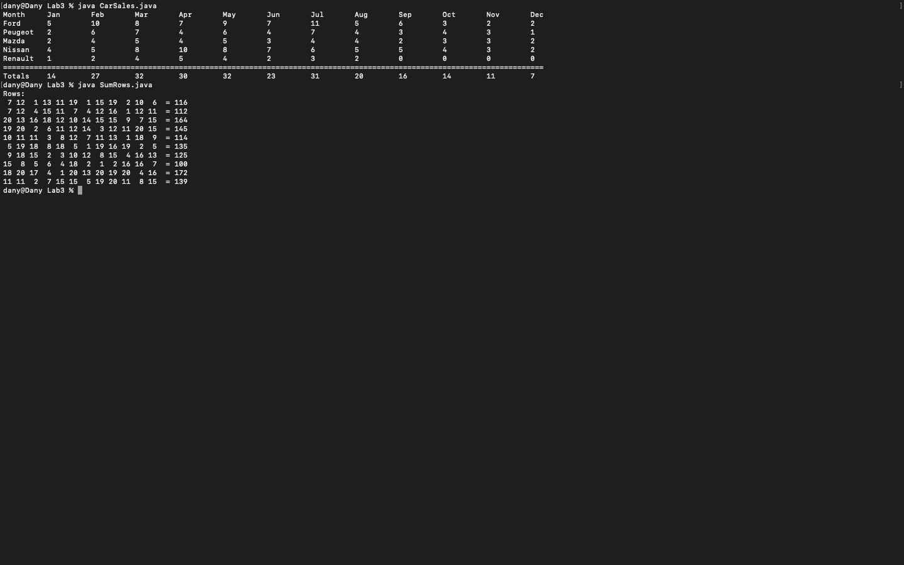
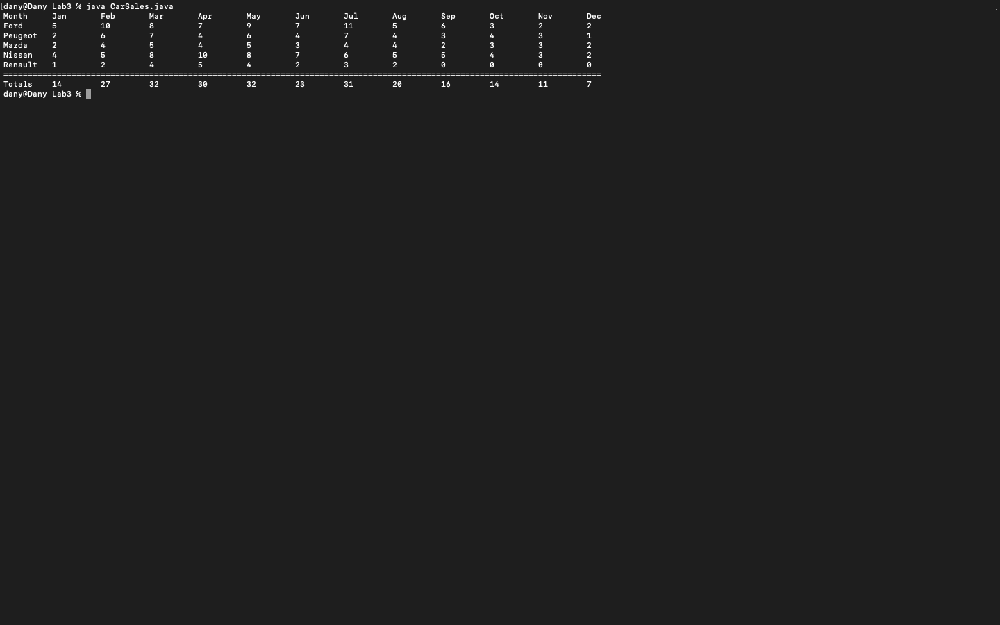
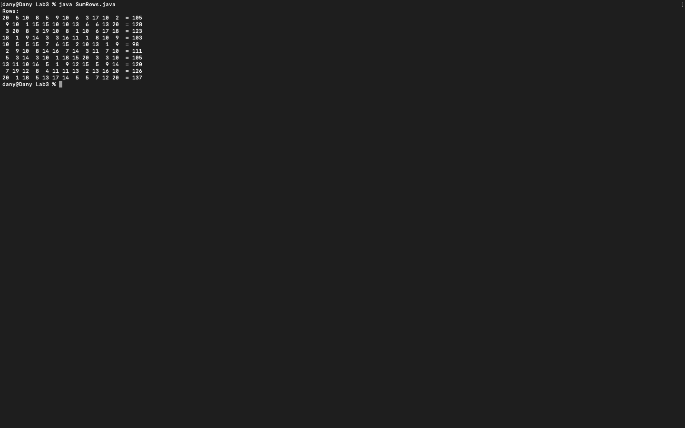

# Week 03 — Exercise sheet 3: 2D arrays

**Module:** Fundamentals of Programming 2 (`COMP H1031`)  
**Semester:** 2 (Year 1), folder `sem02`

[Module README](../README.md)

## What this week is for

Exercise sheet 3: two programs. CarSales.java prints a table of car sales by manufacturer and month, with the total for each month. SumRows.java fills a 10 by 12 array with random values from 1 to 20 and prints the total of each row. The sheet asks for parameterised methods, and the solutions use them.

## Screenshots

*CarSales and SumRows output.*

## Files

| File | What it contains | Screenshot |
|---|---|---|
| [`README.md`](README.md) | This README. | — |
| [`lab/fundamentals_of_programming_2_week03_lab.pdf`](lab/fundamentals_of_programming_2_week03_lab.pdf) | The exercise sheet (2 pages): the car sales table and the 2D row totals. | — |
| [`lab/solution/CarSales.java`](lab/solution/CarSales.java) | Solution: prints the manufacturer-by-month sales table with the column totals (sample data in main). |  *CarSales output: the sales table with column totals.* |
| [`lab/solution/SumRows.java`](lab/solution/SumRows.java) | Solution: fills a 10 by 12 array with random values from 1 to 20 and prints each row with its total. |  *SumRows output: ten rows with their totals.* |
