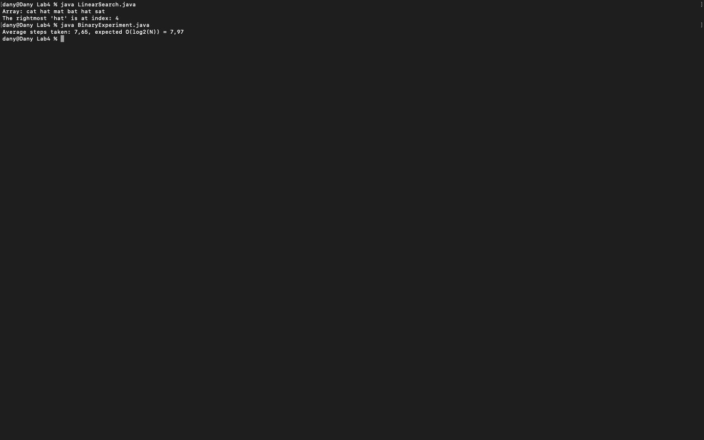
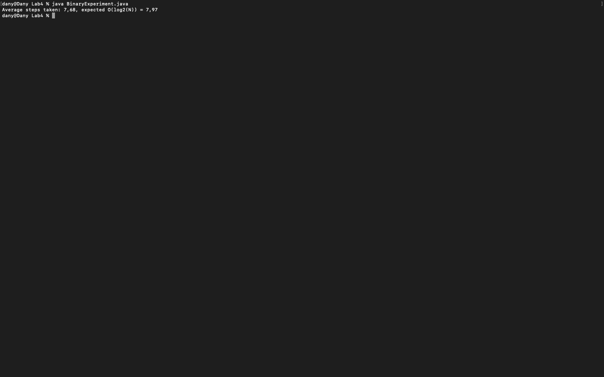

# Week 04 — Exercise sheet 4: searching

**Module:** Fundamentals of Programming 2 (`COMP H1031`)  
**Semester:** 2 (Year 1), folder `sem02`

[Module README](../README.md)

## What this week is for

Exercise sheet 4: two parts. LinearSearch.java finds the rightmost "hat" in a String array and returns its index, or -1 if it is not there. The second part is a binary search experiment that averages the number of steps over random searches.

> [!WARNING]
> [`lab/solution/BinaryExperiment.java`](lab/solution/BinaryExperiment.java): It has a bug: binarySearch starts at index 1 (low = 1), so it never checks index 0. A search for the value at index 0 returns -1 instead of 0. The average is only slightly affected.

## Screenshots

*LinearSearch and BinaryExperiment output.*

## Files

| File | What it contains | Screenshot |
|---|---|---|
| [`README.md`](README.md) | This README. | — |
| [`lab/fundamentals_of_programming_2_week04_lab.pdf`](lab/fundamentals_of_programming_2_week04_lab.pdf) | The exercise sheet (1 page): the rightmost search and the binary-search average. | — |
| [`lab/solution/LinearSearch.java`](lab/solution/LinearSearch.java) | Solution: finds the rightmost "hat" in a String array and prints its index. |  *LinearSearch output: the rightmost 'hat' is at index 4.* |
| [`lab/solution/BinaryExperiment.java`](lab/solution/BinaryExperiment.java) | Binary search experiment over a sorted array of 250 values (0 to 765). It averages the steps over 1000 random searches and compares them with log2(N). |  *BinaryExperiment output: average steps 7.68 against an expected 7.97.* |
