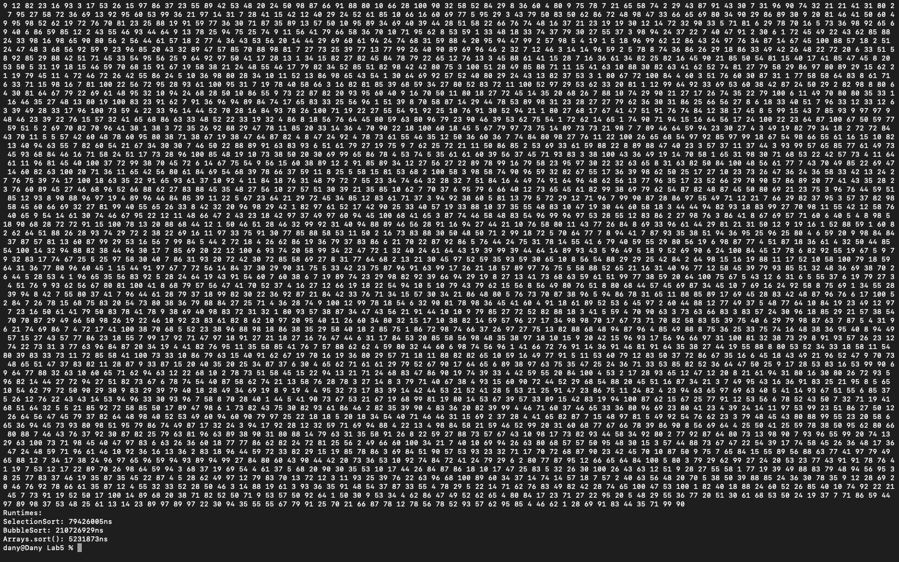

# Week 05 — Exercise sheet 5: sorting and timing

**Module:** Fundamentals of Programming 2 (`COMP H1031`)  
**Semester:** 2 (Year 1), folder `sem02`

[Module README](../README.md)

## What this week is for

Exercise sheet 5: finish the TODO sections of the SortExperiment template, which times selection sort and bubble sort on the same random data, and add a timing experiment for Java's Arrays.sort().

> [!WARNING]
> [`lab/solution/SortingExperiment.java`](lab/solution/SortingExperiment.java): The file is called SortingExperiment.java, but the sheet asks for SortExperiment.java.

## Screenshots

*SortingExperiment output: runtimes for selection sort, bubble sort and Arrays.sort().*

## Files

| File | What it contains |
|---|---|
| [`README.md`](README.md) | This README. |
| [`lab/fundamentals_of_programming_2_week05_lab.pdf`](lab/fundamentals_of_programming_2_week05_lab.pdf) | The exercise sheet (1 page): the sorting experiments. |
| [`lab/solution/SortingExperiment.java`](lab/solution/SortingExperiment.java) | Solution: selection sort, bubble sort and Arrays.sort() on the same seeded random array of 10,000 values, with the runtime of each in nanoseconds. |
