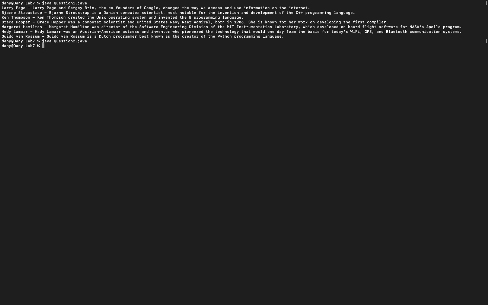
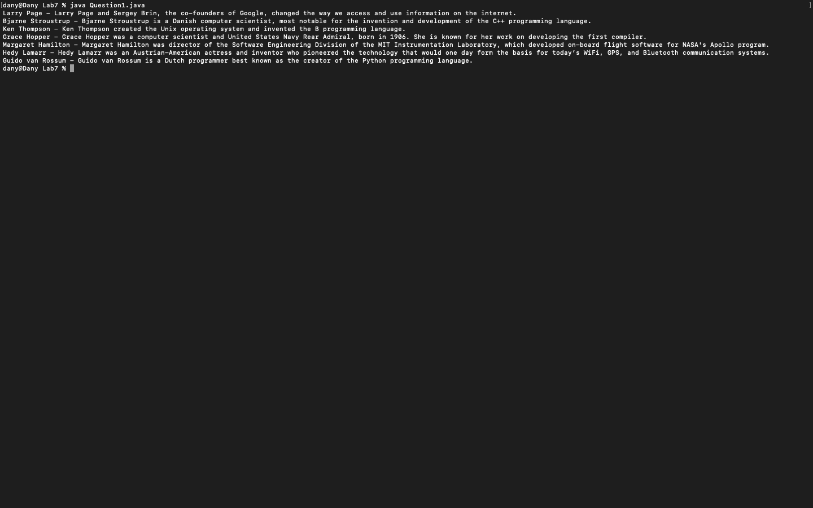
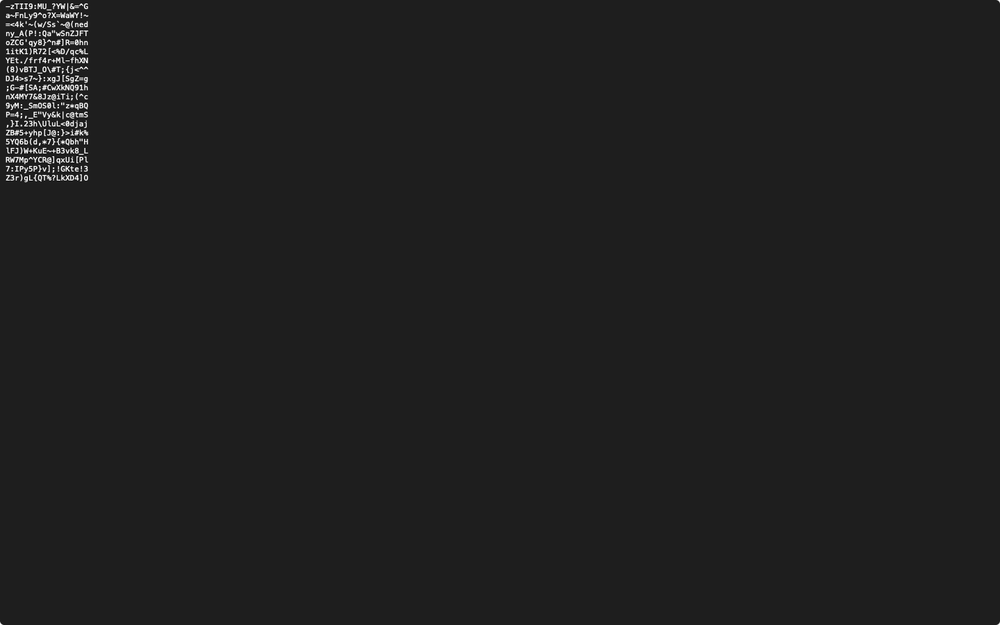

# Week 07 — Exercise sheet 7: file handling

**Module:** Fundamentals of Programming 2 (`COMP H1031`)  
**Semester:** 2 (Year 1), folder `sem02`

[Module README](../README.md)

## What this week is for

Exercise sheet 7: two parts. Reading two text files, names.txt and descriptions.txt (seven entries each), and writing 20 random 18-character passwords to a file. The reading code uses java.nio Files, and the writing code uses BufferedWriter and FileWriter.

## Screenshots

*Question1 and Question2 output*

## Files

| File | What it contains | Screenshot |
|---|---|---|
| [`README.md`](README.md) | This README. | — |
| [`lab/fundamentals_of_programming_2_week07_lab.pdf`](lab/fundamentals_of_programming_2_week07_lab.pdf) | The exercise sheet (2 pages): reading text files and generating passwords. | — |
| [`lab/solution/Question1.java`](lab/solution/Question1.java) | Solution: reads names.txt and descriptions.txt and prints each name with its description (seven entries). |  *Question1 output: the seven names and descriptions.* |
| [`lab/solution/Question2.java`](lab/solution/Question2.java) | Solution: generates 20 random 18-character passwords from printable characters and writes them to files/passwords.txt. |  *Question2 output: twenty random passwords.* |
| [`lab/solution/files/descriptions.txt`](lab/solution/files/descriptions.txt) | The seven one-line descriptions of computer scientists, the input for Question1. | — |
| [`lab/solution/files/names.txt`](lab/solution/files/names.txt) | The seven names of computer scientists, the input for Question1. | — |
| [`lab/solution/files/passwords.txt`](lab/solution/files/passwords.txt) | The 20 generated 18-character passwords, the output of Question2. | — |
