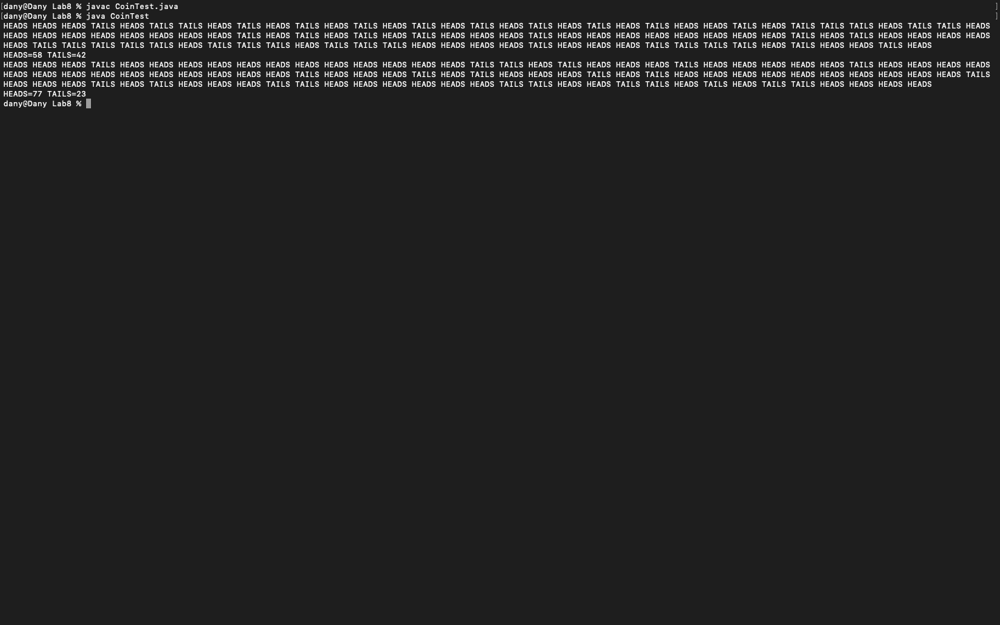

# Week 08 — Formative worksheet: classes and objects (coins)

**Module:** Fundamentals of Programming 2 (`COMP H1031`)  
**Semester:** 2 (Year 1), folder `sem02`

[Module README](../README.md)

## What this week is for

Formative worksheet 8: a Coin class that works with the CoinTest program, which the sheet provides. The class has HEADS and TAILS constants, a fair and a biased flip, and a toString method.

> [!WARNING]
> [`lab/solution/Coin.java`](lab/solution/Coin.java): The field is called state, but the sheet asks for face.

## Screenshots

*CoinTest output: head and tail counts for the fair and biased flips.*

## Files

| File | What it contains |
|---|---|
| [`README.md`](README.md) | This README. |
| [`lab/fundamentals_of_programming_2_week08_lab.pdf`](lab/fundamentals_of_programming_2_week08_lab.pdf) | The formative worksheet (1 page): a Coin class to work with CoinTest.java. |
| [`lab/solution/Coin.java`](lab/solution/Coin.java) | Coin class: HEADS and TAILS constants, a state field, fair and biased flips, and toString(). |
| [`lab/solution/CoinTest.java`](lab/solution/CoinTest.java) | The test program from the sheet: it flips 100 fair coins, then 100 coins with a bias of 0.8, and prints the head and tail counts. |
