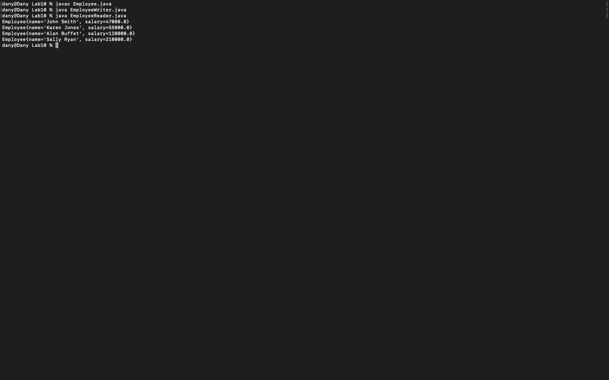

# Week 10 — Formative worksheet: sequential binary files

**Module:** Fundamentals of Programming 2 (`COMP H1031`)  
**Semester:** 2 (Year 1), folder `sem02`

[Module README](../README.md)

## What this week is for

Formative worksheet 10: sequential binary files. An Employee class has put() and get() methods, a writer saves four employees to employees.dat, and a reader reads them back. The data file is 82 bytes.

## Screenshots

*EmployeeReader output: the four employees read back from the binary file.*

## Files

| File | What it contains |
|---|---|
| [`README.md`](README.md) | This README. |
| [`lab/fundamentals_of_programming_2_week10_lab.pdf`](lab/fundamentals_of_programming_2_week10_lab.pdf) | The formative worksheet (1 page): writing and reading binary files with an Employee class. |
| [`lab/solution/Employee.java`](lab/solution/Employee.java) | Employee class with a name and a salary, and put() and get() methods for binary streams. |
| [`lab/solution/EmployeeWriter.java`](lab/solution/EmployeeWriter.java) | Writer: saves four employees (John Smith, Karen Jones, Alan Buffet and Sally Ryan) to employees.dat. |
| [`lab/solution/EmployeeReader.java`](lab/solution/EmployeeReader.java) | Reader: reads employees.dat back into an ArrayList and prints each employee. |
| [`lab/solution/employees.dat`](lab/solution/employees.dat) | The binary file that EmployeeWriter writes: four records, 82 bytes. |
