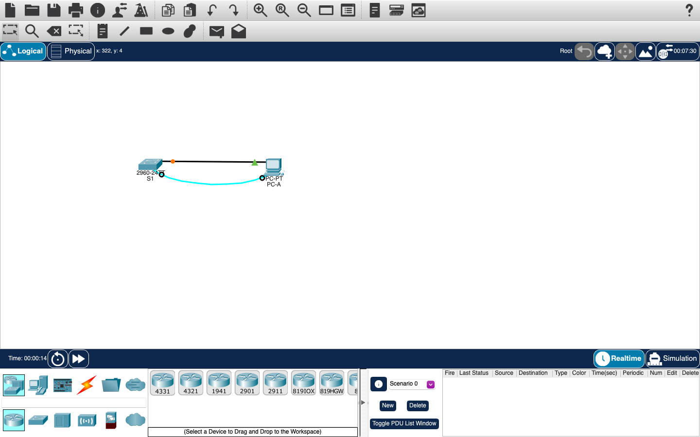
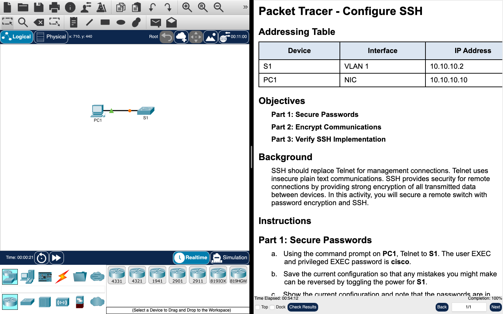
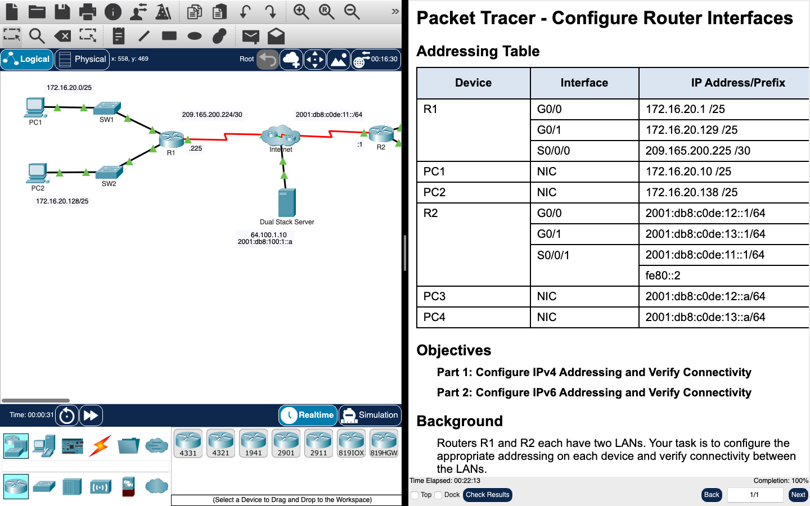
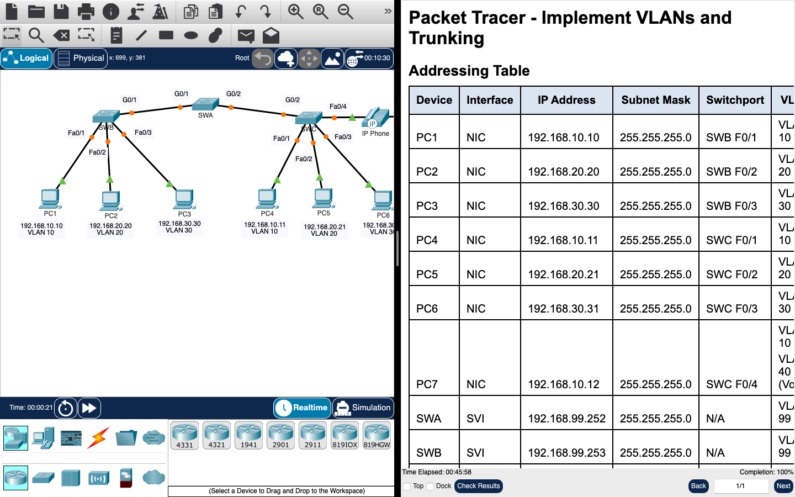
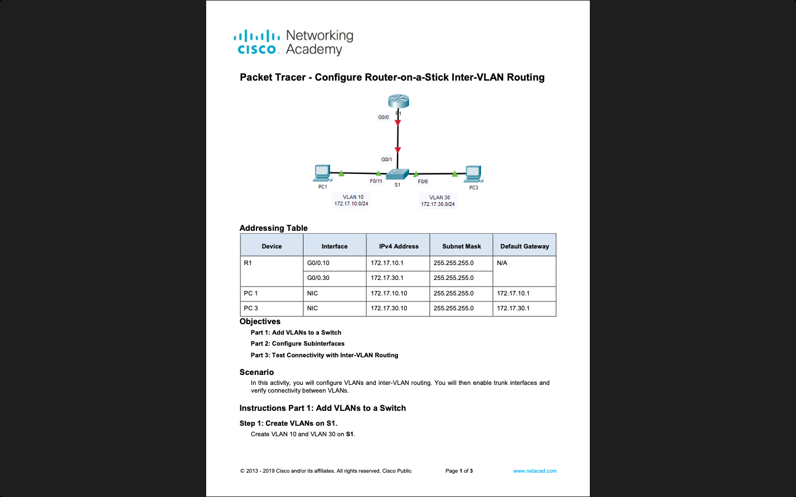
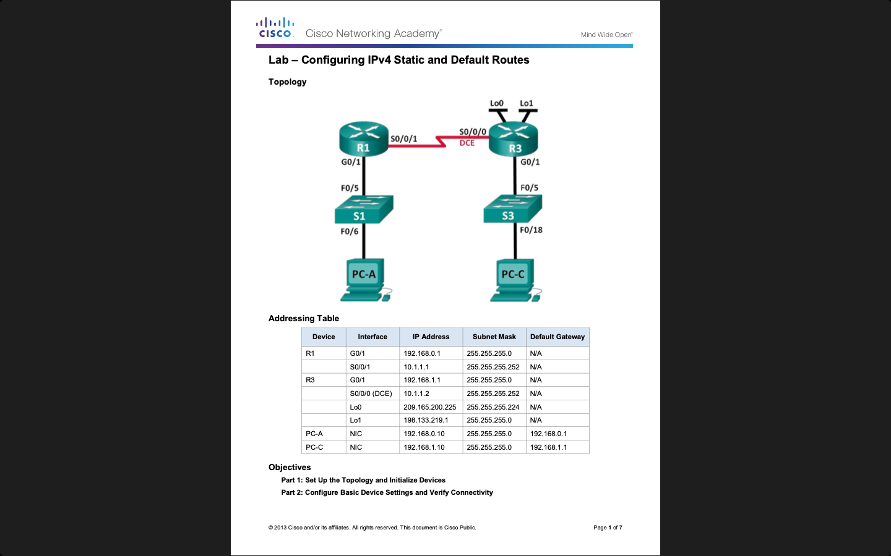

# Routers and Routing Basics

**Module:** Routers and Routing Basics (`COMP H1021`)  
**Semester:** 2 (Year 1), folder `sem02`  
**Lecturer:** Conn Cremin  
**Date:** January - May 2024  
**Credits:** 5 ECTS  
**Matching project branch:** none

## What this module is for

Routers and Routing Basics covers how a small Cisco network is built and configured: switch configuration, SSH, router interfaces, VLANs and trunking, inter-VLAN routing, DHCP, static routes and password recovery. Labs 1 to 4 and 6 are Cisco Packet Tracer activities, and this folder has a Packet Tracer file for each of them. Packet Tracer saves files in an encrypted format, so those files open only in Packet Tracer. Lab 5 (task 2), lab 7 and lab 8 are hands-on labs on real routers and switches, with no solution file. The SSH lab replaces Telnet, which sends passwords in plain text, and the password-recovery lab shows that physical access to a device gives access to its configuration. The module has a practical Packet Tracer exam (CA 1, week 10) and an MCQ test (CA 2, week 12); neither exam is in the repository.

## Grades Breakdown

| Assessment Type | Weighting |
|---|---|
| Weekly labs | idk |
| CA 1 (practical exam) | idk |
| CA 2 (MCQ test) | idk |
| Cisco Academy Exams | idk |

## All weeks

| Week | Title | Files | Screenshot |
|---|---|---|---|
| [Week 1](week01/) | Lab 1: basic switch configuration | [`lab/routers_and_routing_basics_week01_lab_basic_switch_configuration.pdf`](week01/lab/routers_and_routing_basics_week01_lab_basic_switch_configuration.pdf) [`lab/solution/routers_and_routing_basics_week01_lab_basic_switch_configuration.pkt`](week01/lab/solution/routers_and_routing_basics_week01_lab_basic_switch_configuration.pkt) The sheet is labelled 'Instructor Version'. |  |
| [Week 2](week02/) | Lab 2: configure SSH | [`lab/routers_and_routing_basics_week02_lab_configure_ssh.pdf`](week02/lab/routers_and_routing_basics_week02_lab_configure_ssh.pdf) [`lab/solution/routers_and_routing_basics_week02_lab_configure_ssh.pka`](week02/lab/solution/routers_and_routing_basics_week02_lab_configure_ssh.pka) |  |
| [Week 3](week03/) | Lab 3: configure router interfaces | [`lab/routers_and_routing_basics_week03_lab_configure_router_interfaces.pdf`](week03/lab/routers_and_routing_basics_week03_lab_configure_router_interfaces.pdf) [`lab/solution/routers_and_routing_basics_week03_lab_configure_router_interfaces.pka`](week03/lab/solution/routers_and_routing_basics_week03_lab_configure_router_interfaces.pka) |  |
| [Week 4](week04/) | Lab 4: implement VLANs and trunking | [`lab/routers_and_routing_basics_week04_lab_implement_vlans_and_trunking.pdf`](week04/lab/routers_and_routing_basics_week04_lab_implement_vlans_and_trunking.pdf) [`lab/solution/routers_and_routing_basics_week04_lab_implement_vlans_and_trunking.pka`](week04/lab/solution/routers_and_routing_basics_week04_lab_implement_vlans_and_trunking.pka) [`resources/cli_vlan_commands.pdf`](week04/resources/cli_vlan_commands.pdf) |  |
| [Week 5](week05/) | Lab 5: router-on-a-stick and password recovery | [`lab/routers_and_routing_basics_week05_lab_configure_router_on_a_stick_inter_vlan_routing.pdf`](week05/lab/routers_and_routing_basics_week05_lab_configure_router_on_a_stick_inter_vlan_routing.pdf) [`lab/routers_and_routing_basics_week05_lab_password_recovery_on_a_cisco_router_&_switch.pdf`](week05/lab/routers_and_routing_basics_week05_lab_password_recovery_on_a_cisco_router_&_switch.pdf) |  |
| [Week 6](week06/) | Lab 6: configure DHCPv4 | [`lab/routers_and_routing_basics_week06_lab_configure_dhcpv4.pdf`](week06/lab/routers_and_routing_basics_week06_lab_configure_dhcpv4.pdf) [`lab/solution/routers_and_routing_basics_week06_lab_configure_dhcpv4.pka`](week06/lab/solution/routers_and_routing_basics_week06_lab_configure_dhcpv4.pka) [`resources/cli_dhcp_commands.pdf`](week06/resources/cli_dhcp_commands.pdf) |  |
| [Week 7](week07/) | Lab 7: IPv4 static and default routes | [`lab/routers_and_routing_basics_week07_lab_configuring_ipv4_static_and_default_routes.pdf`](week07/lab/routers_and_routing_basics_week07_lab_configuring_ipv4_static_and_default_routes.pdf) |  |
| [Week 8](week08/) | Lab 8: IPv6 static and default routes | [`lab/routers_and_routing_basics_week08_lab_configuring_ipv6_static_and_default_routes.pdf`](week08/lab/routers_and_routing_basics_week08_lab_configuring_ipv6_static_and_default_routes.pdf) |  |
| Week 10 | CA 1: practical Packet Tracer exam | None. | — |
| Week 12 | CA 2: MCQ test | None. | — |

---

## Weeks
- [Weeks](#weeks)
    - [Week 1 (Lab 1)](#week-1-lab-1-basic-switch-configuration): Basic Switch Configuration
    - [Week 2 (Lab 2)](#week-2-lab-2-configure-ssh): Configure SSH
    - [Week 3 (Lab 3)](#week-3-lab-3-configure-router-interfaces): Configure Router Interfaces
    - [Week 4 (Lab 4)](#week-4-lab-4-implement-vlans-and-trunking): Implement VLANs and Trunking
    - [Week 5 (Lab 5)](#week-5-lab-5-configure-router-on-a-stick-inter-vlan-routing): Configure Router on a Stick Inter VLAN Routing
    - [Week 6 (Lab 6)](#week-6-lab-6-configure-dhcpv4): Configure DHCPv4
    - [Week 7 (Lab 7)](#week-7-lab-7-configuring-ipv4-static-and-default-routes): Configuring IPv4 Static and Default Routes
    - [Week 8 (Lab 8)](#week-8-lab-8-configuring-ipv6-static-and-default-routes): Configuring IPv6 Static and Default Routes
    - [Week 10 (CA 1)](#week-10-ca-1-practical-packet-tracer-exam): Practical Packet Tracer exam
    - [Week 12 (CA 2)](#week-12-ca-2-mcq-test): MCQ Test

### [Week 1 (Lab 1)](./week01/lab/): Basic Switch Configuration
[Task](./week01/lab/routers_and_routing_basics_week01_lab_basic_switch_configuration.pdf) | [Packet Tracer Solution (.pkt)](./week01/lab/solution/routers_and_routing_basics_week01_lab_basic_switch_configuration.pkt)

This laboratory exercise introduces students to the basic switch configuration.

#### Objectives
1. Cable the Network and Verify the Default Switch Configuration
2. Configure Basic Network Device Settings
    - Configure basic switch settings.
    - Configure the PC IP address.
3. Verify and Test Network Connectivity
    - Display device configuration.
    - Test end-to-end connectivity with ping.
    - Test remote management capabilities with Telnet.
4. Manage the MAC Address Table
    - Record the MAC address of the host.
    - Determine the MAC addresses that the switch has learned.
    - List the show mac address-table command options.
    - Set up a static MAC address

### [Week 2 (Lab 2)](./week02/lab/): Configure SSH
[Task](./week02/lab/routers_and_routing_basics_week02_lab_configure_ssh.pdf) | [Packet Tracer Solution (.pka)](./week02/lab/solution/routers_and_routing_basics_week02_lab_configure_ssh.pka)

This laboratory exercise introduces students to the Secure Shell (SSH) protocol.

#### Objectives
1. Secure Passwords
2. Encrypt Communications
3. Verify SSH Implementation

### [Week 3 (Lab 3)](./week03/lab/): Configure Router Interfaces
[Task](./week03/lab/routers_and_routing_basics_week03_lab_configure_router_interfaces.pdf) | [Packet Tracer Solution (.pka)](./week03/lab/solution/routers_and_routing_basics_week03_lab_configure_router_interfaces.pka)

This laboratory exercise introduces students to the configuration of router interfaces.

#### Objectives
1. Configure IPv4 Addressing and Verify Connectivity
2. Configure IPv6 Addressing and Verify Connectivity

### [Week 4 (Lab 4)](./week04/lab/): Implement VLANs and Trunking
[Task](./week04/lab/routers_and_routing_basics_week04_lab_implement_vlans_and_trunking.pdf) | [Packet Tracer Solution (.pka)](./week04/lab/solution/routers_and_routing_basics_week04_lab_implement_vlans_and_trunking.pka) | [cli_vlan_commands.pdf (resources)](./week04/resources/cli_vlan_commands.pdf)

This laboratory exercise introduces students to the configuration of VLANs and trunking.

#### Objectives
1. Configure VLANs
2. Assign Ports to VLANs
3. Configure Static Trunking
4. Configure Dynamic Trunking

### [Week 5 (Lab 5)](./week05/lab/): Configure Router on a Stick Inter VLAN Routing
[Task 1 (configure_router_on_a_stick_inter_vlan_routing.pdf)](./week05/lab/routers_and_routing_basics_week05_lab_configure_router_on_a_stick_inter_vlan_routing.pdf) | [Task 2 (password_recovery_on_a_cisco_router_&_switch.pdf)](./week05/lab/routers_and_routing_basics_week05_lab_password_recovery_on_a_cisco_router_&_switch.pdf)

This laboratory exercise introduces students to the configuration of router-on-a-stick inter-VLAN routing & password recovery on a Cisco router & switch.

#### Objectives
1. Configure Console Passwords on Router & Switch
2. Perform Password Recovery on Router
3. Perform Password Recovery on Switch
4. Add VLANs to a Switch
5. Configure Subinterfaces
5. Test Connectivity with Inter-VLAN Routing

### [Week 6 (Lab 6)](./week06/lab/): Configure DHCPv4
[Task](./week06/lab/routers_and_routing_basics_week06_lab_configure_dhcpv4.pdf) | [Packet Tracer Solution (.pka)](./week06/lab/solution/routers_and_routing_basics_week06_lab_configure_dhcpv4.pka) | [cli_dhcp_commands.pdf (resources)](./week06/resources/cli_dhcp_commands.pdf)

This laboratory exercise introduces students to the configuration of DHCPv4.

#### Objectives
1. Configure a Router as a DHCP Server
2. Configure DHCP Relay
3. Configure a Router as a DHCP Client
4. Verify DHCP and Connectivity

### [Week 7 (Lab 7)](./week07/lab/): Configuring IPv4 Static and Default Routes
[Task](./week07/lab/routers_and_routing_basics_week07_lab_configuring_ipv4_static_and_default_routes.pdf)

This laboratory exercise introduces students to the configuration of IPv4 static and default routes.

#### Objectives
1. Set Up the Topology and Initialize Devices
2. Configure Basic Device Settings and Verify Connectivity
3. Configure Static Routes
    - Configure a recursive static route.
    - Configure a directly connected static route.
    - Configure and remove static routes.
4. Configure and Verify a Default Route

### [Week 8 (Lab 8)](./week08/lab/): Configuring IPv6 Static and Default Routes
[Task](./week08/lab/routers_and_routing_basics_week08_lab_configuring_ipv6_static_and_default_routes.pdf)

This laboratory exercise introduces students to the configuration of IPv6 static and default routes.

#### Objectives
1. Build the Network and Configure Basic Device Settings
    - Enable IPv6 unicast routing and configure IPv6 addressing on the Routers and PCs.
    - Use show commands to verify IPv6 settings.
2. Configure IPv6 Static and Default Routes
    - Configure a directly attached IPv6 static route.
    - Configure a recursive IPv6 static route.
    - Configure a default IPv6 static route

### Week 10 (CA 1): Practical Packet Tracer exam
> Practical Packet Tracer exam covering all topics from this module.

### Week 12 (CA 2): MCQ Test
> This exam covers the content of all lectures to date.  
> It is an MCQ with 50 questions.
