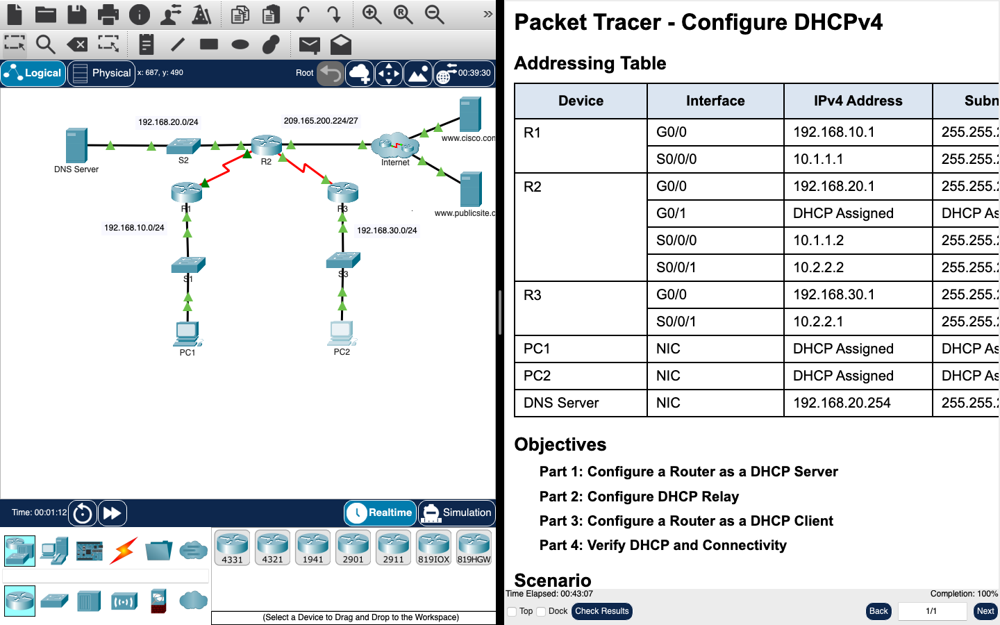

# Week 06 — Lab 6: configure DHCPv4

**Module:** Routers and Routing Basics (`COMP H1021`)  
**Semester:** 2 (Year 1), folder `sem02`

[Module README](../README.md)

## What this week is for

Lab 6 is a Packet Tracer activity on DHCPv4. R2 becomes a DHCP server with two pools (R1-LAN and R3-LAN), each with its default gateway and the DNS server. The first ten addresses of each LAN are excluded, so the server never hands out an address that a router or server already uses. R1 and R3 relay DHCP requests to R2 with ip helper-address, and R2's G0/1 port becomes a DHCP client of the ISP side. The last steps are to check the bindings with show ip dhcp binding and to check that PC1 and PC2 can ping each other. The Packet Tracer file is listed below.

## Screenshots

*Packet Tracer DHCPv4 topology (routers, switches, DNS server and PCs) beside the lab sheet.*

## Files

| File | What it contains |
|---|---|
| [`README.md`](README.md) | This README. |
| [`lab/routers_and_routing_basics_week06_lab_configure_dhcpv4.pdf`](lab/routers_and_routing_basics_week06_lab_configure_dhcpv4.pdf) | The Packet Tracer lab sheet (2 pages): DHCPv4 server, relay and client configuration. |
| [`lab/solution/routers_and_routing_basics_week06_lab_configure_dhcpv4.pka`](lab/solution/routers_and_routing_basics_week06_lab_configure_dhcpv4.pka) | Packet Tracer file for this lab. Packet Tracer saves files in an encrypted format, so this file opens only in Cisco Packet Tracer and its contents are not shown in the repository. The task it solves is the PDF listed above. |
| [`resources/cli_dhcp_commands.pdf`](resources/cli_dhcp_commands.pdf) | A two-page command reference for DHCP: excluded addresses, address pools and the server commands. |
