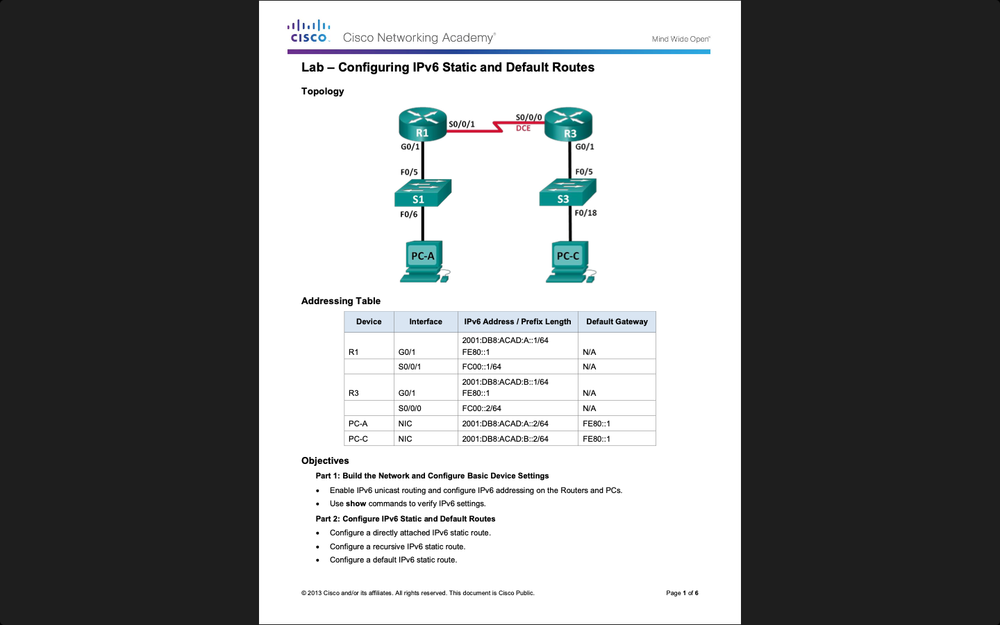

# Week 08 — Lab 8: IPv6 static and default routes

**Module:** Routers and Routing Basics (`COMP H1021`)  
**Semester:** 2 (Year 1), folder `sem02`

[Module README](../README.md)

## What this week is for

Lab 8 is a hands-on lab on real equipment, not Packet Tracer: two routers, two switches and two PCs. The sheet enables IPv6 routing and addresses on both routers and both PCs, and then adds three kinds of IPv6 static route: a directly attached route, a recursive route through a next-hop address, and a default route (::/0). There is no solution file for this lab in the repository.

## Screenshots

*Page 1 of the IPv6 static and default routes lab sheet.*

## Files

| File | What it contains |
|---|---|
| [`README.md`](README.md) | This README. |
| [`lab/routers_and_routing_basics_week08_lab_configuring_ipv6_static_and_default_routes.pdf`](lab/routers_and_routing_basics_week08_lab_configuring_ipv6_static_and_default_routes.pdf) | The lab sheet (6 pages): IPv6 static, recursive and default routes. It is a hands-on lab, not Packet Tracer, and there is no solution file for it. |
