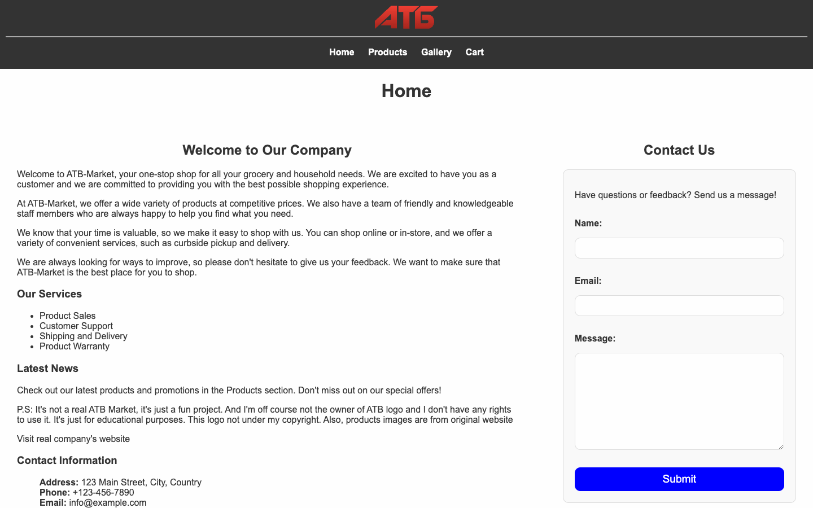

# Assessment 1: ATB Market

**Module:** Web Development Client-Side (`COMP H1035`)  
**Semester:** 2 (Year 1), folder `sem02`  
**Type:** project (Assignment 2, mini-project), team of 2  
**Weight:** 50%  
**Deadline:** Tuesday 16 April 2024, with a demonstration in a lab session  
**Result:** —  
**On main:** [`sem02/web_development_client_side/assessment/01/`](https://github.com/DanyilT/projects-in-university/tree/main/sem02/web_development_client_side/assessment/01) (the brief, the link to the project, the screenshot and this README)  
**Branch:** [`project/year01/module-web_development_client_side/atb-market`](https://github.com/DanyilT/projects-in-university/tree/project/year01/module-web_development_client_side/atb-market) (the website with its README and licence)  
**Repository:** [WebDev](https://github.com/DanyilT/WebDev) (the folder ATB-Market had the same files until 11 November 2025; it has only a README that points to the branch now)

[Module README](../../README.md)

## What this assessment is for

Assignment 2 is the mini-project of the module (50%), done in a team of two: a website that gives a products company an online presence, in one of seven areas (books, music, computer games, computer equipment, beauty products, clothes or footwear) or in an area that the team chooses and tells the lecturer about. The screen design of three pages (home, products and user details) is made in a mock-up tool and exported to a Word document. The home page uses a grid layout with a responsive menu, details about the company, an image and a footer with contact details. The products page offers five products, each with an image, a short description, a price and a quantity, using JSON data. A checkout page validates the name, address and email with jQuery, and a gallery page completes the site, which has at least three pages. All text has to be written by the team. The project is uploaded to Moodle as a zip, with the CSS, JavaScript and images in separate folders, by Tuesday 16 April 2024 (10% off for each day late) and demonstrated in a lab session; without a demonstration the mark is zero.

The submitted project is ATB Market, a parody of the website of the ATB Market grocery chain, not a copy of it. It has three pages: the home page with a contact form, the products page with product cards that are loaded from a JSON file and added to a cart that is kept in the browser, and a gallery page with a slider. The cart opens as a pop-up with a checkout form, and a hamburger menu serves narrow screens. The screen design is a Figma image.

> [!WARNING]
> The project has two problems:
>
> - [`web_development_client_side_assessment.pdf`](web_development_client_side_assessment.pdf): The brief asks for a checkout page with jQuery validation of the name, address and email. On the project branch there are three HTML pages (index, products and gallery), a Figma design instead of a Word wireframe, and no checkout page: the checkout is a pop-up form on each page, and jQuery validates its name, email and address.
> - [`scripts/script.js`](https://github.com/DanyilT/projects-in-university/blob/project/year01/module-web_development_client_side/atb-market/scripts/script.js#L16) (on the project branch): The fallback that loads the products when the local `data/products.json` cannot be fetched requests `https://danyilt.github.io/WebDev/ATB-Market/data/products.json` (line 16), which answers 404: the `WebDev` repository is archived and has no GitHub Pages site.

*The home page of the ATB Market website: the navigation bar (Home, Products, Gallery, Cart), the welcome text, the services, the news, the contact details and the contact form.*

## Files

| File | What it contains |
|---|---|
| [`README.md`](README.md) | This README. |
| [`web_development_client_side_assessment.pdf`](web_development_client_side_assessment.pdf) | The ATB Market mini-project brief (5 pages, 50%): a team of two, all text written by the team, a demonstration in a lab session, and a submission on Tuesday 16 April. It asks for a shopping site with a grid-layout home page, a products page that uses JSON data, a checkout page with jQuery validation of the name, address and email, and a gallery page. At least three pages are required. |
| [`submission/project_link.txt`](submission/project_link.txt) | Two lines: the GitHub link to the ATB Market project on its branch, and the branch name. |

## Online versions

- [web-development-client-side--atb-market.pages.dev](https://web-development-client-side--atb-market.pages.dev): the website of the branch on Cloudflare Pages; its home page is the same file as the one on the branch.
