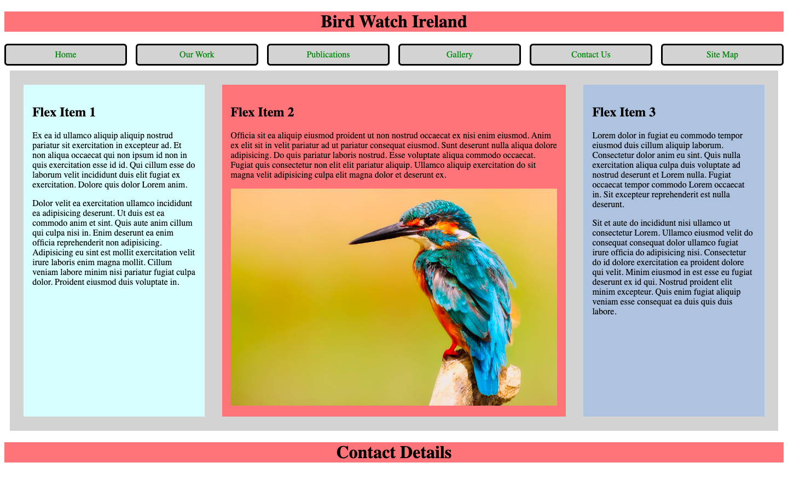

# Week 01 — Lab 1: lab revision

**Module:** Web Development Client-Side (`COMP H1035`)  
**Semester:** 2 (Year 1), folder `sem02`

[Module README](../README.md)

## What this week is for

Lab 1 revises last semester's topics. The solution is a Bird Watch Ireland page with a header, six navigation links, three flex items (one with a linked kingfisher photograph) and a footer, styled with a stylesheet.

## Screenshots

*Bird Watch Ireland page with three flex items and the kingfisher image.*

## Files

| File | What it contains |
|---|---|
| [`README.md`](README.md) | This README. |
| [`lab/web_development_client_side_week01_lab.pdf`](lab/web_development_client_side_week01_lab.pdf) | The lab brief (5 pages): the revision page with flex items, links, images and a navigation bar. |
| [`lab/solution/index.html`](lab/solution/index.html) | Bird Watch Ireland page: a header, six navigation links, a main area with three flex items (one with a linked kingfisher photograph) and a footer. |
| [`lab/solution/css/styles.css`](lab/solution/css/styles.css) | Stylesheet: navigation links, the flex layout (flex 2 for item 2), the item colours and a full-width image. |
| [`lab/solution/images/kingfisher.jpg`](lab/solution/images/kingfisher.jpg) | The kingfisher photograph, used by index.html. |
