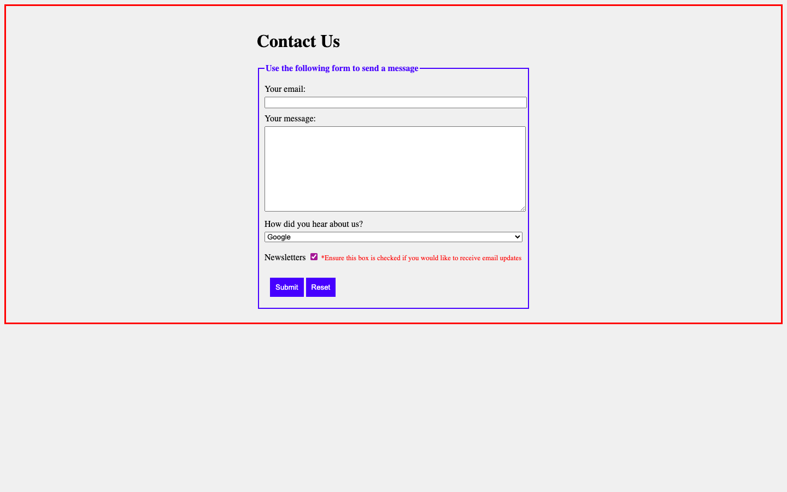

# Week 02 — Lab 2: basic form and styling

**Module:** Web Development Client-Side (`COMP H1035`)  
**Semester:** 2 (Year 1), folder `sem02`

[Module README](../README.md)

## What this week is for

Lab 2 is a Contact Us form with fields, a drop-down, a checkbox and buttons, styled with CSS, and a confirmation page. The form submits to the confirmation page.

> [!WARNING]
> [`lab/solution/css/contactForm.css`](lab/solution/css/contactForm.css): The border, padding and background are set on the body, but the sheet asks for them on the form.

## Screenshots

*Contact Us form with the newsletter checkbox checked.*

## Files

| File | What it contains |
|---|---|
| [`README.md`](README.md) | This README. |
| [`lab/web_development_client_side_week02_lab.pdf`](lab/web_development_client_side_week02_lab.pdf) | The lab brief (4 pages): a contact form and its styling. |
| [`lab/solution/contactForm.html`](lab/solution/contactForm.html) | Contact Us form: an email field, a message text area, a drop-down, a checked newsletter checkbox, and submit and reset buttons. It submits to confirm.html. |
| [`lab/solution/confirm.html`](lab/solution/confirm.html) | The confirmation page: Thank you for contacting us. We will email you shortly. |
| [`lab/solution/css/contactForm.css`](lab/solution/css/contactForm.css) | Form stylesheet (fieldset, legend, buttons and a small red note). |
