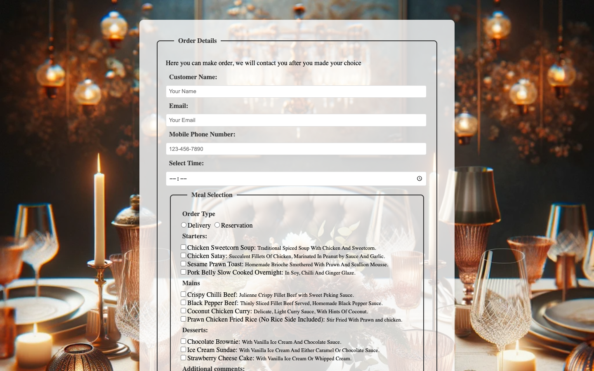

# Week 03 — Lab 3: form and styling

**Module:** Web Development Client-Side (`COMP H1035`)  
**Semester:** 2 (Year 1), folder `sem02`

[Module README](../README.md)

## What this week is for

Lab 3 is a take-away order form for a restaurant: customer details, a time, the order type, starters, mains, desserts and comments, styled with a background image.

*Restaurant order form on its background image.*

## Files

| File | What it contains |
|---|---|
| [`README.md`](README.md) | This README. |
| [`lab/web_development_client_side_week03_lab.pdf`](lab/web_development_client_side_week03_lab.pdf) | The lab brief (5 pages): a take-away order form for a restaurant, and its styling. |
| [`lab/solution/index.html`](lab/solution/index.html) | Restaurant order form: customer details, a time field, a drink field with a list of suggestions, order-type radio buttons, starters, mains, desserts, a children's menu, specials, comments, and a submit button that shows a message. |
| [`lab/solution/css/styles.css`](lab/solution/css/styles.css) | Stylesheet: the background image, fieldsets with a legend in Arial, labels, inputs (the email and text fields are 20em wide), a comments box at least 10em high, focus effects and a large-screen rule. |
| [`lab/solution/images/image.webp`](lab/solution/images/image.webp) | The restaurant table photograph, used as the page background by css/styles.css. |
