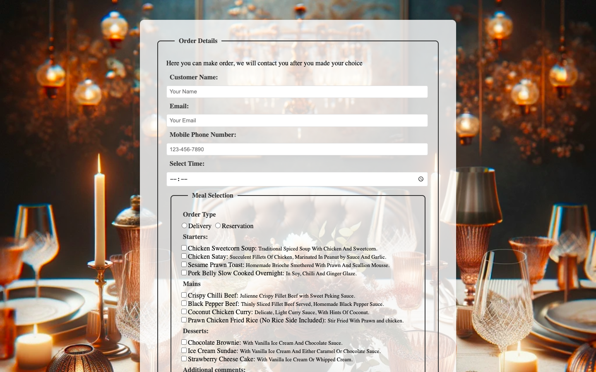

# Week 03 — Lab 3: form and styling

**Module:** Web Development Client-Side (`COMP H1035`)  
**Semester:** 2 (Year 1), folder `sem02`

[Module README](../README.md)

## What this week is for

Lab 3 is a take-away order form for a restaurant: customer details, a time, the order type, starters, mains, desserts and comments, styled with a background image.

> [!WARNING]
> The solution has gaps against the sheet:
>
> - [`lab/solution/index.html`](lab/solution/index.html): There is no data list and no children's menu or specials sections, which the sheet asks for. The phone field's label points at the id mobile, but the field's id is phone, and the name field has autofocus twice.
> - [`lab/solution/css/styles.css`](lab/solution/css/styles.css): The email and text inputs are 97% wide (the sheet asks for 20em), the comments box has no minimum height (the sheet asks for 10em), and the legend uses no different font (the sheet asks for one).

## Screenshots

*Restaurant order form on its background image.*

## Files

| File | What it contains |
|---|---|
| [`README.md`](README.md) | This README. |
| [`lab/web_development_client_side_week03_lab.pdf`](lab/web_development_client_side_week03_lab.pdf) | The lab brief (5 pages): a take-away order form for a restaurant, and its styling. |
| [`lab/solution/index.html`](lab/solution/index.html) | Restaurant order form: customer details, a time field, order-type radio buttons, starters, mains, desserts, comments, and a submit button that shows a message. |
| [`lab/solution/css/styles.css`](lab/solution/css/styles.css) | Stylesheet: the background image, fieldsets, labels, inputs, focus effects and a large-screen rule. |
| [`lab/solution/images/image.webp`](lab/solution/images/image.webp) | The restaurant table photograph, used as the page background by css/styles.css. |
