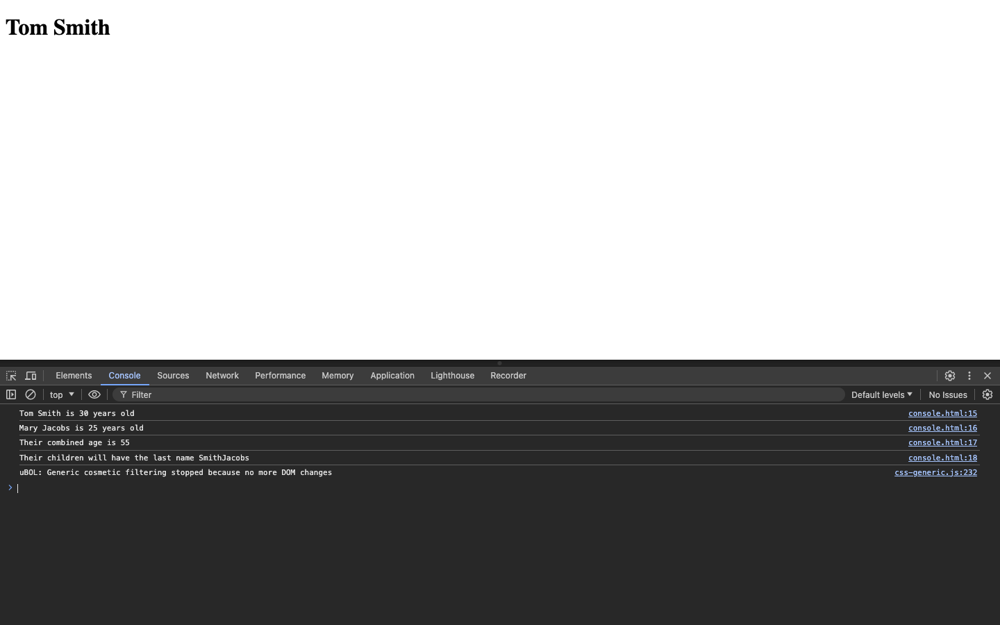
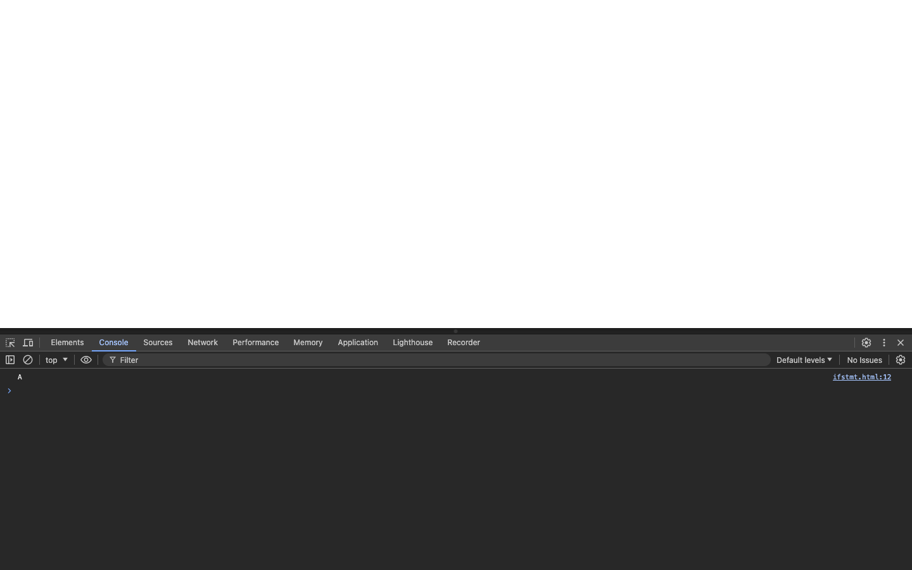
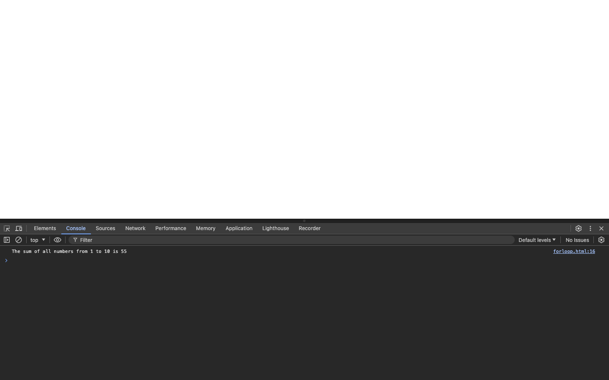

# Week 04 — Lab 4: JavaScript

**Module:** Web Development Client-Side (`COMP H1035`)  
**Semester:** 2 (Year 1), folder `sem02`

[Module README](../README.md)

## What this week is for

Lab 4 uses JavaScript on three pages: console output (console.html), a grade check with if statements (ifstmt.html), and the sum of a range with a for loop (forloop.html).

> [!WARNING]
> [`lab/solution/console.html`](lab/solution/console.html): The title is "Console Example" and the heading is "Tom Smith", but the sheet asks for "Arithmetic and Concatenation" and "Tom and Mary".

## Files

| File | What it contains | Screenshot |
|---|---|---|
| [`README.md`](README.md) | This README. | — |
| [`lab/web_development_client_side_week04_lab.pdf`](lab/web_development_client_side_week04_lab.pdf) | The lab brief (4 pages): JavaScript exercises. | — |
| [`lab/solution/console.html`](lab/solution/console.html) | Console page: it logs four statements about Tom and Mary to the console. Its title is "Console Example" and its heading is "Tom Smith". |  *console.html output in the browser console.* |
| [`lab/solution/ifstmt.html`](lab/solution/ifstmt.html) | Prompts for a score and logs the grade (A to F) to the console. |  *Output of ifstmt.html: grade A.* |
| [`lab/solution/forloop.html`](lab/solution/forloop.html) | Prompts for a start and end number and logs their inclusive sum to the console. |  *Output of forloop.html: the sum from 1 to 10 is 55.* |
