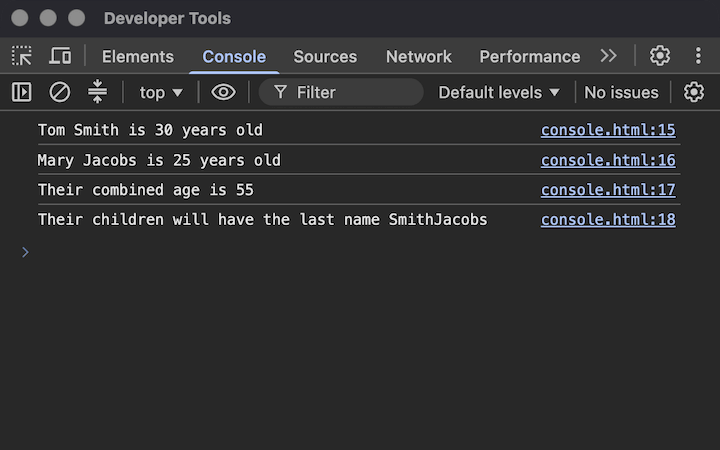
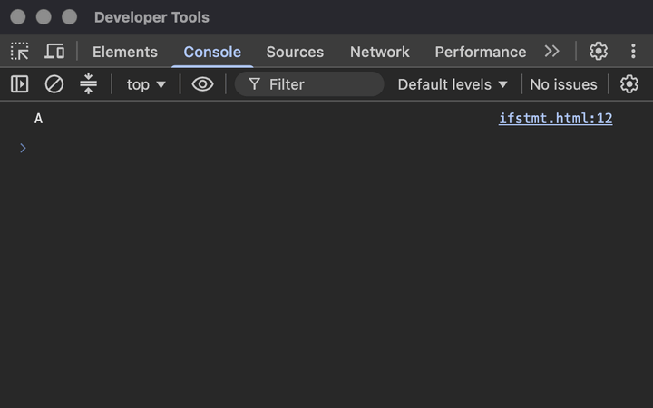
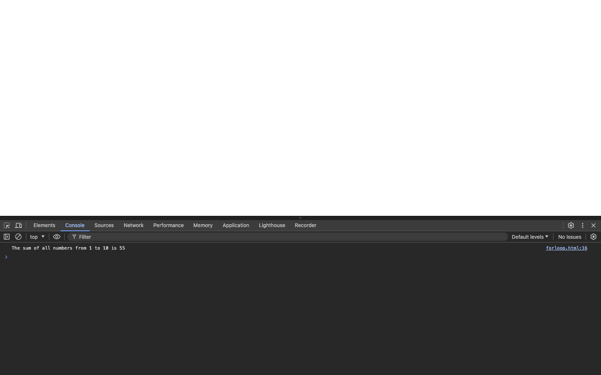

# Week 04 — Lab 4: JavaScript

**Module:** Web Development Client-Side (`COMP H1035`)  
**Semester:** 2 (Year 1), folder `sem02`

[Module README](../README.md)

## What this week is for

Lab 4 uses JavaScript on three pages: console output (console.html), a grade check with if statements (ifstmt.html), and the sum of a range with a for loop (forloop.html).

<table>
  <tr valign="top">
    <td width="33%"> <i>console.html output in the browser console.</i></td>
    <td width="33%"> <i>Output of ifstmt.html: grade A.</i></td>
    <td width="33%"> <i>Output of forloop.html: the sum from 1 to 10 is 55.</i></td>
  </tr>
</table>

## Files

| File | What it contains |
|---|---|
| [`README.md`](README.md) | This README. |
| [`lab/web_development_client_side_week04_lab.pdf`](lab/web_development_client_side_week04_lab.pdf) | The lab brief (4 pages): JavaScript exercises. |
| [`lab/solution/console.html`](lab/solution/console.html) | Console page: it logs four statements about Tom and Mary to the console. Its title is "Arithmetic and Concatenation" and its heading is "Tom and Mary". |
| [`lab/solution/ifstmt.html`](lab/solution/ifstmt.html) | Prompts for a score and logs the grade (A to F) to the console. |
| [`lab/solution/forloop.html`](lab/solution/forloop.html) | Prompts for a start and end number and logs their inclusive sum to the console. |
