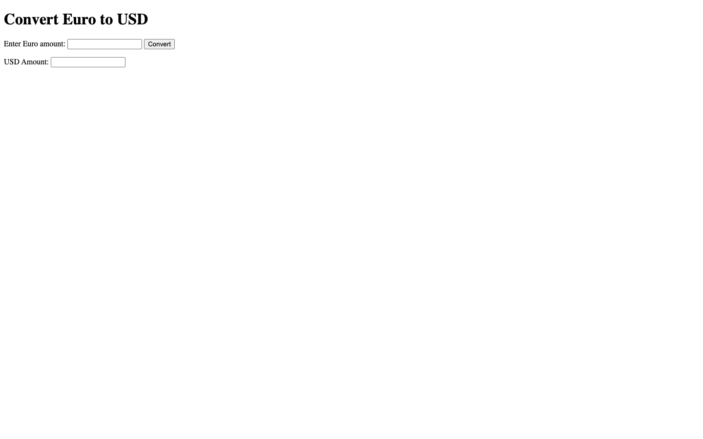
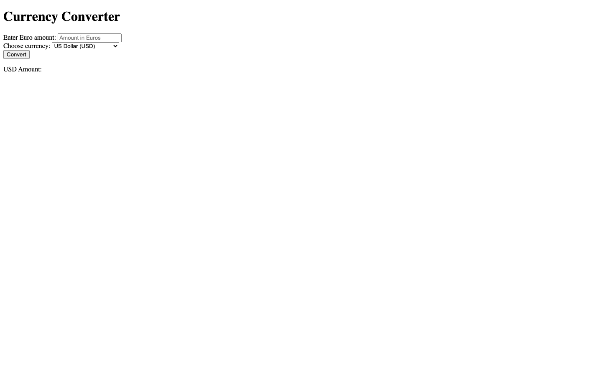
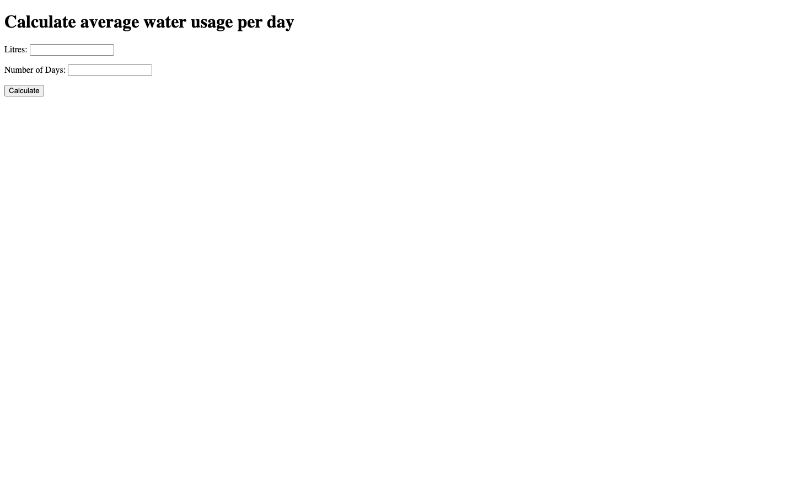

# Week 05 — Lab 5: JavaScript

**Module:** Web Development Client-Side (`COMP H1035`)  
**Semester:** 2 (Year 1), folder `sem02`

[Module README](../README.md)

## What this week is for

Lab 5 uses JavaScript in external files: a Euro-to-USD form, a currency converter and an average water-usage form.

> [!WARNING]
> [`lab/solution/js/euroConverter.js`](lab/solution/js/euroConverter.js): The rates are fixed in the file, but the sheet asks for current exchange rates from Google.

## Files

| File | What it contains | Screenshot |
|---|---|---|
| [`README.md`](README.md) | This README. | — |
| [`lab/web_development_client_side_week05_lab.pdf`](lab/web_development_client_side_week05_lab.pdf) | The lab brief (4 pages): forms with JavaScript in external files. | — |
| [`lab/solution/euroToUSD.html`](lab/solution/euroToUSD.html) | Euro-to-USD form: a Convert button and a read-only result. |  *Euro to USD converter page.* |
| [`lab/solution/js/euroToUSD.js`](lab/solution/js/euroToUSD.js) | Converts the Euro amount at 1.09 and shows two decimals. | — |
| [`lab/solution/euroConverter.html`](lab/solution/euroConverter.html) | Currency converter: a Euro amount and a choice of USD, GBP, AUD or JPY. |  *Currency converter page with the four currencies.* |
| [`lab/solution/js/euroConverter.js`](lab/solution/js/euroConverter.js) | Holds fixed rates for the four currencies and converts the amount. | — |
| [`lab/solution/waterUsage.html`](lab/solution/waterUsage.html) | Average water-usage form: litres and number of days, with a Calculate button. |  *Average water usage calculator page.* |
| [`lab/solution/js/waterUsage.js`](lab/solution/js/waterUsage.js) | Divides litres by days and writes the average into the heading. | — |
