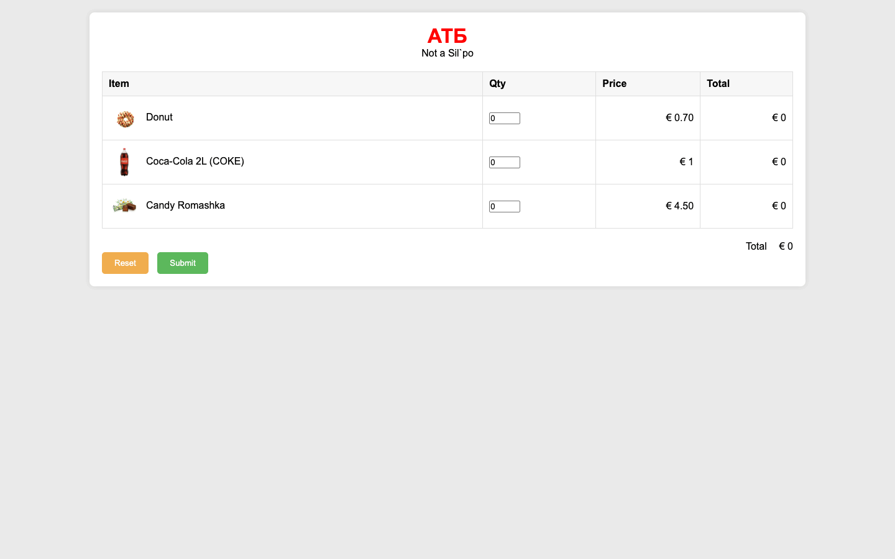
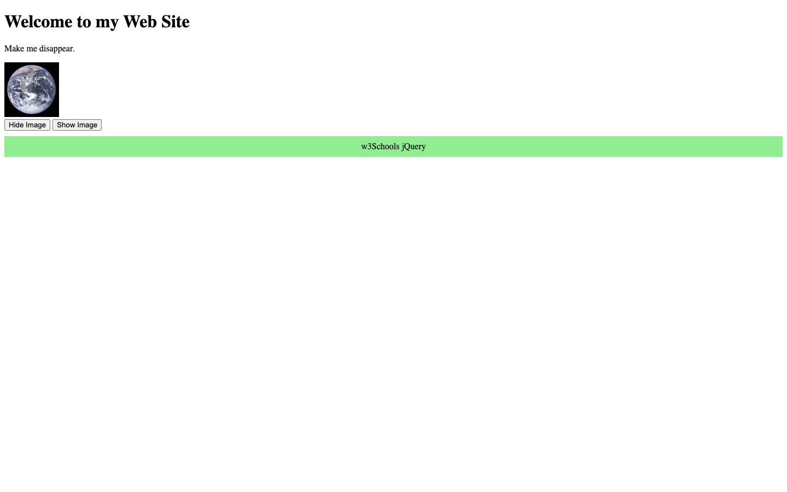

# Week 06 — Lab 6: JavaScript and jQuery

**Module:** Web Development Client-Side (`COMP H1035`)  
**Semester:** 2 (Year 1), folder `sem02`

[Module README](../README.md)

## What this week is for

Lab 6 uses JavaScript and jQuery: a shopping cart whose item totals and grand total update as the quantities change (ex1), and jQuery effects (ex2).

<table>
  <tr valign="top">
    <td width="50%"> <i>Shopping cart page with three items.</i></td>
    <td width="50%"> <i>jQuery examples page: the image with its buttons, and the green panel.</i></td>
  </tr>
</table>

## Files

| File | What it contains |
|---|---|
| [`README.md`](README.md) | This README. |
| [`lab/web_development_client_side_week06_lab.pdf`](lab/web_development_client_side_week06_lab.pdf) | The lab brief (4 pages): a shopping cart and jQuery examples. |
| [`lab/solution/ex1/shopCart.html`](lab/solution/ex1/shopCart.html) | Shopping cart: three items (Donut, Coca-Cola, Candy Romashka) with quantity fields (0 to 100), totals, and Reset and Submit buttons. The subtotals are table cells, not input boxes. |
| [`lab/solution/ex1/js/shopCart.js`](lab/solution/ex1/js/shopCart.js) | Updates each item's total and the grand total when a quantity changes (a quantity above 100 becomes 100), clears them on reset, and shows an alert with the amount due on submit. |
| [`lab/solution/ex1/css/shopCart.css`](lab/solution/ex1/css/shopCart.css) | The stylesheet for the cart table, the totals and the buttons. |
| [`lab/solution/ex1/images/Donut.webp`](lab/solution/ex1/images/Donut.webp) | Product photo: Donut, shown in the cart. |
| [`lab/solution/ex1/images/Coca-Cola.webp`](lab/solution/ex1/images/Coca-Cola.webp) | Product photo: Coca-Cola, shown in the cart. |
| [`lab/solution/ex1/images/Romashka.webp`](lab/solution/ex1/images/Romashka.webp) | Product photo: Candy Romashka, shown in the cart. |
| [`lab/solution/ex2/jQueryexamples.html`](lab/solution/ex2/jQueryexamples.html) | JQuery examples: the paragraph hides on click, Hide and Show Image buttons, and a green panel that slides open. The image is a picture of the Earth from Apollo 17 (NASA, public domain) that is loaded from Wikimedia Commons. jQuery is loaded from a CDN. |
