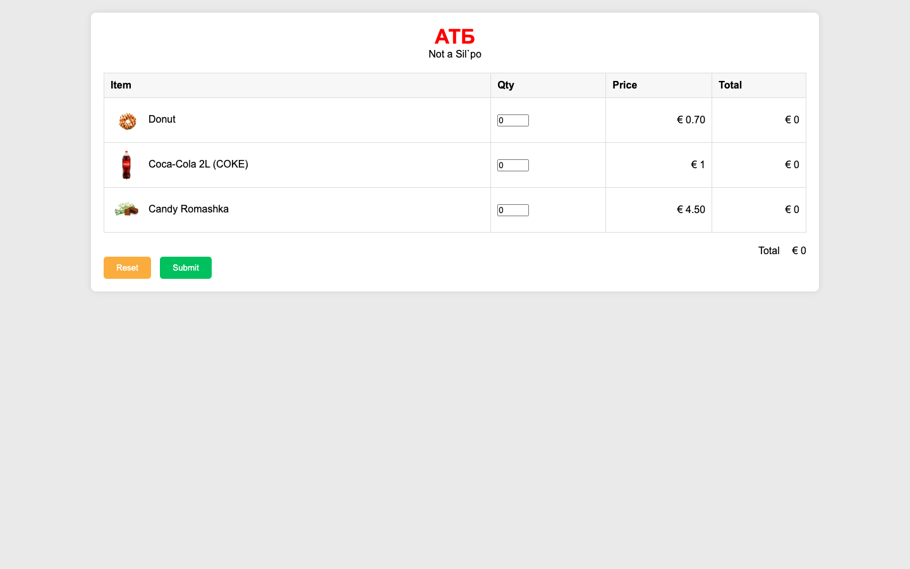
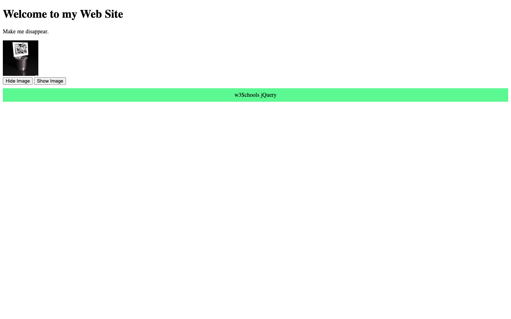

# Week 06 — Lab 6: JavaScript and jQuery

**Module:** Web Development Client-Side (`COMP H1035`)  
**Semester:** 2 (Year 1), folder `sem02`

[Module README](../README.md)

## What this week is for

Lab 6 uses JavaScript and jQuery: a shopping cart whose item totals and grand total update as the quantities change (ex1), and jQuery effects (ex2).

> [!WARNING]
> - [`lab/solution/ex1/shopCart.html`](lab/solution/ex1/shopCart.html): There is no alert with the total on submit and no maximum quantity of 100, both of which the sheet asks for.
> - [`lab/solution/ex2/jQueryexamples.html`](lab/solution/ex2/jQueryexamples.html): The image is a local file, but the sheet asks for an image from the web.

## Files

| File | What it contains | Screenshot |
|---|---|---|
| [`README.md`](README.md) | This README. | — |
| [`lab/web_development_client_side_week06_lab.pdf`](lab/web_development_client_side_week06_lab.pdf) | The lab brief (4 pages): a shopping cart and jQuery examples. | — |
| [`lab/solution/ex1/shopCart.html`](lab/solution/ex1/shopCart.html) | Shopping cart: three items (Donut, Coca-Cola, Candy Romashka) with quantity fields, totals, and Reset and Submit buttons. The subtotals are table cells, not input boxes. |  *Shopping cart page with three items.* |
| [`lab/solution/ex1/js/shopCart.js`](lab/solution/ex1/js/shopCart.js) | Updates each item's total and the grand total when a quantity changes, and clears them on reset. | — |
| [`lab/solution/ex1/css/shopCart.css`](lab/solution/ex1/css/shopCart.css) | The stylesheet for the cart table, the totals and the buttons. | — |
| [`lab/solution/ex1/images/Donut.webp`](lab/solution/ex1/images/Donut.webp) | Product photo: Donut, shown in the cart. | — |
| [`lab/solution/ex1/images/Coca-Cola.webp`](lab/solution/ex1/images/Coca-Cola.webp) | Product photo: Coca-Cola, shown in the cart. | — |
| [`lab/solution/ex1/images/Romashka.webp`](lab/solution/ex1/images/Romashka.webp) | Product photo: Candy Romashka, shown in the cart. | — |
| [`lab/solution/ex2/jQueryexamples.html`](lab/solution/ex2/jQueryexamples.html) | JQuery examples: the paragraph hides on click, Hide and Show Image buttons, and a green panel that slides open. The image is a local file. jQuery is loaded from a CDN. |  *jQuery examples page: the image with its buttons, and the green panel.* |
| [`lab/solution/ex2/images/Trash.png`](lab/solution/ex2/images/Trash.png) | A black-and-white image (1.35 MB), used by jQueryexamples.html. | — |
