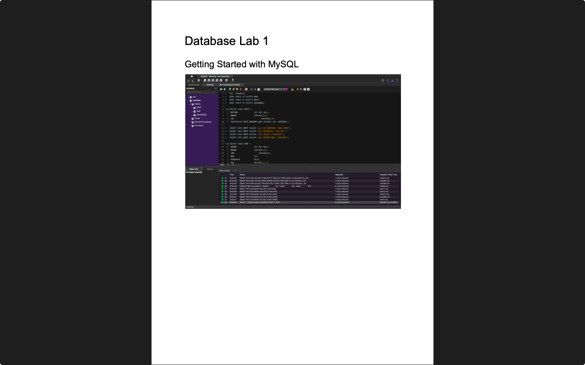
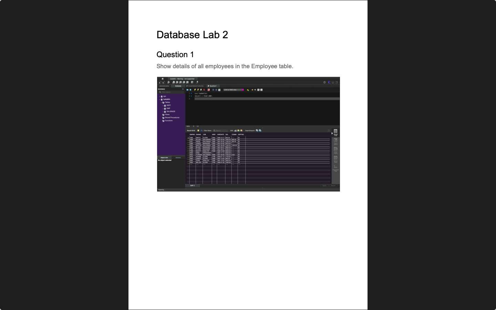
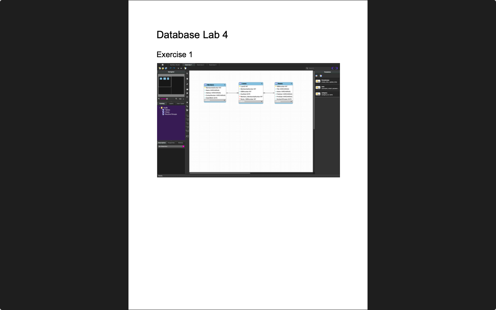
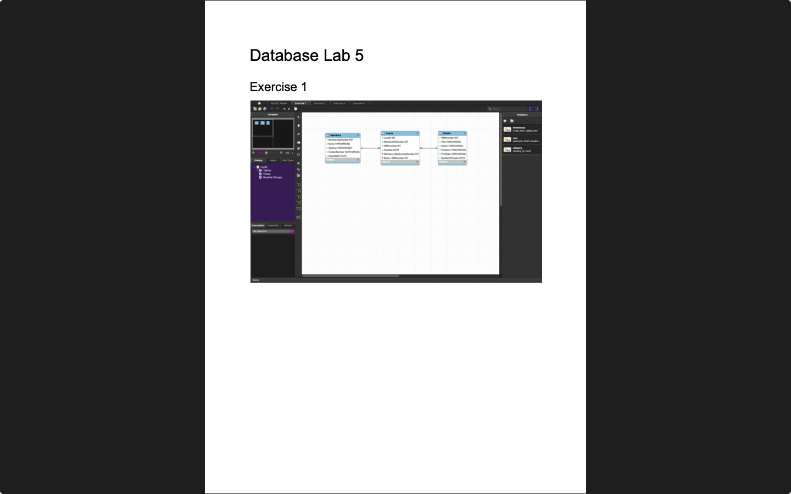
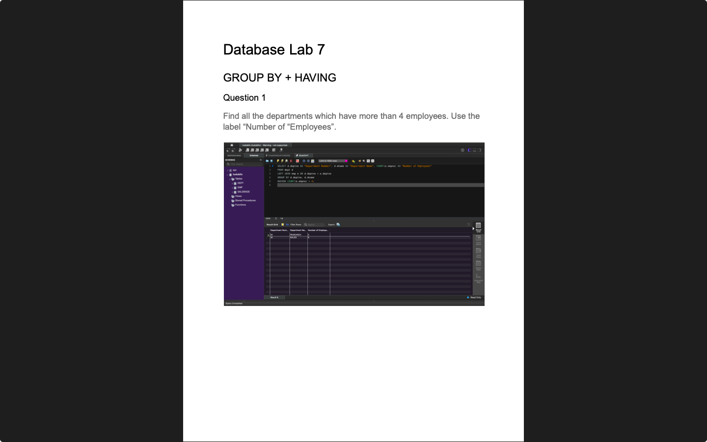
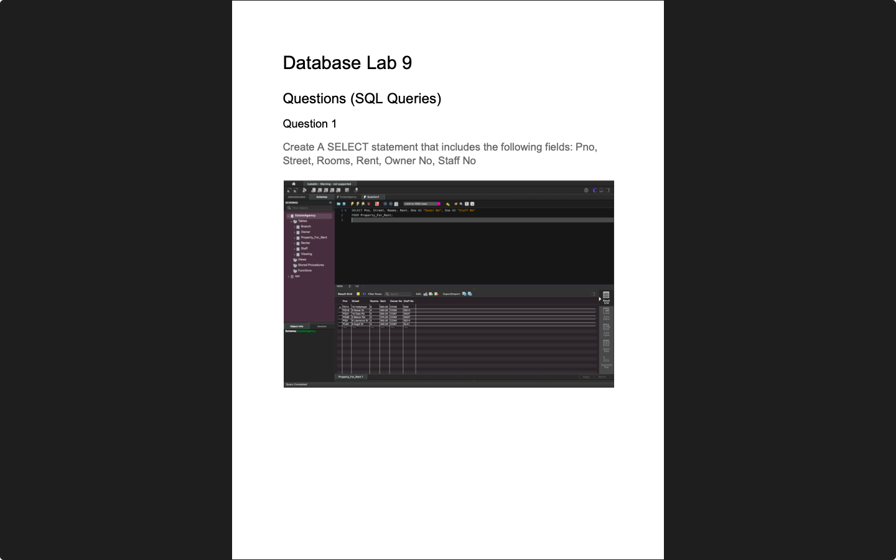

# Database Fundamentals

**Module:** Database Fundamentals (`COMP H1029`)  
**Semester:** 3 (Year 2), folder `sem03`  
**Lecturer:** Dr Tania Malik  
**Date:** September - December 2024  
**Credits:** 5 ECTS  
**Matching project branch:** [`project/year02/module-database_fundamentals/develop-database-system-for-university-office`](https://github.com/DanyilT/projects-in-university/tree/project/year02/module-database_fundamentals/develop-database-system-for-university-office) (the university office database project)

## What this module is for

Database Fundamentals is an introduction to relational databases with MySQL. The lectures run from an introduction to databases (week 1) through relational concepts and SQL, entity-relationship modelling, normalisation, SQL functions, joins and a SQL revision lecture to transaction processing, data warehousing, data mining, database security and NoSQL (weeks 9 to 13). The labs use MySQL Workbench: creating the emp, dept and salgrade sample tables and querying them (weeks 1, 2, 6 and 8), drawing entity-relationship diagrams (week 3), normalising tables to third normal form (weeks 4 and 5), a project week (week 9) and queries on the Estate Agency database (week 10). Week 7 was a reading week, and weeks 11 to 13 had no labs. The assessments are weekly lab work (10%), a database project (40%, a database for a university office) and a final written exam (50%). The exam paper is not in the repository, and the project files are on the branch linked above. This folder has the lab sheets, the solutions as reports with SQL and diagram files, the lecturer's solutions, the exercise sheets and reading material for each week, the project brief, and screenshots.

## Grades Breakdown

| Assessment Type | Weighting |
|---|---|
| Weekly Lab Work | 10% |
| Project (database for a university office) | 40% |
| Final Written Exam | 50% |

## All weeks

| Week | Title | Files | Screenshot |
|---|---|---|---|
| [Week 1](week01/) | Lab 1: getting started with MySQL | [`lab/database_fundamentals_week01_lab.pdf`](week01/lab/database_fundamentals_week01_lab.pdf) [`lab/resources/CreateTablesForMySQL.sql`](week01/lab/resources/CreateTablesForMySQL.sql) [`lab/resources/sql_server_and_workbench.pdf`](week01/lab/resources/sql_server_and_workbench.pdf) [`lab/solution/database_fundamentals_week01_lab_solution.pdf`](week01/lab/solution/database_fundamentals_week01_lab_solution.pdf) |  |
| [Week 2](week02/) | Lab 2: SQL SELECT queries on the emp table | [`lab/database_fundamentals_week02_lab.pdf`](week02/lab/database_fundamentals_week02_lab.pdf) [`lab/resources/CreateTablesForMySQL.sql`](week02/lab/resources/CreateTablesForMySQL.sql) [`lab/solution/database_fundamentals_week02_lab_solution.pdf`](week02/lab/solution/database_fundamentals_week02_lab_solution.pdf) [`lab/solution/queries/Question1.sql`](week02/lab/solution/queries/Question1.sql) [`lab/solution/queries/Question2.sql`](week02/lab/solution/queries/Question2.sql) [`lab/solution/queries/Question3.sql`](week02/lab/solution/queries/Question3.sql) [`lab/solution/queries/Question4.sql`](week02/lab/solution/queries/Question4.sql) [`lab/solution/queries/Question5.sql`](week02/lab/solution/queries/Question5.sql) [`lab/solution/queries/Question6.sql`](week02/lab/solution/queries/Question6.sql) [`lab/solution/queries/Question7.sql`](week02/lab/solution/queries/Question7.sql) [`lab/solution/queries/Question8.sql`](week02/lab/solution/queries/Question8.sql) [`lab/solution/queries/Question9.sql`](week02/lab/solution/queries/Question9.sql) [`lab/solution/queries/Question10.sql`](week02/lab/solution/queries/Question10.sql) [`lab/solution/queries/Question11.sql`](week02/lab/solution/queries/Question11.sql) [`lab/solution/queries/Question12.sql`](week02/lab/solution/queries/Question12.sql) [`lab/solution/queries/Question13.sql`](week02/lab/solution/queries/Question13.sql) [`lab/teacher_solution/database_fundamentals_week02_lab_teacher_solution.txt`](week02/lab/teacher_solution/database_fundamentals_week02_lab_teacher_solution.txt) [`resources/sql_quick_guide.pdf`](week02/resources/sql_quick_guide.pdf) [`resources/sql_commands_quick_guide.pdf`](week02/resources/sql_commands_quick_guide.pdf) |  |
| [Week 3](week03/) | Lab 3: entity-relationship diagrams in MySQL Workbench | [`lab/database_fundamentals_week03_lab.pdf`](week03/lab/database_fundamentals_week03_lab.pdf) [`lab/solution/database_fundamentals_week03_lab_solution.pdf`](week03/lab/solution/database_fundamentals_week03_lab_solution.pdf) [`lab/solution/diagrams/Model.mwb`](week03/lab/solution/diagrams/Model.mwb) [`lab/solution/diagrams/Question1.pdf`](week03/lab/solution/diagrams/Question1.pdf) [`lab/solution/diagrams/Question2.pdf`](week03/lab/solution/diagrams/Question2.pdf) [`lab/teacher_solution/database_fundamentals_week03_lab_teacher_solution.pdf`](week03/lab/teacher_solution/database_fundamentals_week03_lab_teacher_solution.pdf) [`resources/erd_rules.pdf`](week03/resources/erd_rules.pdf) [`resources/good_practice_rules_for_constructing_entity_relationship_models.pdf`](week03/resources/good_practice_rules_for_constructing_entity_relationship_models.pdf) |  |
| [Week 4](week04/) | Lab 4: ERDs, relational model and normalisation | [`lab/database_fundamentals_week04_lab.pdf`](week04/lab/database_fundamentals_week04_lab.pdf) [`lab/solution/database_fundamentals_week04_lab_solution.pdf`](week04/lab/solution/database_fundamentals_week04_lab_solution.pdf) [`lab/solution/diagrams/Model.mwb`](week04/lab/solution/diagrams/Model.mwb) [`lab/solution/diagrams/Exercise1.pdf`](week04/lab/solution/diagrams/Exercise1.pdf) [`lab/solution/diagrams/Exercise2.pdf`](week04/lab/solution/diagrams/Exercise2.pdf) [`lab/solution/diagrams/Exercise3.pdf`](week04/lab/solution/diagrams/Exercise3.pdf) [`lab/teacher_solution/database_fundamentals_week04_lab_teacher_solution_exercise_1.pdf`](week04/lab/teacher_solution/database_fundamentals_week04_lab_teacher_solution_exercise_1.pdf) [`lab/teacher_solution/database_fundamentals_week04_lab_teacher_solution_exercise_2.png`](week04/lab/teacher_solution/database_fundamentals_week04_lab_teacher_solution_exercise_2.png) [`lab/teacher_solution/database_fundamentals_week04_lab_teacher_solution_exercise_3.pdf`](week04/lab/teacher_solution/database_fundamentals_week04_lab_teacher_solution_exercise_3.pdf) [`resources/normalisation.pdf`](week04/resources/normalisation.pdf) [`resources/exercises/normalization_exercise_1.pdf`](week04/resources/exercises/normalization_exercise_1.pdf) [`resources/exercises/normalization_exercise_1_solution.pdf`](week04/resources/exercises/normalization_exercise_1_solution.pdf) |  |
| [Week 5](week05/) | Lab 5: normalisation to third normal form (continued) | [`lab/database_fundamentals_week05_lab.pdf`](week05/lab/database_fundamentals_week05_lab.pdf) [`lab/solution/database_fundamentals_week05_lab_solution.pdf`](week05/lab/solution/database_fundamentals_week05_lab_solution.pdf) [`lab/solution/diagrams/Model.mwb`](week05/lab/solution/diagrams/Model.mwb) [`lab/solution/diagrams/Exercise1.pdf`](week05/lab/solution/diagrams/Exercise1.pdf) [`lab/solution/diagrams/Exercise2.pdf`](week05/lab/solution/diagrams/Exercise2.pdf) [`lab/solution/diagrams/Exercise3.pdf`](week05/lab/solution/diagrams/Exercise3.pdf) [`lab/solution/diagrams/Exercise4.pdf`](week05/lab/solution/diagrams/Exercise4.pdf) [`lab/teacher_solution/database_fundamentals_week05_lab_teacher_solution.pdf`](week05/lab/teacher_solution/database_fundamentals_week05_lab_teacher_solution.pdf) |  |
| [Week 6](week06/) | Lab 6: SQL queries, single-row and group functions | [`lab/database_fundamentals_week06_lab.pdf`](week06/lab/database_fundamentals_week06_lab.pdf) [`lab/resources/CreateTablesforMySQL.sql`](week06/lab/resources/CreateTablesforMySQL.sql) [`lab/solution/database_fundamentals_week06_lab_solution.pdf`](week06/lab/solution/database_fundamentals_week06_lab_solution.pdf) [`lab/solution/queries/Question1.sql`](week06/lab/solution/queries/Question1.sql) [`lab/solution/queries/Question2.sql`](week06/lab/solution/queries/Question2.sql) [`lab/solution/queries/Question3.sql`](week06/lab/solution/queries/Question3.sql) [`lab/solution/queries/Question4.sql`](week06/lab/solution/queries/Question4.sql) [`lab/solution/queries/Question5.sql`](week06/lab/solution/queries/Question5.sql) [`lab/solution/queries/Question6.sql`](week06/lab/solution/queries/Question6.sql) [`lab/solution/queries/Question7.sql`](week06/lab/solution/queries/Question7.sql) [`lab/solution/queries/Question8.sql`](week06/lab/solution/queries/Question8.sql) [`lab/solution/queries/Question9.sql`](week06/lab/solution/queries/Question9.sql) [`lab/solution/queries/Question10.sql`](week06/lab/solution/queries/Question10.sql) [`lab/solution/queries/Question11.sql`](week06/lab/solution/queries/Question11.sql) [`lab/teacher_solution/database_fundamentals_week06_lab_teacher_solutions.txt`](week06/lab/teacher_solution/database_fundamentals_week06_lab_teacher_solutions.txt) [`resources/sql_joins_detailed_overview.pdf`](week06/resources/sql_joins_detailed_overview.pdf) |  |
| Week 7 | Reading week | None. Reading week: no lecture and no lab. | — |
| [Week 8](week08/) | Lab 7: GROUP BY, HAVING and joins | [`lab/database_fundamentals_week08_lab.pdf`](week08/lab/database_fundamentals_week08_lab.pdf) [`lab/solution/database_fundamentals_week08_lab_solution.pdf`](week08/lab/solution/database_fundamentals_week08_lab_solution.pdf) [`lab/solution/queries/Question1.sql`](week08/lab/solution/queries/Question1.sql) [`lab/solution/queries/Question2.sql`](week08/lab/solution/queries/Question2.sql) [`lab/solution/queries/Question3.sql`](week08/lab/solution/queries/Question3.sql) [`lab/solution/queries/Question4.sql`](week08/lab/solution/queries/Question4.sql) [`lab/solution/queries/Question5.sql`](week08/lab/solution/queries/Question5.sql) [`lab/solution/queries/Question6.sql`](week08/lab/solution/queries/Question6.sql) [`lab/solution/queries/Question7.sql`](week08/lab/solution/queries/Question7.sql) [`lab/solution/queries/Question8.sql`](week08/lab/solution/queries/Question8.sql) [`resources/exercises/exercise_1.pdf`](week08/resources/exercises/exercise_1.pdf) [`resources/exercises/exercise_1_solution.sql`](week08/resources/exercises/exercise_1_solution.sql) |  |
| [Week 9](week09/) | Lab 8: project work | [`lab/database_fundamentals_week09_lab.pdf`](week09/lab/database_fundamentals_week09_lab.pdf) [`lab/teacher_solution/database_fundamentals_week09_lab_teacher_solution.sql`](week09/lab/teacher_solution/database_fundamentals_week09_lab_teacher_solution.sql) [`resources/exercises/exercise_2.pdf`](week09/resources/exercises/exercise_2.pdf) [`resources/exercises/exercise_2_solution.pdf`](week09/resources/exercises/exercise_2_solution.pdf) [`resources/lost_update_problem.pdf`](week09/resources/lost_update_problem.pdf) [`resources/mysql_transactions_tutorialspoint.pdf`](week09/resources/mysql_transactions_tutorialspoint.pdf) | — |
| [Week 10](week10/) | Lab 9: Estate Agency queries | [`lab/database_fundamentals_week10_lab.pdf`](week10/lab/database_fundamentals_week10_lab.pdf) [`lab/resources/EstateAgency.sql`](week10/lab/resources/EstateAgency.sql) [`lab/solution/database_fundamentals_week10_lab_solution.pdf`](week10/lab/solution/database_fundamentals_week10_lab_solution.pdf) [`lab/solution/queries/Question1.sql`](week10/lab/solution/queries/Question1.sql) [`lab/solution/queries/Question2.sql`](week10/lab/solution/queries/Question2.sql) [`lab/solution/queries/Question3.sql`](week10/lab/solution/queries/Question3.sql) [`lab/solution/queries/Question4.sql`](week10/lab/solution/queries/Question4.sql) [`lab/solution/queries/Question5.sql`](week10/lab/solution/queries/Question5.sql) [`lab/solution/queries/Question6.sql`](week10/lab/solution/queries/Question6.sql) [`lab/solution/queries/Question7.sql`](week10/lab/solution/queries/Question7.sql) [`lab/solution/queries/Question8.sql`](week10/lab/solution/queries/Question8.sql) [`lab/solution/queries/Question9.sql`](week10/lab/solution/queries/Question9.sql) [`lab/solution/queries/Question10.sql`](week10/lab/solution/queries/Question10.sql) [`lab/solution/queries/Question11.sql`](week10/lab/solution/queries/Question11.sql) [`lab/solution/queries/Question12.sql`](week10/lab/solution/queries/Question12.sql) [`lab/teacher_solution/database_fundamentals_week10_lab_teacher_solution_1.pdf`](week10/lab/teacher_solution/database_fundamentals_week10_lab_teacher_solution_1.pdf) [`lab/teacher_solution/database_fundamentals_week10_lab_teacher_solution_2.pdf`](week10/lab/teacher_solution/database_fundamentals_week10_lab_teacher_solution_2.pdf) [`resources/exercises/exercise_3.pdf`](week10/resources/exercises/exercise_3.pdf) [`resources/exercises/exercise_3_solution.pdf`](week10/resources/exercises/exercise_3_solution.pdf) |  |
| Week 11 | Lecture 10: data mining | None. No lab this week. | — |
| Week 12 | Lecture 11: database security | None. No lab this week. | — |
| Week 13 | Lecture 12: NoSQL | None. No lab this week. | — |

## Assessments and other files

| File | What it contains |
|---|---|
| [`assessment/01/database_fundamentals_assessment.pdf`](assessment/01/database_fundamentals_assessment.pdf) | The project brief (3 pages, 40%, deadline 26 November 2024): a database for a university office, in three tasks: design (conceptual, logical and physical ERDs and the relational model in 3NF), create and populate the database with DDL and DML (at least 10 rows per table), and 20 queries (updates, deletes, counts, a view over three tables). |
| [`assessment/01/submission/project_link.txt`](assessment/01/submission/project_link.txt) | Two lines: the GitHub link to the project on its branch, and the branch name. |
| [`assessment/README.md`](assessment/README.md) | The project page: the brief, the submission on its branch, and the screenshots of the diagrams, the DDL and DML statements. |

The module page links five YouTube videos for the labs and the project:
- How to get SQL data from Mockaroo: https://www.youtube.com/watch?v=Uqnf6X2-KQo
- Reverse and forward engineering: https://www.youtube.com/watch?v=aNuOYfQ0l8U
- How to take the dump of a database: https://www.youtube.com/watch?v=YAOdFAj86bc
