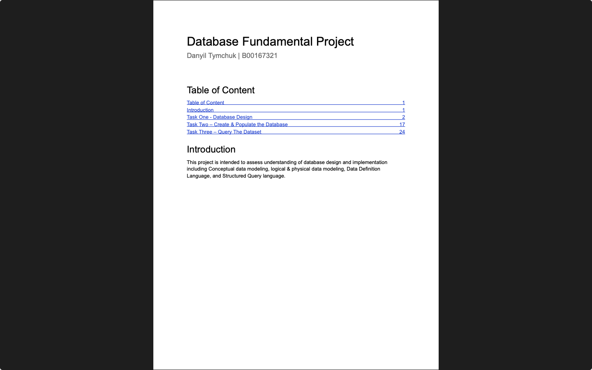
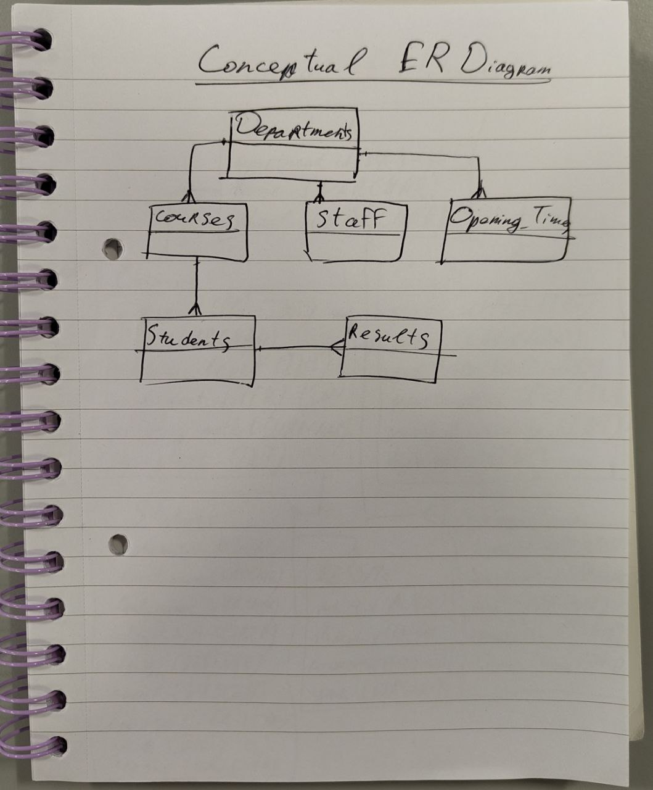
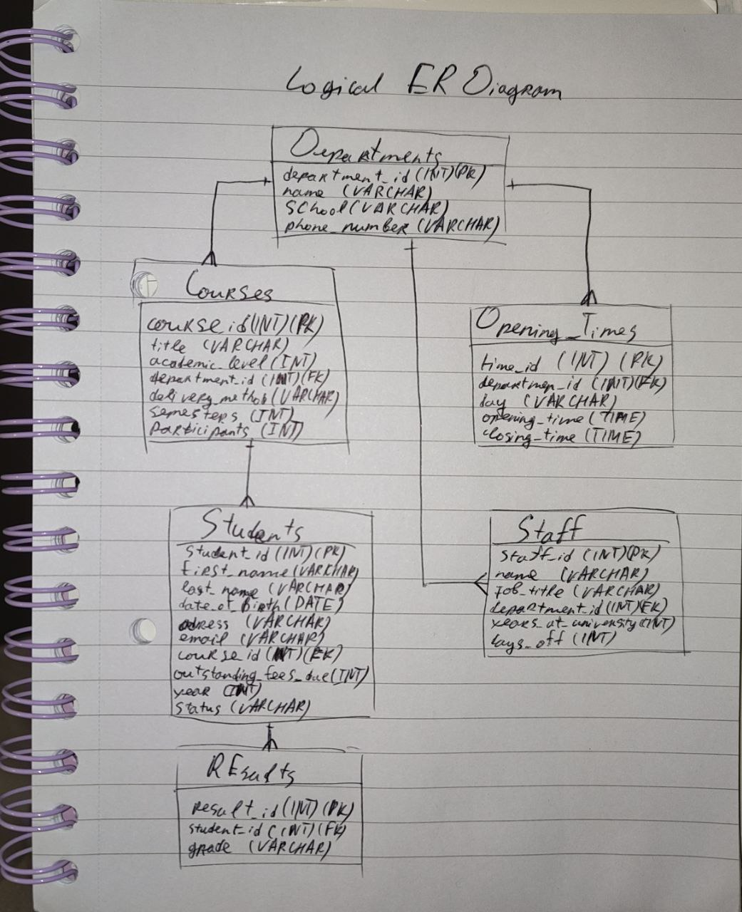
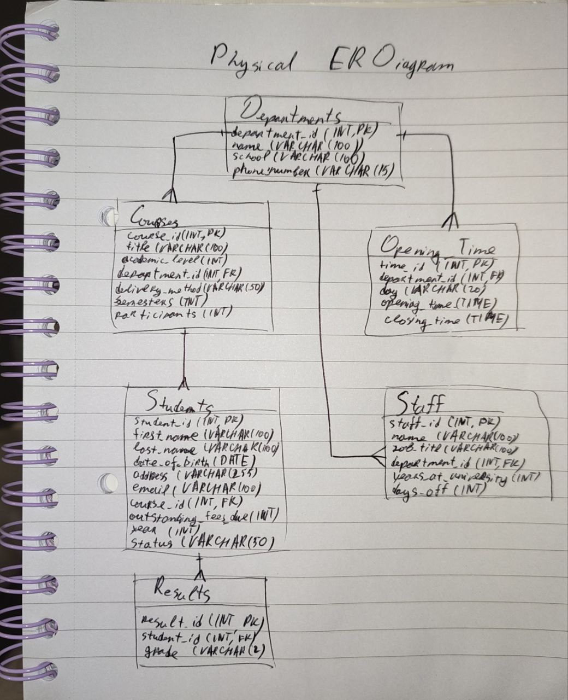
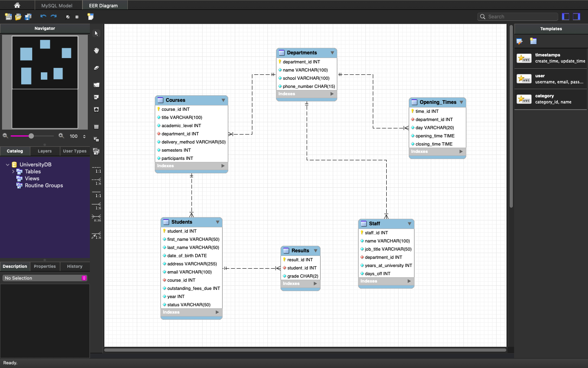
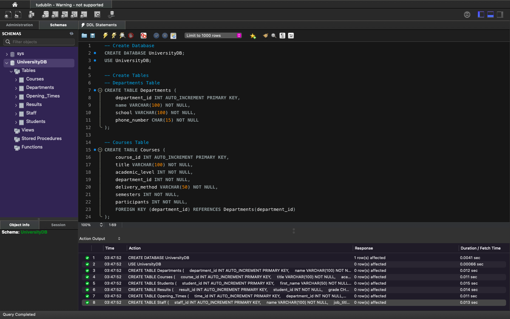
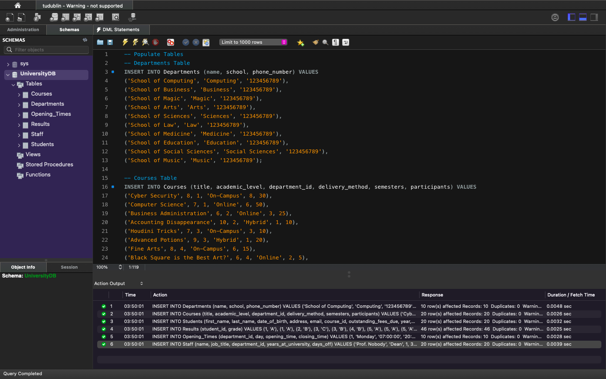

# Assessment 01 — Database project: a database for a university office

**Module:** Database Fundamentals (`COMP H1029`)  
**Semester:** 3 (Year 2), folder `sem03`  
**Weight:** 40%  
**Result:** 82%  
**Deadline:** 26 November 2024

[Module README](../README.md)

## The brief

[`01/database_fundamentals_assessment.pdf`](01/database_fundamentals_assessment.pdf) (3 pages) asks for a database system for a university office with courses at levels 6 to 10, departments, student information (academic and personal), end-of-year results and opening times, with at least 10 rows in each table. The brief suggests Mockaroo (https://www.mockaroo.com) for generating data. It has three tasks:

1. **Database design (40% of the project).** The entities, relationships and business rules; the conceptual, logical and physical ERDs; and the relational model in third normal form.
2. **Create and populate the database.** The DDL statements for the tables, and the DML statements that insert at least 10 rows into each table.
3. **Query the dataset.** 20 questions: updates (year 1 to year 2, course status, opening times, phone number, dean), deletes, a descending list of grades, a count of business students, staff with more than 4 years of service, courses over 3 semesters, addresses containing "road" and a view over three tables.

The submission is a report with the diagrams, screenshots and a narrative, and an SQL script with each statement labelled by its question number.

## The submission

The project files are on a separate branch: [`project/year02/module-database_fundamentals/develop-database-system-for-university-office`](https://github.com/DanyilT/projects-in-university/tree/project/year02/module-database_fundamentals/develop-database-system-for-university-office). [`01/submission/project_link.txt`](01/submission/project_link.txt) holds the link and the branch name. The branch has the report PDF, the conceptual, logical and physical ERDs (photographs of hand-drawn diagrams), the relational EER diagram and the Workbench model, the DDL and DML scripts, and the 20 query files.

The database has six tables: Departments, Courses, Students, Staff, Results and Opening_Times.

## Screenshots

*The first page of the project report.*

|  |  |  |
|---|---|---|
| Conceptual ERD (hand-drawn) | Logical ERD (hand-drawn) | Physical ERD (hand-drawn) |

*The relational EER diagram from MySQL Workbench.*

|  |  |
|---|---|
| The DDL statements that create the database | The DML statements that fill it |

The 20 query screenshots are [`query_01.png`](../.screenshots/assessment/01/query_01.png) to [`query_20.png`](../.screenshots/assessment/01/query_20.png) in the same folder, one per question of task 3.
