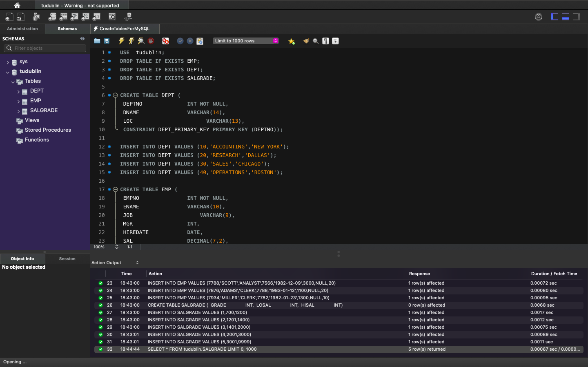

# Week 01 — Lab 1: getting started with MySQL

**Module:** Database Fundamentals (`COMP H1029`)  
**Semester:** 3 (Year 2), folder `sem03`

[Module README](../README.md)

## What this week is for

Lab 1 sets up MySQL Workbench. It creates the tudublin schema and runs the script that builds the emp, dept and salgrade tables, which the labs of weeks 2, 6 and 8 query. The lecture was the introduction to databases and relational database management systems.

## Files

| File | What it contains | Screenshot |
|---|---|---|
| [`README.md`](README.md) | This README. | — |
| [`lab/database_fundamentals_week01_lab.pdf`](lab/database_fundamentals_week01_lab.pdf) | The lab sheet (4 pages): open Workbench, create the tudublin schema, run CreateTablesForMySQL.sql and refresh the schema to see the three tables. | — |
| [`lab/resources/CreateTablesForMySQL.sql`](lab/resources/CreateTablesForMySQL.sql) | The script from the lab sheet: it drops and creates the DEPT, EMP and SALGRADE tables in tudublin and inserts 4 departments, 14 employees and 5 salary grades. |  *MySQL Workbench with the tudublin schema (DEPT, EMP and SALGRADE tables) and the script that created them.* |
| [`lab/resources/sql_server_and_workbench.pdf`](lab/resources/sql_server_and_workbench.pdf) | Lecturer's slides for lab 1 (17 pages): what MySQL is, how the client and server work, and installing MySQL Server and Workbench. | — |
| [`lab/solution/database_fundamentals_week01_lab_solution.pdf`](lab/solution/database_fundamentals_week01_lab_solution.pdf) | The solution report (1 page): a title and one screenshot of the script run in Workbench. |  *The solution report: the Getting Started with MySQL page with a screenshot of the script in Workbench.* |
