# Week 02 — Lab 2: SQL SELECT queries on the emp table

**Module:** Database Fundamentals (`COMP H1029`)  
**Semester:** 3 (Year 2), folder `sem03`

[Module README](../README.md)

## What this week is for

Lab 2 writes 13 SELECT queries on the emp table: choosing columns, filtering with WHERE, comparison operators, BETWEEN, IN and NOT IN, and a date range. The sheet also has a short exercise that creates a student table (student ID, name and date of birth, with the ID as the primary key) in Workbench. Each query is saved as a .sql file and shown with its result in the report. The lecture covered relational concepts (primary and foreign keys) and SQL.

> [!WARNING]
> [`lab/solution/queries/Question6.sql`](lab/solution/queries/Question6.sql): It uses SAL < 2850 where the sheet says less than 2500.

## Files

| File | What it contains | Screenshot |
|---|---|---|
| [`README.md`](README.md) | This README. | — |
| [`lab/database_fundamentals_week02_lab.pdf`](lab/database_fundamentals_week02_lab.pdf) | The lab sheet (6 pages): create the student table in Workbench, then 13 SQL queries on the emp table. | — |
| [`lab/resources/CreateTablesForMySQL.sql`](lab/resources/CreateTablesForMySQL.sql) | The table setup script from week 1 (DEPT, EMP and SALGRADE), used again for these queries. | — |
| [`lab/solution/database_fundamentals_week02_lab_solution.pdf`](lab/solution/database_fundamentals_week02_lab_solution.pdf) | The solution report (13 pages): each question with a screenshot of its query and result. |  *The solution report: Question 1 with a screenshot of the query and its result.* |
| [`lab/solution/queries/Question1.sql`](lab/solution/queries/Question1.sql) | Question 1: all details of all employees. | 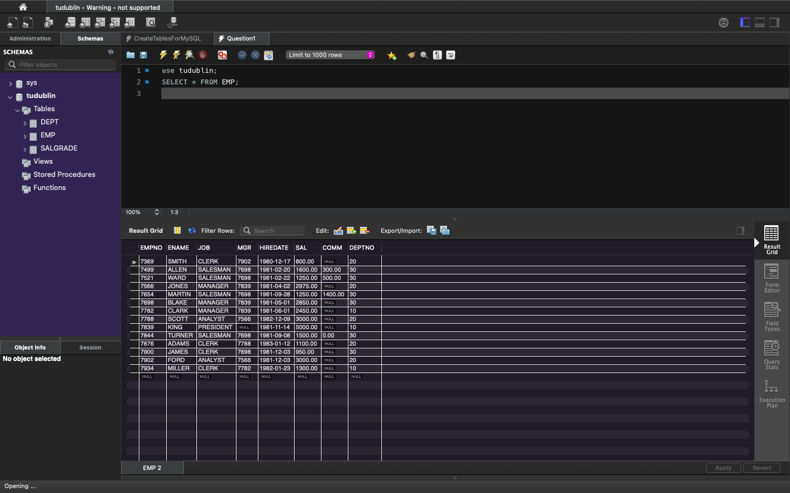 *Question 1 in Workbench: all columns of the EMP table.* |
| [`lab/solution/queries/Question2.sql`](lab/solution/queries/Question2.sql) | Question 2: employee number, name and job. | 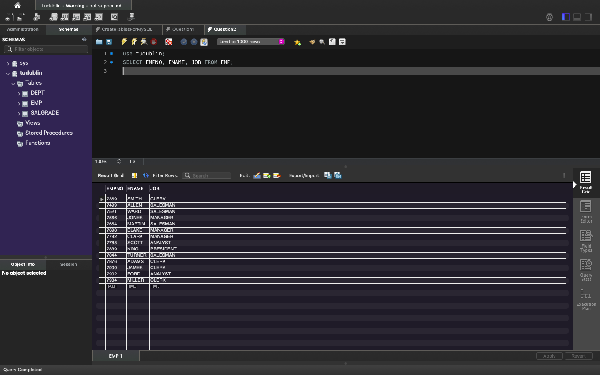 *Question 2 in Workbench: employee number, name and job.* |
| [`lab/solution/queries/Question3.sql`](lab/solution/queries/Question3.sql) | Question 3: employee number and department number. | 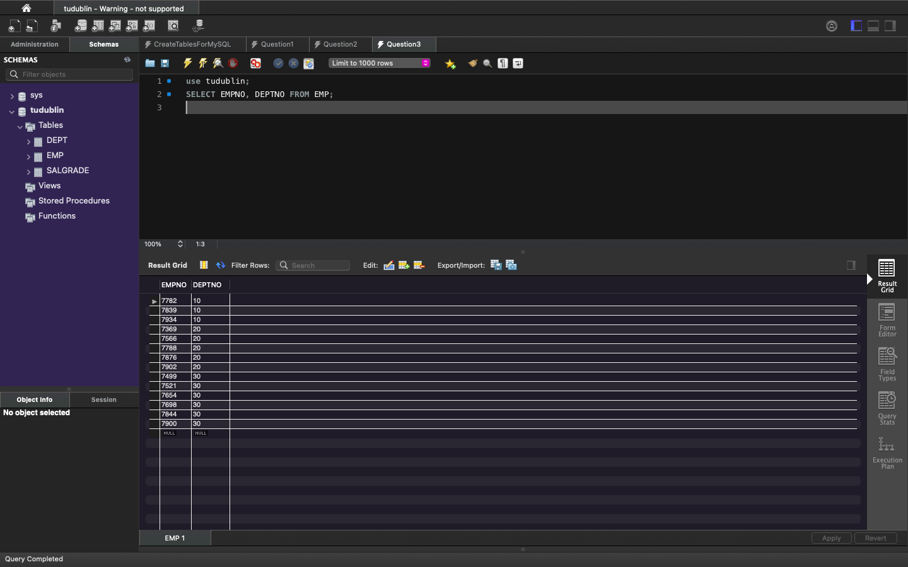 *Question 3 in Workbench: employee number and department number.* |
| [`lab/solution/queries/Question4.sql`](lab/solution/queries/Question4.sql) | Question 4: employees employed as clerks. | 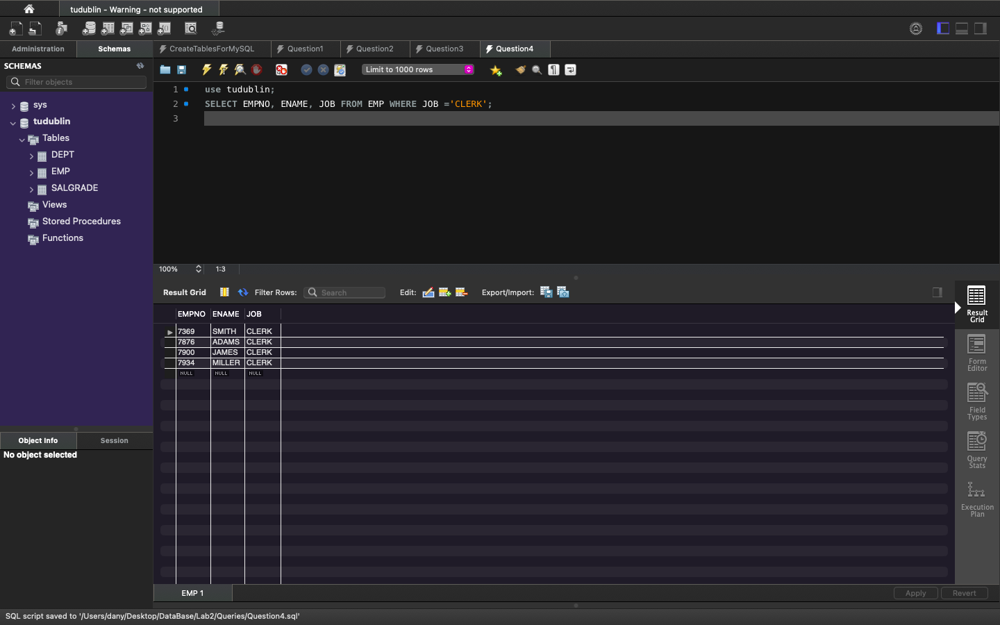 *Question 4 in Workbench: employees whose job is CLERK.* |
| [`lab/solution/queries/Question5.sql`](lab/solution/queries/Question5.sql) | Question 5: name and salary of employees earning more than 2850. | 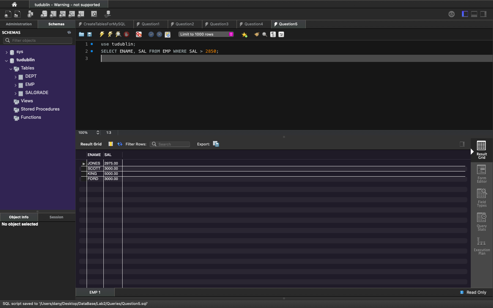 *Question 5 in Workbench: salary above 2850.* |
| [`lab/solution/queries/Question6.sql`](lab/solution/queries/Question6.sql) | Question 6: name and salary of employees earning less than 2850. | 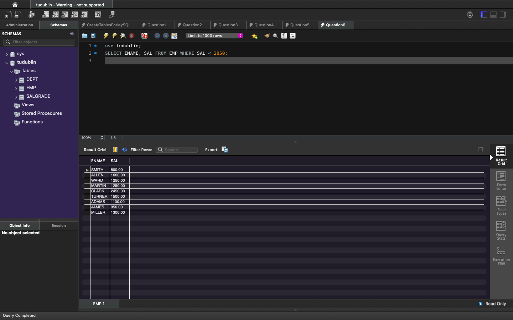 *Question 6 in Workbench: salary below 2850.* |
| [`lab/solution/queries/Question7.sql`](lab/solution/queries/Question7.sql) | Question 7: name and department number of employee 7566. | 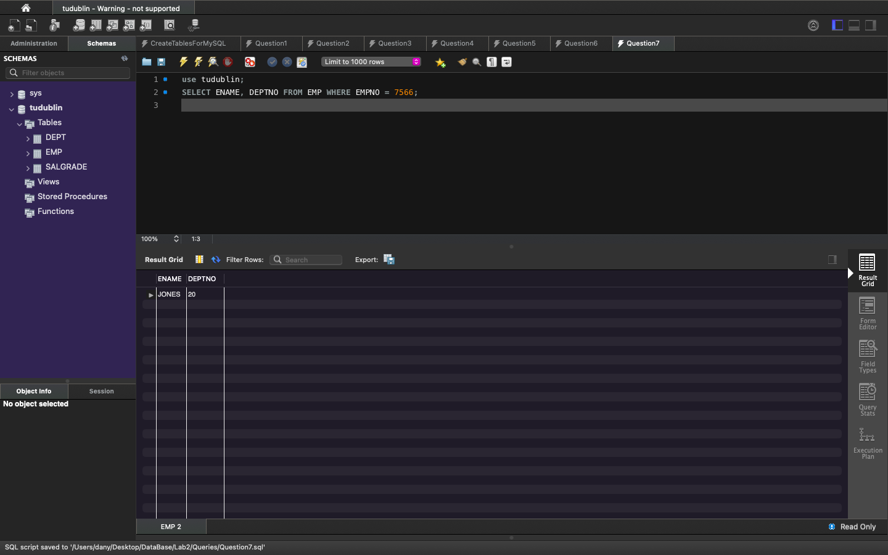 *Question 7 in Workbench: employee number 7566.* |
| [`lab/solution/queries/Question8.sql`](lab/solution/queries/Question8.sql) | Question 8: employees whose salary is less than their commission. | 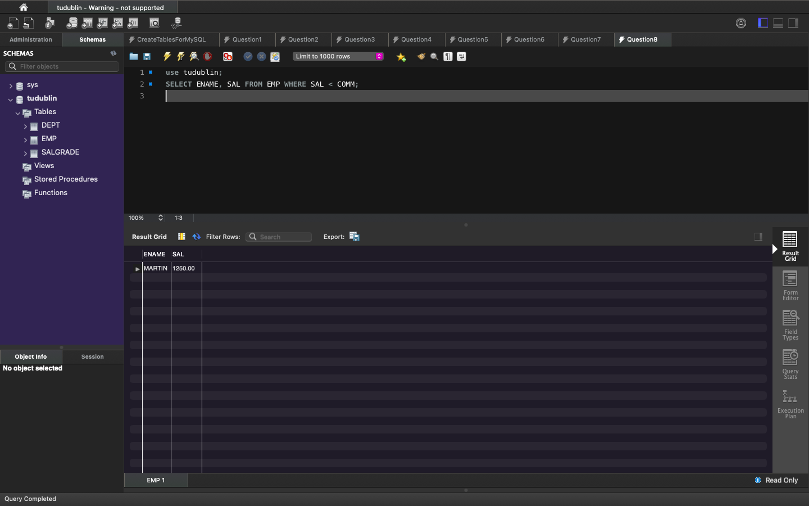 *Question 8 in Workbench: salary less than commission.* |
| [`lab/solution/queries/Question9.sql`](lab/solution/queries/Question9.sql) | Question 9: employees earning between 1500 and 3000. | 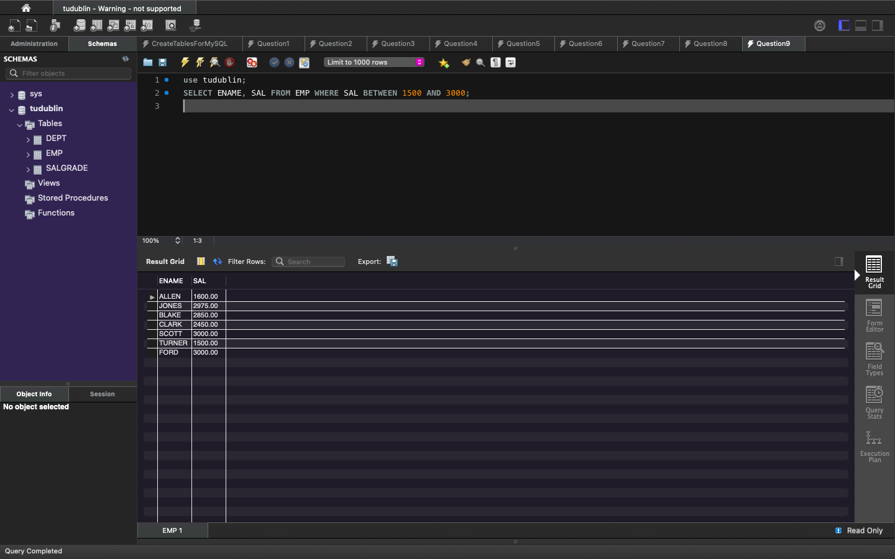 *Question 9 in Workbench: salary between 1500 and 3000.* |
| [`lab/solution/queries/Question10.sql`](lab/solution/queries/Question10.sql) | Question 10: employees whose salary is not between 1500 and 2850. | 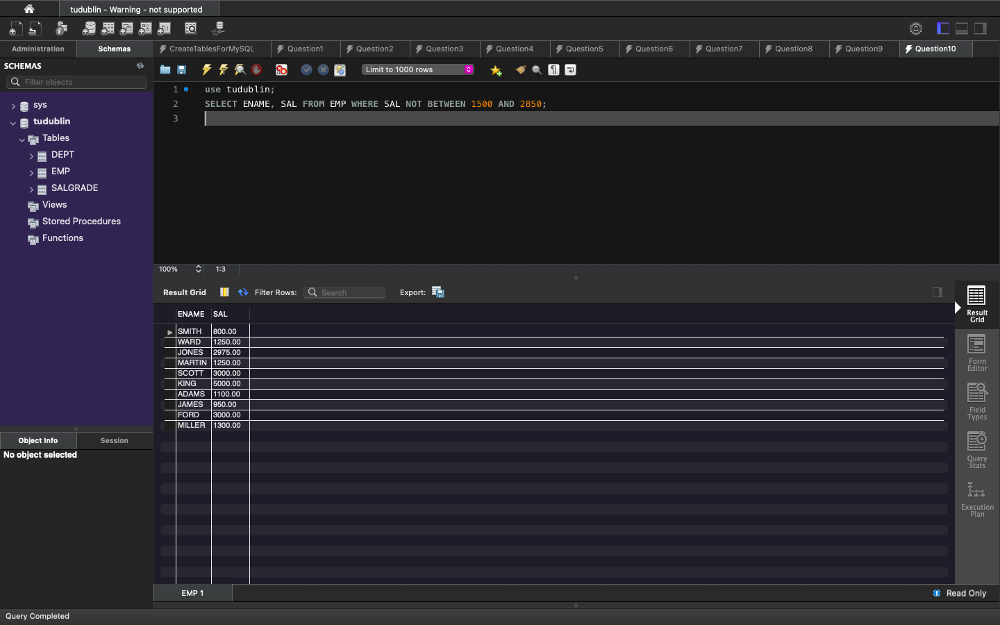 *Question 10 in Workbench: salary not between 1500 and 2850.* |
| [`lab/solution/queries/Question11.sql`](lab/solution/queries/Question11.sql) | Question 11: name, job and hire date for hires between 20 February and 1 May 1981. | 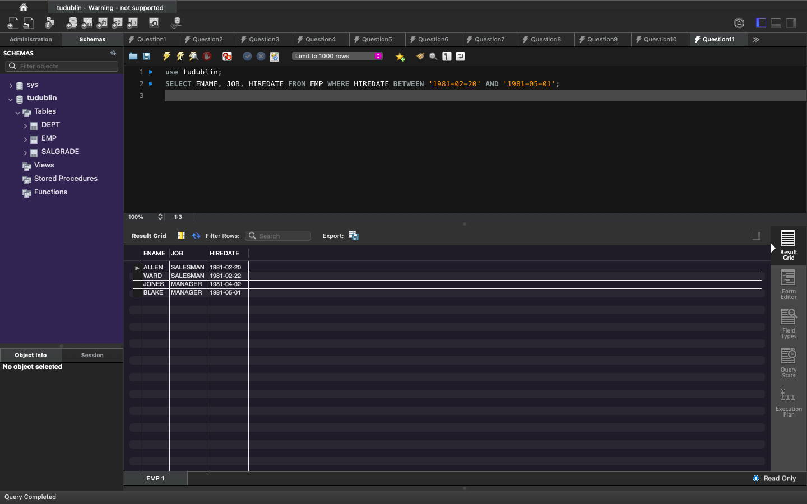 *Question 11 in Workbench: hired between 20 February and 1 May 1981.* |
| [`lab/solution/queries/Question12.sql`](lab/solution/queries/Question12.sql) | Question 12: name and department number in departments 10 and 30. | 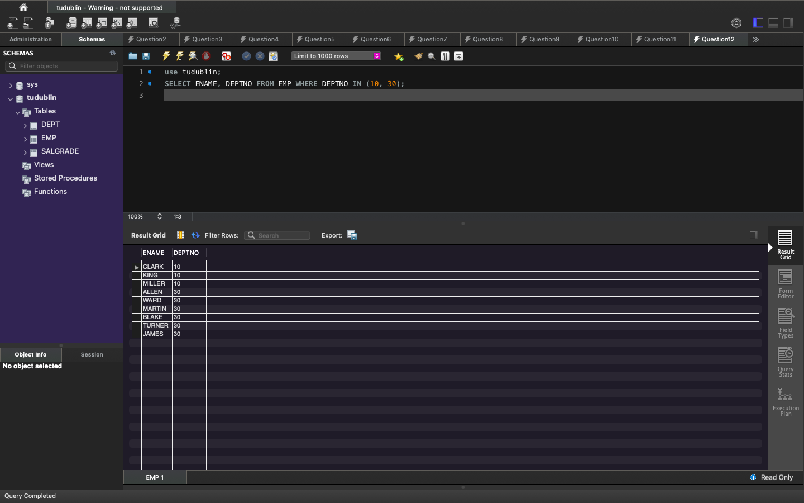 *Question 12 in Workbench: departments 10 and 30.* |
| [`lab/solution/queries/Question13.sql`](lab/solution/queries/Question13.sql) | Question 13: employees who are not managers, clerks or salespeople. | 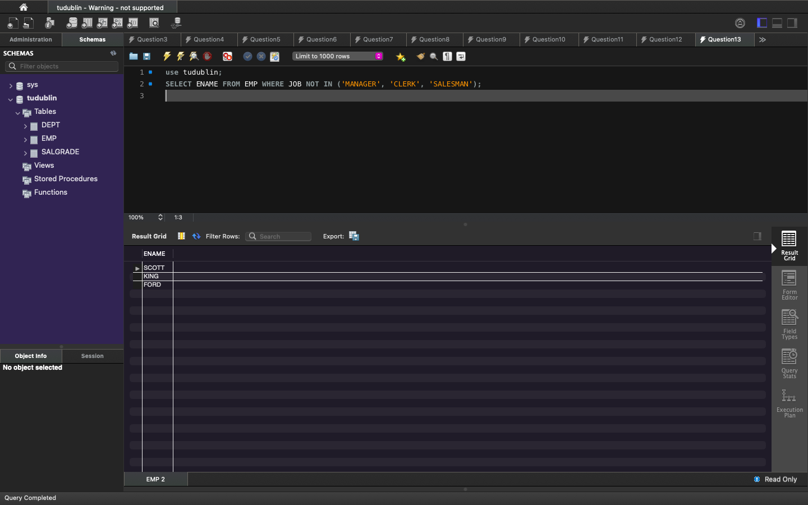 *Question 13 in Workbench: jobs other than manager, clerk and salesman.* |
| [`lab/teacher_solution/database_fundamentals_week02_lab_teacher_solution.txt`](lab/teacher_solution/database_fundamentals_week02_lab_teacher_solution.txt) | Lecturer's solution: the SQL answers for the sheet's queries in one text file. | — |
| [`resources/sql_quick_guide.pdf`](resources/sql_quick_guide.pdf) | An SQL quick guide (3 pages): what SQL is, the dialects of different database systems, and terms such as field, column and NULL. | — |
| [`resources/sql_commands_quick_guide.pdf`](resources/sql_commands_quick_guide.pdf) | SQL commands quick guide (2 pages): the DML, DDL, DCL and TCL command groups, and the aggregate and scalar functions. | — |
