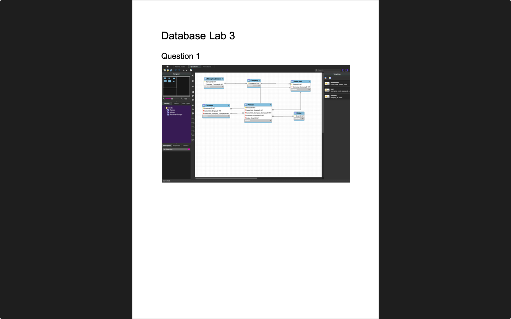
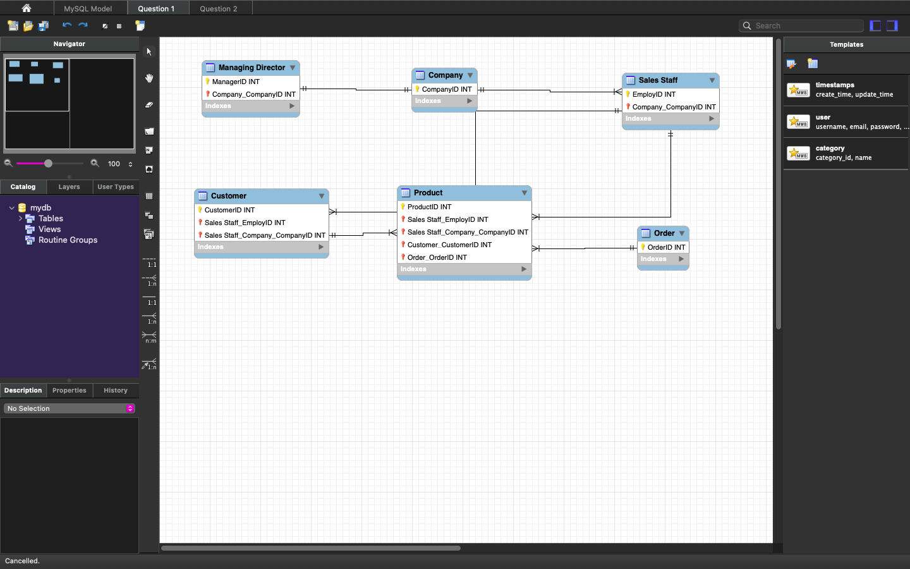
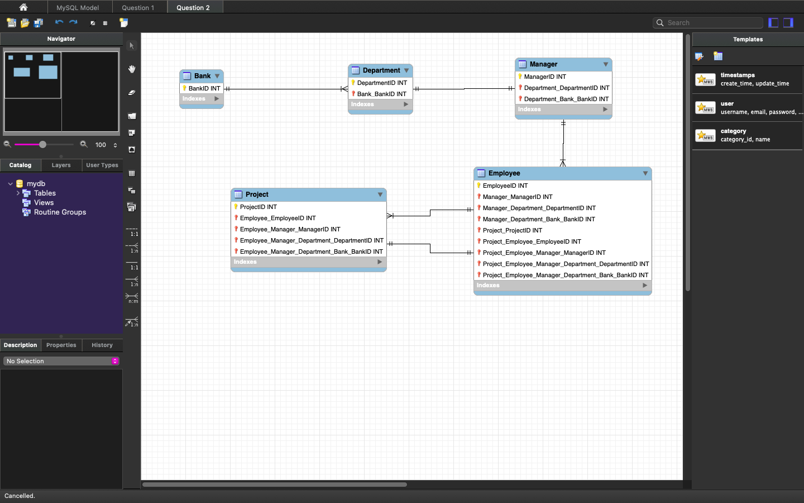

# Week 03 — Lab 3: entity-relationship diagrams in MySQL Workbench

**Module:** Database Fundamentals (`COMP H1029`)  
**Semester:** 3 (Year 2), folder `sem03`

[Module README](../README.md)

## What this week is for

Lab 3 draws entity-relationship diagrams (ERDs) in MySQL Workbench: first a practice diagram of student and course with a one-to-many and then a many-to-many relationship, then two questions. Question 1 draws four statements about a managing director, a company, sales staff, customers and products. Question 2 draws a bank with departments, managers, employees and projects. The sheet explains the conceptual, logical and physical levels of an ERD and dotted (non-identifying) and solid (identifying) relationships. The lecture was entity-relationship modelling.

## Files

| File | What it contains | Screenshot |
|---|---|---|
| [`README.md`](README.md) | This README. | — |
| [`lab/database_fundamentals_week03_lab.pdf`](lab/database_fundamentals_week03_lab.pdf) | The lab sheet (8 pages): an ER model practice in Workbench and two ERD questions. | — |
| [`lab/solution/database_fundamentals_week03_lab_solution.pdf`](lab/solution/database_fundamentals_week03_lab_solution.pdf) | The solution report (2 pages): the Question 1 and Question 2 diagrams. |  *The solution report: the Lab 3 title page with the Question 1 diagram.* |
| [`lab/solution/diagrams/Model.mwb`](lab/solution/diagrams/Model.mwb) | The MySQL Workbench model with the two diagrams (Question 1 and Question 2). | — |
| [`lab/solution/diagrams/Question1.pdf`](lab/solution/diagrams/Question1.pdf) | The Question 1 diagram exported from Workbench (2 pages). |  *Question 1 in Workbench: managing director, company, sales staff, customer, product and order.* |
| [`lab/solution/diagrams/Question2.pdf`](lab/solution/diagrams/Question2.pdf) | The Question 2 diagram exported from Workbench (2 pages). |  *Question 2 in Workbench: bank, department, manager, employee and project.* |
| [`lab/teacher_solution/database_fundamentals_week03_lab_teacher_solution.pdf`](lab/teacher_solution/database_fundamentals_week03_lab_teacher_solution.pdf) | Lecturer's solution (3 pages): the entity-relationship diagram for each statement of Question 1 and for the bank in Question 2. | — |
| [`resources/erd_rules.pdf`](resources/erd_rules.pdf) | ERD rules (2 pages): the rules for drawing an E-R diagram and a purchase order example with customers, purchase orders, line items and stock items. | — |
| [`resources/good_practice_rules_for_constructing_entity_relationship_models.pdf`](resources/good_practice_rules_for_constructing_entity_relationship_models.pdf) | Good practice rules for entity-relationship models (1 page): singular entity names, naming a relationship and resolving many-to-many relationships. | — |
