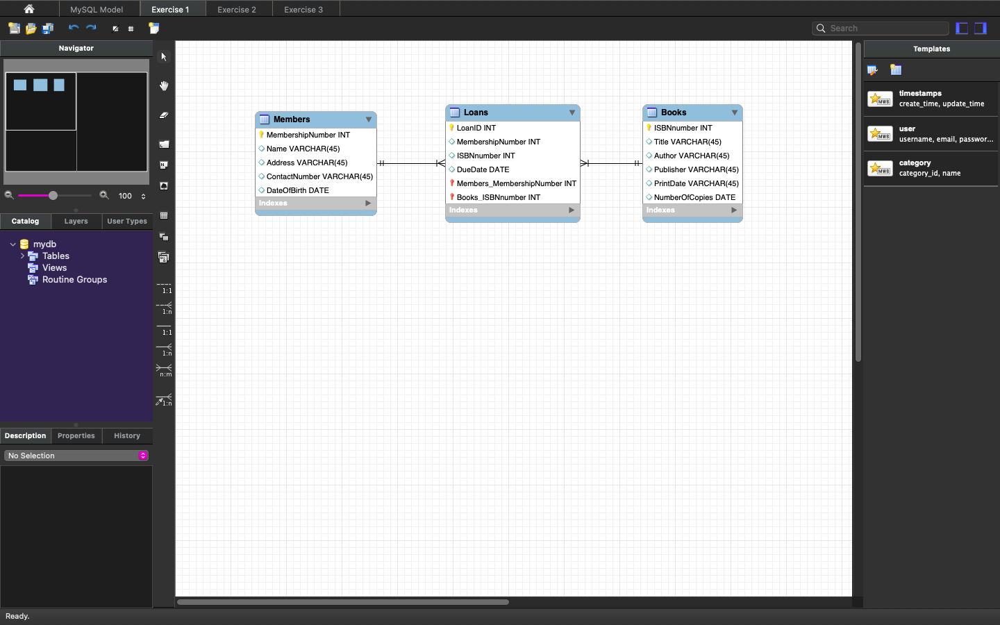
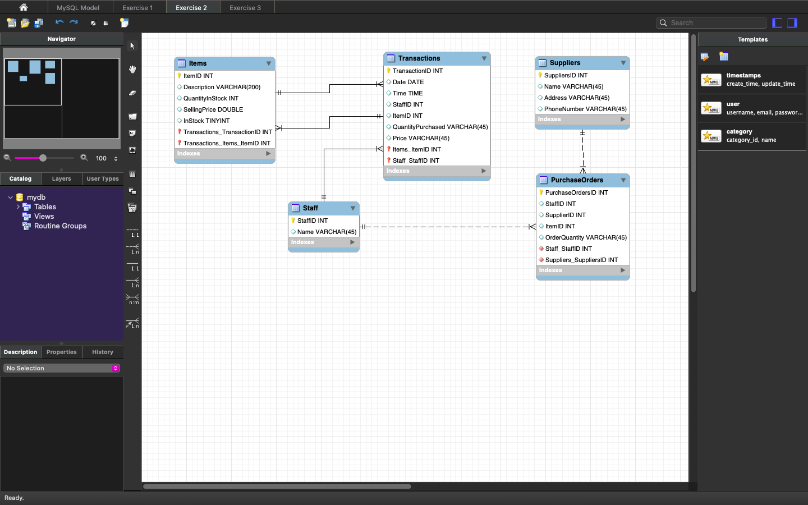
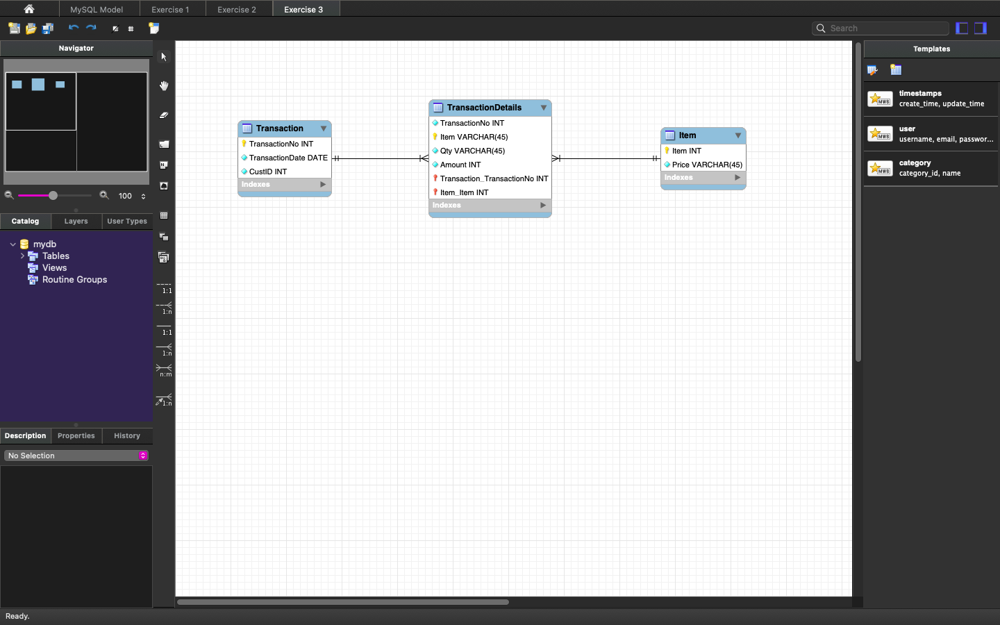

# Week 04 — Lab 4: ERDs, relational model and normalisation

**Module:** Database Fundamentals (`COMP H1029`)  
**Semester:** 3 (Year 2), folder `sem03`

[Module README](../README.md)

## What this week is for

Lab 4 goes from a description to an ERD in Workbench, maps it to a relational model and normalises it to third normal form. Exercise 1 is a library with members, books and loans. Exercise 2 is the We Have It general store with items, transactions, staff, suppliers and purchase orders. Exercise 3 normalises a transaction table step by step (1NF, 2NF, 3NF). The lecture was normalisation. The lab 5 sheet allows labs 4 and 5 to be submitted together in one document.

## Files

| File | What it contains | Screenshot |
|---|---|---|
| [`README.md`](README.md) | This README. | — |
| [`lab/database_fundamentals_week04_lab.pdf`](lab/database_fundamentals_week04_lab.pdf) | The lab sheet (3 pages): the objectives and three exercises (library, general store, and a table to take to third normal form). | — |
| [`lab/solution/database_fundamentals_week04_lab_solution.pdf`](lab/solution/database_fundamentals_week04_lab_solution.pdf) | The solution report (9 pages): for each exercise the tables with column types and keys, the ERD, and the normalisation steps. |  *The solution report: Exercise 1 with a screenshot of the ERD.* |
| [`lab/solution/diagrams/Model.mwb`](lab/solution/diagrams/Model.mwb) | The MySQL Workbench model with the three exercise diagrams. | — |
| [`lab/solution/diagrams/Exercise1.pdf`](lab/solution/diagrams/Exercise1.pdf) | The Exercise 1 diagram exported from Workbench (2 pages). |  *Exercise 1 in Workbench: members, loans and books.* |
| [`lab/solution/diagrams/Exercise2.pdf`](lab/solution/diagrams/Exercise2.pdf) | The Exercise 2 diagram exported from Workbench (2 pages). |  *Exercise 2 in Workbench: items, transactions, suppliers, staff and purchase orders.* |
| [`lab/solution/diagrams/Exercise3.pdf`](lab/solution/diagrams/Exercise3.pdf) | The Exercise 3 diagram exported from Workbench (2 pages). |  *Exercise 3 in Workbench: transaction, transaction details and item.* |
| [`lab/teacher_solution/database_fundamentals_week04_lab_teacher_solution_exercise_1.pdf`](lab/teacher_solution/database_fundamentals_week04_lab_teacher_solution_exercise_1.pdf) | Lecturer's solution to Exercise 1 (4 pages): the ERD and the library relations. The sheet header says Lab 8, from an earlier year. | — |
| [`lab/teacher_solution/database_fundamentals_week04_lab_teacher_solution_exercise_2.png`](lab/teacher_solution/database_fundamentals_week04_lab_teacher_solution_exercise_2.png) | Lecturer's solution to Exercise 2: the ERD as an image. | — |
| [`lab/teacher_solution/database_fundamentals_week04_lab_teacher_solution_exercise_3.pdf`](lab/teacher_solution/database_fundamentals_week04_lab_teacher_solution_exercise_3.pdf) | Lecturer's solution to Exercise 3 (2 pages): the first, second and third normal form relations. | — |
| [`resources/normalisation.pdf`](resources/normalisation.pdf) | A normalisation tutorial (4 pages) with a movies rented table: the 1NF rules and primary key rules. | — |
| [`resources/exercises/normalization_exercise_1.pdf`](resources/exercises/normalization_exercise_1.pdf) | Normalisation exercise 1 (1 page): a pet health history report to take from unnormalised form to 2NF. | — |
| [`resources/exercises/normalization_exercise_1_solution.pdf`](resources/exercises/normalization_exercise_1_solution.pdf) | Solution to normalisation exercise 1 (1 page): the pet, pet visit and procedure relations. | — |
