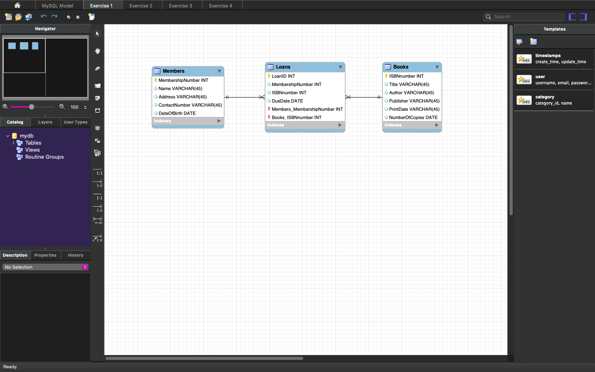
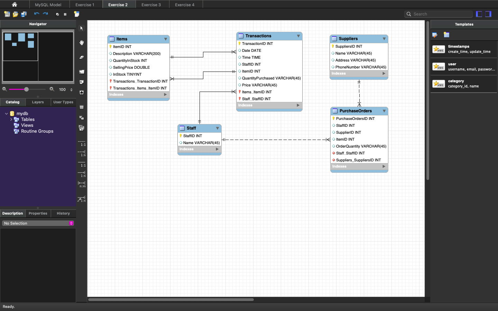
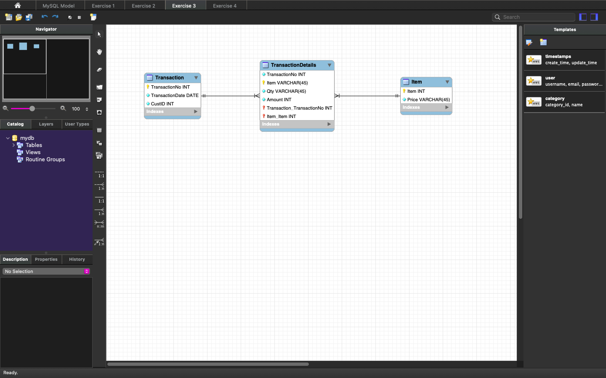
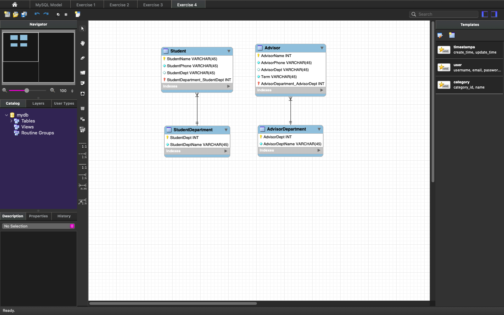

# Week 05 — Lab 5: normalisation to third normal form (continued)

**Module:** Database Fundamentals (`COMP H1029`)  
**Semester:** 3 (Year 2), folder `sem03`

[Module README](../README.md)

## What this week is for

Lab 5 repeats the exercises of lab 4 and adds two more: Exercise 3 normalises a transaction table and Exercise 4 normalises a table of students and their advisors. The sheet makes lab 5 mandatory, and labs 4 and 5 were submitted in one document. The lecture was SQL functions. The diagrams of Exercises 1 to 3 are the same as in week 4.

## Files

| File | What it contains | Screenshot |
|---|---|---|
| [`README.md`](README.md) | This README. | — |
| [`lab/database_fundamentals_week05_lab.pdf`](lab/database_fundamentals_week05_lab.pdf) | The lab sheet (3 pages): the objectives (1NF repeating groups, 2NF partial dependencies, 3NF transitive dependencies) and four exercises. | — |
| [`lab/solution/database_fundamentals_week05_lab_solution.pdf`](lab/solution/database_fundamentals_week05_lab_solution.pdf) | The solution report (13 pages): the tables, the ERD and the normalisation steps for the four exercises. |  *The solution report: Exercise 1 with a screenshot of the ERD.* |
| [`lab/solution/diagrams/Model.mwb`](lab/solution/diagrams/Model.mwb) | The MySQL Workbench model with the four exercise diagrams. | — |
| [`lab/solution/diagrams/Exercise1.pdf`](lab/solution/diagrams/Exercise1.pdf) | The Exercise 1 diagram exported from Workbench (2 pages); the same as in week 4. |  *Exercise 1 in Workbench: members, loans and books.* |
| [`lab/solution/diagrams/Exercise2.pdf`](lab/solution/diagrams/Exercise2.pdf) | The Exercise 2 diagram exported from Workbench (2 pages). |  *Exercise 2 in Workbench: items, transactions, suppliers, staff and purchase orders.* |
| [`lab/solution/diagrams/Exercise3.pdf`](lab/solution/diagrams/Exercise3.pdf) | The Exercise 3 diagram exported from Workbench (2 pages); the same as in week 4. |  *Exercise 3 in Workbench: transaction, transaction details and item.* |
| [`lab/solution/diagrams/Exercise4.pdf`](lab/solution/diagrams/Exercise4.pdf) | The Exercise 4 diagram exported from Workbench (2 pages). |  *Exercise 4 in Workbench: student, advisor, student department and advisor department.* |
| [`lab/teacher_solution/database_fundamentals_week05_lab_teacher_solution.pdf`](lab/teacher_solution/database_fundamentals_week05_lab_teacher_solution.pdf) | Lecturer's solution to Exercise 4 (1 page): the ambiguities in the table and the third normal form relations. | — |
