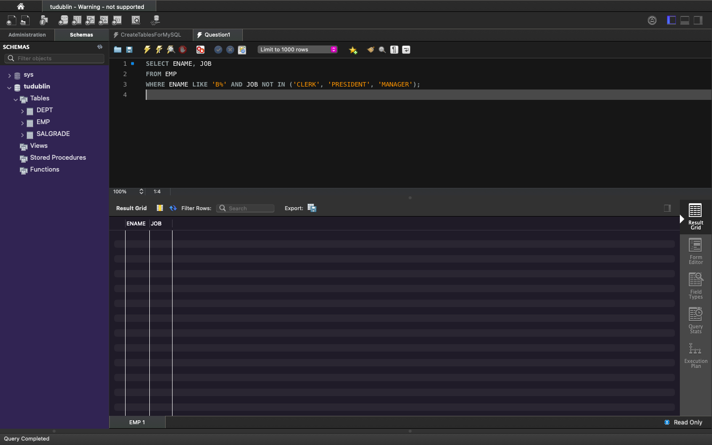
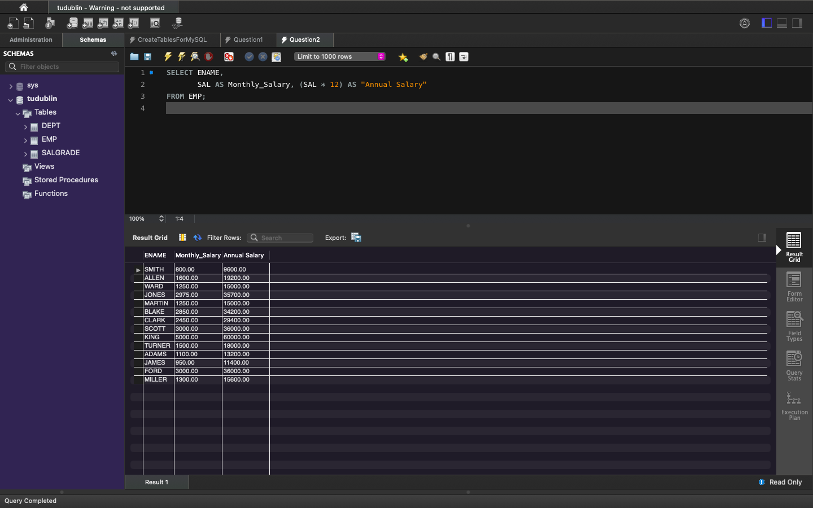
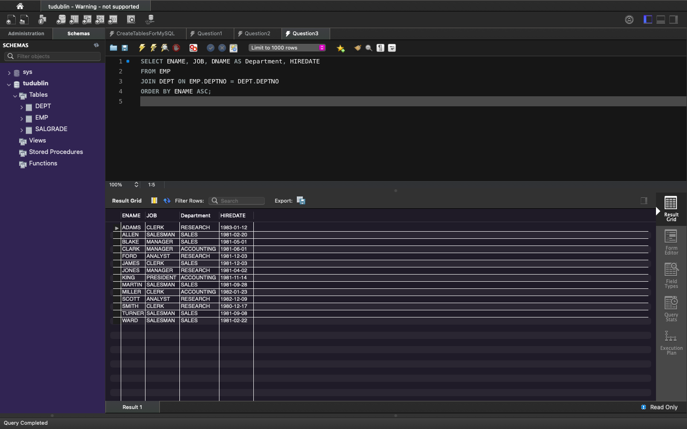
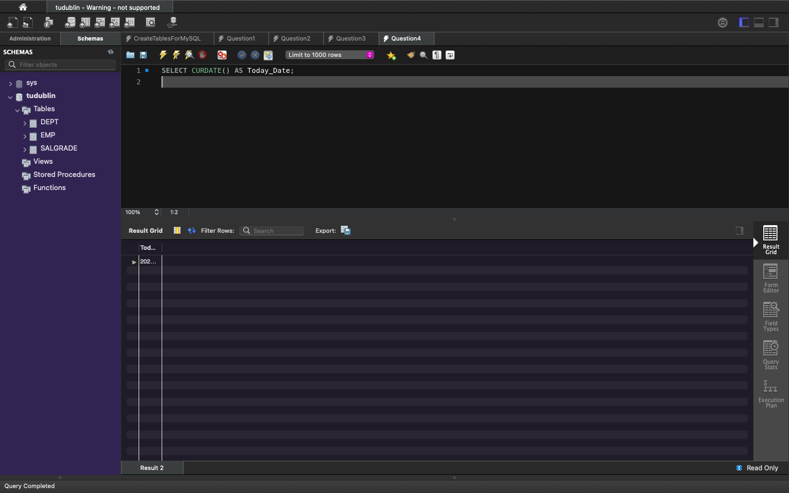
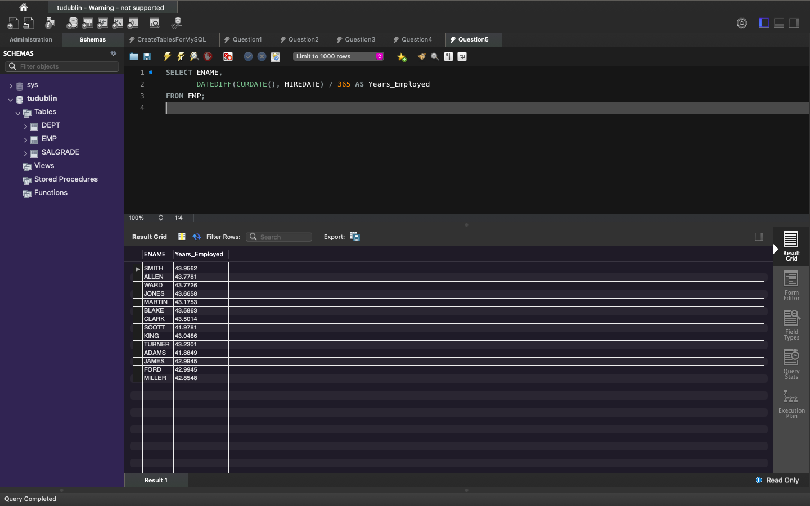
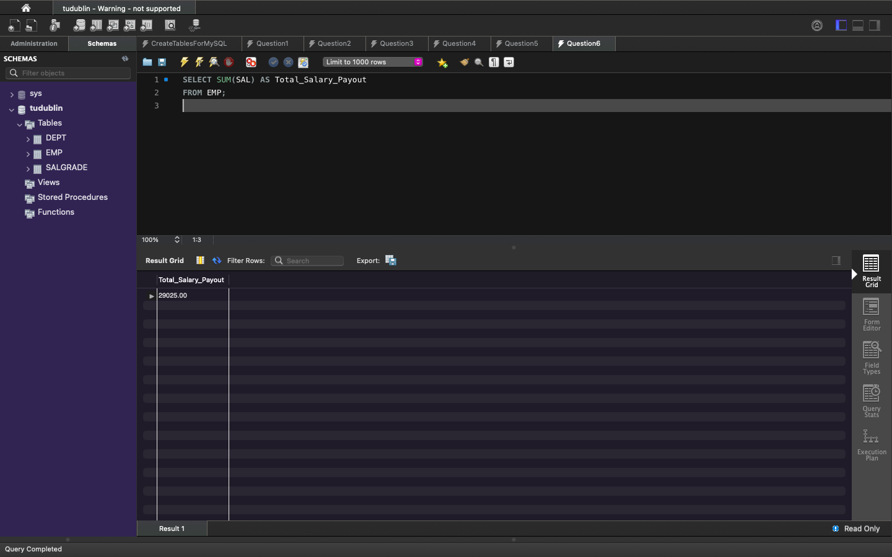
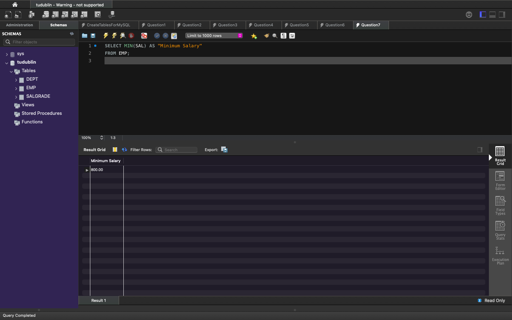
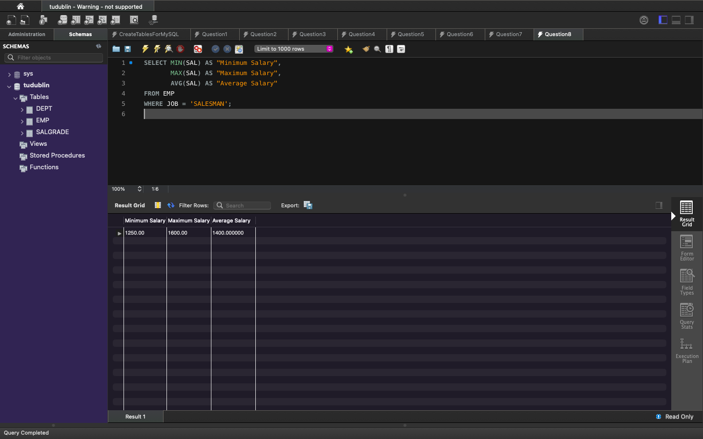
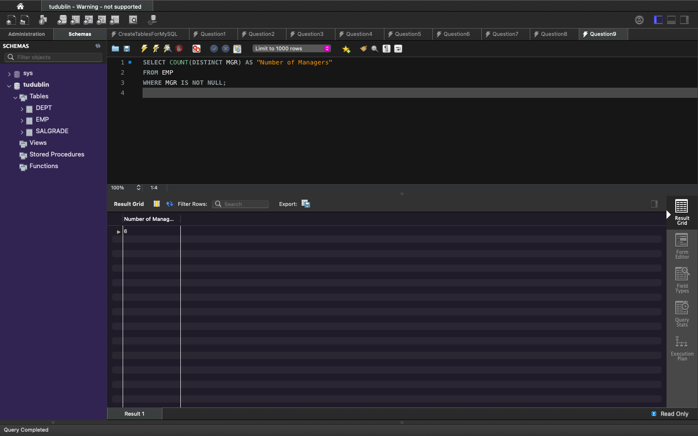
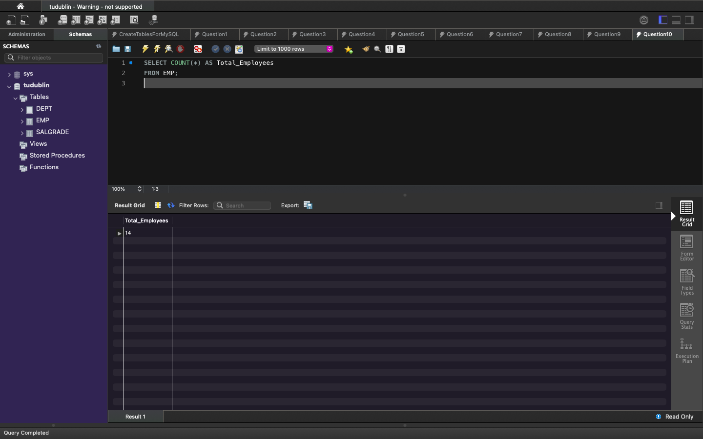

# Week 06 — Lab 6: SQL queries, single-row and group functions

**Module:** Database Fundamentals (`COMP H1029`)  
**Semester:** 3 (Year 2), folder `sem03`

[Module README](../README.md)

## What this week is for

Lab 6 writes 11 queries on the emp table: a pattern match with LIKE, a calculated annual salary with a column heading, a join with the department name and an ORDER BY, the single-row functions CURDATE and DATEDIFF, and the group functions SUM, MIN, MAX, AVG and COUNT. The lecture was SQL joins. Each query is saved as a .sql file and shown with its result in the report. Question 5 gives the years employed as a decimal (DATEDIFF divided by 365), while the lecturer's answer rounds down.

## Files

| File | What it contains | Screenshot |
|---|---|---|
| [`README.md`](README.md) | This README. | — |
| [`lab/database_fundamentals_week06_lab.pdf`](lab/database_fundamentals_week06_lab.pdf) | The lab sheet (2 pages): 11 SQL queries, with single-row and group functions. | — |
| [`lab/resources/CreateTablesforMySQL.sql`](lab/resources/CreateTablesforMySQL.sql) | The table setup script (DEPT, EMP and SALGRADE) given again for this lab. | — |
| [`lab/solution/database_fundamentals_week06_lab_solution.pdf`](lab/solution/database_fundamentals_week06_lab_solution.pdf) | The solution report (11 pages): each question with a screenshot of its query and result. |  *The solution report: Question 1 with a screenshot of the query and its result.* |
| [`lab/solution/queries/Question1.sql`](lab/solution/queries/Question1.sql) | Question 1: names beginning with B whose job is not clerk, president or manager. |  *Question 1 in Workbench: names beginning with B whose job is not clerk, president or manager.* |
| [`lab/solution/queries/Question2.sql`](lab/solution/queries/Question2.sql) | Question 2: monthly salary and annual salary, with the heading Annual Salary. |  *Question 2 in Workbench: monthly and annual salary.* |
| [`lab/solution/queries/Question3.sql`](lab/solution/queries/Question3.sql) | Question 3: name, job, department name and hire date, sorted by name. |  *Question 3 in Workbench: name, job, department and hire date, sorted by name.* |
| [`lab/solution/queries/Question4.sql`](lab/solution/queries/Question4.sql) | Question 4: today's date with CURDATE. |  *Question 4 in Workbench: today's date with CURDATE.* |
| [`lab/solution/queries/Question5.sql`](lab/solution/queries/Question5.sql) | Question 5: years employed from DATEDIFF divided by 365. |  *Question 5 in Workbench: years employed with DATEDIFF.* |
| [`lab/solution/queries/Question6.sql`](lab/solution/queries/Question6.sql) | Question 6: the total amount paid in salaries. |  *Question 6 in Workbench: total salaries with SUM.* |
| [`lab/solution/queries/Question7.sql`](lab/solution/queries/Question7.sql) | Question 7: the minimum salary, labelled Minimum Salary. |  *Question 7 in Workbench: the minimum salary.* |
| [`lab/solution/queries/Question8.sql`](lab/solution/queries/Question8.sql) | Question 8: minimum, maximum and average salary of salespeople. |  *Question 8 in Workbench: minimum, maximum and average salary of salespeople.* |
| [`lab/solution/queries/Question9.sql`](lab/solution/queries/Question9.sql) | Question 9: the number of distinct managers. |  *Question 9 in Workbench: the number of managers.* |
| [`lab/solution/queries/Question10.sql`](lab/solution/queries/Question10.sql) | Question 10: the number of employees. |  *Question 10 in Workbench: the number of employees.* |
| [`lab/solution/queries/Question11.sql`](lab/solution/queries/Question11.sql) | Question 11: the number of employees in department 20. |  *Question 11 in Workbench: employees in department 20.* |
| [`lab/teacher_solution/database_fundamentals_week06_lab_teacher_solutions.txt`](lab/teacher_solution/database_fundamentals_week06_lab_teacher_solutions.txt) | Lecturer's solution: the SQL answers for the sheet's queries in one text file. | — |
| [`resources/sql_joins_detailed_overview.pdf`](resources/sql_joins_detailed_overview.pdf) | SQL joins overview (9 pages): the join types with examples. | — |
