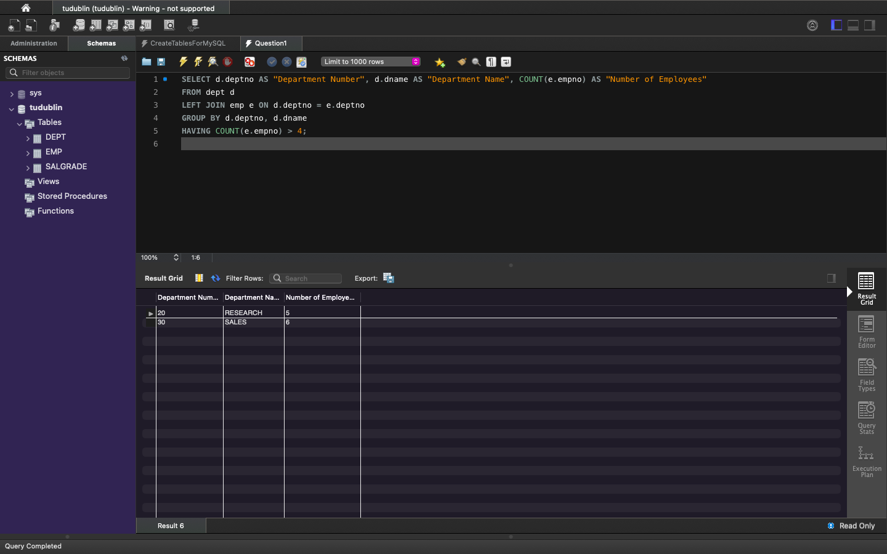
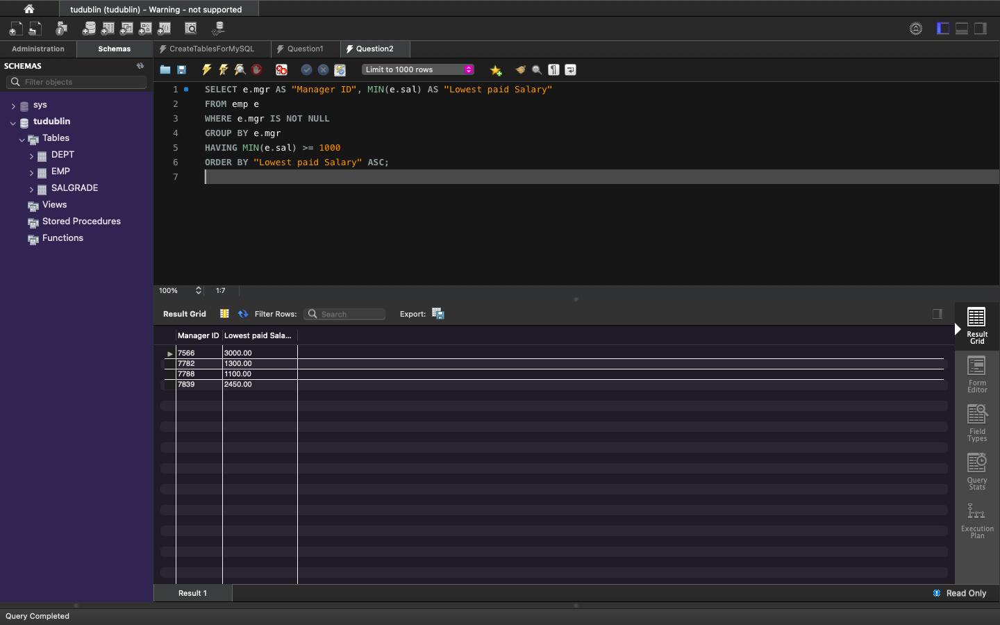
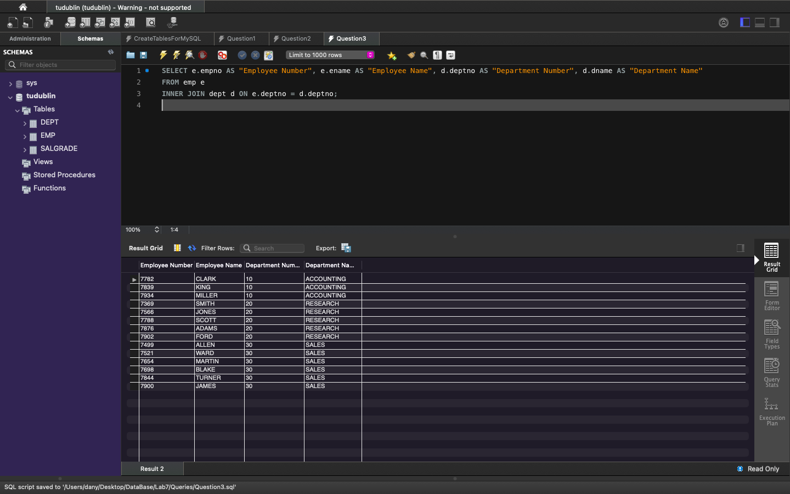
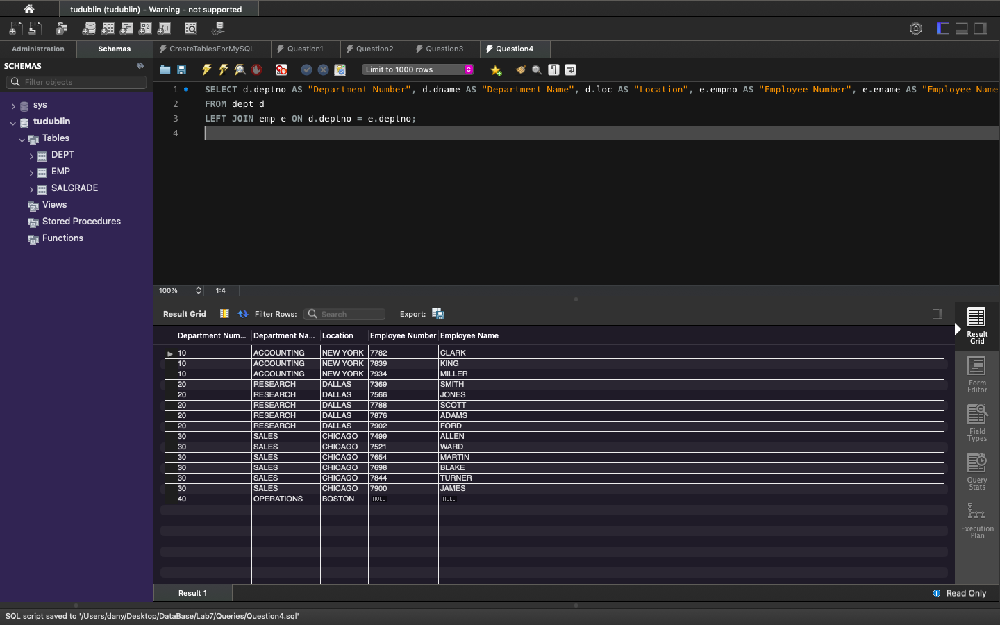
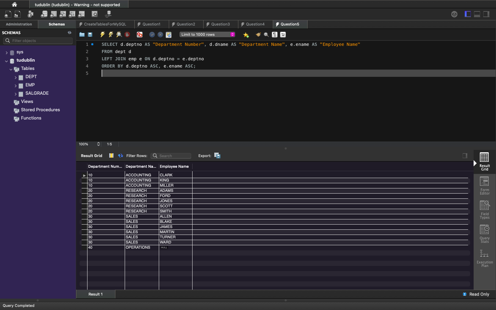
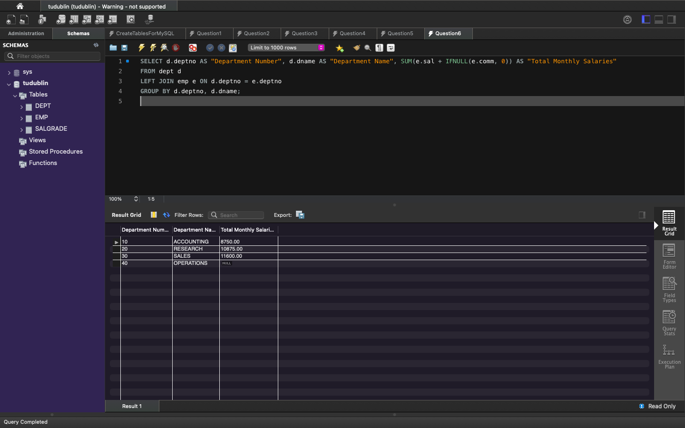
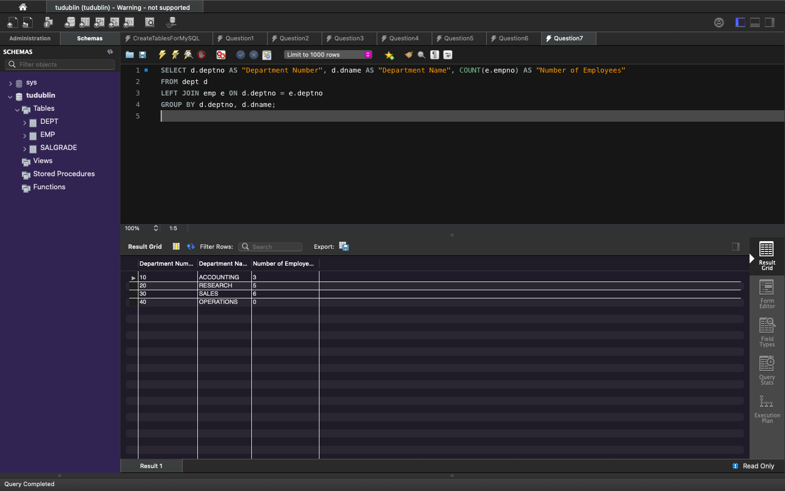
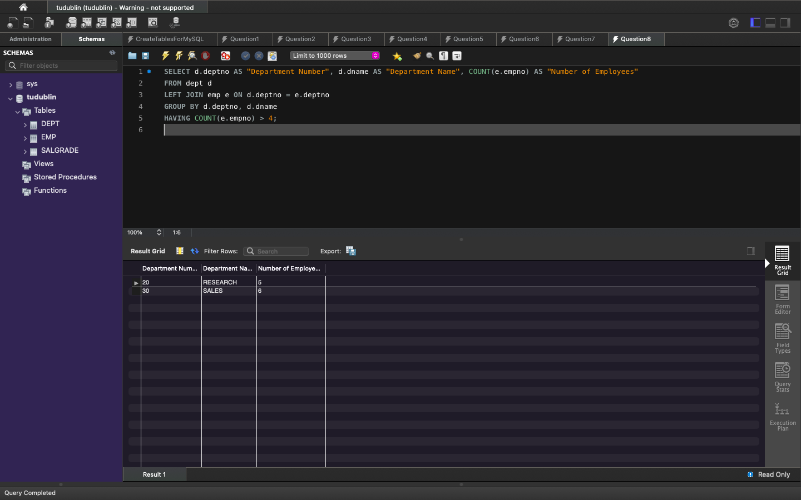

# Week 08 — Lab 7: GROUP BY, HAVING and joins

**Module:** Database Fundamentals (`COMP H1029`)  
**Semester:** 3 (Year 2), folder `sem03`

[Module README](../README.md)

## What this week is for

Lab 7 (week 8, after the reading week) is a SQL revision lab: two GROUP BY and HAVING queries and six join queries on the emp and dept tables, written with table aliases. The lecture was SQL revision. Exercise 1 in the resources creates a Football database and a premiership table and inserts, updates and deletes rows.

> [!WARNING]
> - [`lab/solution/queries/Question4.sql`](lab/solution/queries/Question4.sql), [`lab/solution/queries/Question5.sql`](lab/solution/queries/Question5.sql), [`lab/solution/queries/Question6.sql`](lab/solution/queries/Question6.sql), [`lab/solution/queries/Question7.sql`](lab/solution/queries/Question7.sql), [`lab/solution/queries/Question8.sql`](lab/solution/queries/Question8.sql): Questions 4 to 8 use LEFT JOIN where the sheet asks for inner joins, so department 40 (OPERATIONS), which has no employees, also appears in the results of questions 4 to 7.
> - [`resources/exercises/exercise_1_solution.sql`](resources/exercises/exercise_1_solution.sql): It has two errors: an extra closing bracket after CREATE TABLE, and the delete of Arsenal names football (the database) instead of premiership (the table).

## Files

| File | What it contains | Screenshot |
|---|---|---|
| [`README.md`](README.md) | This README. | — |
| [`lab/database_fundamentals_week08_lab.pdf`](lab/database_fundamentals_week08_lab.pdf) | The lab sheet (2 pages, titled Lab Sheet 7): 2 GROUP BY and HAVING queries and 6 inner join queries. | — |
| [`lab/solution/database_fundamentals_week08_lab_solution.pdf`](lab/solution/database_fundamentals_week08_lab_solution.pdf) | The solution report (8 pages): each question with a screenshot of its query and result. |  *The solution report: Question 1 with a screenshot of the query and its result.* |
| [`lab/solution/queries/Question1.sql`](lab/solution/queries/Question1.sql) | Question 1: departments with more than 4 employees. |  *Question 1 in Workbench: departments with more than 4 employees.* |
| [`lab/solution/queries/Question2.sql`](lab/solution/queries/Question2.sql) | Question 2: the lowest salary for the employees of each manager, excluding groups below 1000. |  *Question 2 in Workbench: the lowest salary for each manager.* |
| [`lab/solution/queries/Question3.sql`](lab/solution/queries/Question3.sql) | Question 3: employee number and name with department number and name (inner join). |  *Question 3 in Workbench: employee and department numbers and names.* |
| [`lab/solution/queries/Question4.sql`](lab/solution/queries/Question4.sql) | Question 4: department number, name and location with each employee's number and name (left join). |  *Question 4 in Workbench: departments with their locations and employees.* |
| [`lab/solution/queries/Question5.sql`](lab/solution/queries/Question5.sql) | Question 5: department number and name with employee names, sorted (left join). |  *Question 5 in Workbench: department and employee names, sorted.* |
| [`lab/solution/queries/Question6.sql`](lab/solution/queries/Question6.sql) | Question 6: total monthly pay (salary plus commission) per department (left join). |  *Question 6 in Workbench: total monthly salaries per department.* |
| [`lab/solution/queries/Question7.sql`](lab/solution/queries/Question7.sql) | Question 7: the number of employees per department (left join). |  *Question 7 in Workbench: the number of employees per department.* |
| [`lab/solution/queries/Question8.sql`](lab/solution/queries/Question8.sql) | Question 8: departments with more than 4 employees (left join and HAVING). |  *Question 8 in Workbench: departments with more than 4 employees.* |
| [`resources/exercises/exercise_1.pdf`](resources/exercises/exercise_1.pdf) | Exercise 1 (1 page): create the Football database and the premiership table, insert five teams, update, select and delete. | — |
| [`resources/exercises/exercise_1_solution.sql`](resources/exercises/exercise_1_solution.sql) | The sample SQL solution to exercise 1. | — |
