# Week 10 — Lab 9: Estate Agency queries

**Module:** Database Fundamentals (`COMP H1029`)  
**Semester:** 3 (Year 2), folder `sem03`

[Module README](../README.md)

## What this week is for

Lab 9 (week 10) creates the EstateAgency database from a script (branch, staff, property for rent, renter, owner and viewing tables) and answers 12 queries: column lists, conditions, BETWEEN, COUNT, the highest value, GROUP BY, SUM, NOT LIKE and an inner join of renters and viewings. The lecture was data warehousing. The folder also has two lecturer's solutions, the exam exercise 3 on normal forms, and its solution.

## Files

| File | What it contains | Screenshot |
|---|---|---|
| [`README.md`](README.md) | This README. | — |
| [`lab/database_fundamentals_week10_lab.pdf`](lab/database_fundamentals_week10_lab.pdf) | The lab sheet (3 pages, titled Labsheet 9): the Estate Agency tables with their rows and 12 questions. | — |
| [`lab/resources/EstateAgency.sql`](lab/resources/EstateAgency.sql) | The script that creates the EstateAgency database and its six tables with their rows. | — |
| [`lab/solution/database_fundamentals_week10_lab_solution.pdf`](lab/solution/database_fundamentals_week10_lab_solution.pdf) | The solution report (12 pages): each question with a screenshot of its query and result. |  *The solution report: Question 1 with a screenshot of the query and its result.* |
| [`lab/solution/queries/Question1.sql`](lab/solution/queries/Question1.sql) | Question 1: property number, street, rooms, rent, owner number and staff number. | 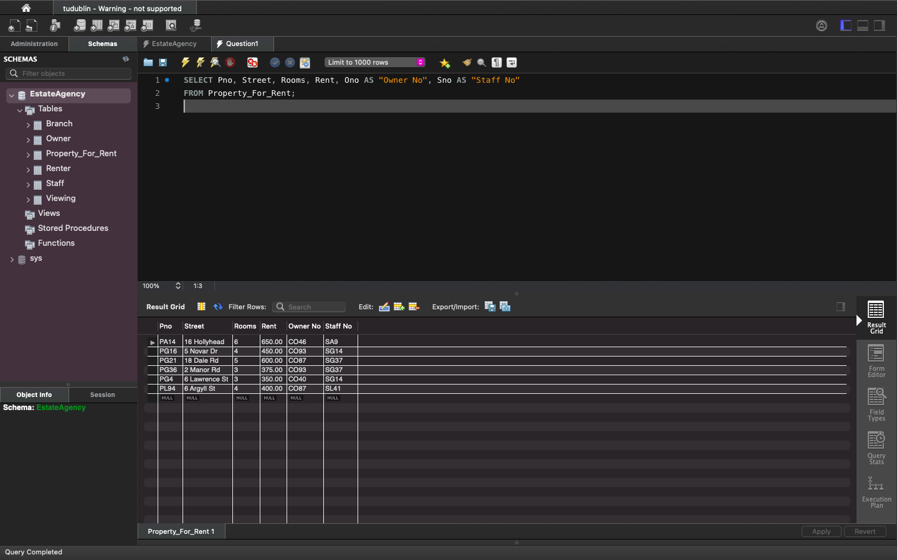 *Question 1 in Workbench: property number, street, rooms, rent, owner and staff number.* |
| [`lab/solution/queries/Question2.sql`](lab/solution/queries/Question2.sql) | Question 2: the same columns for property PG4. | 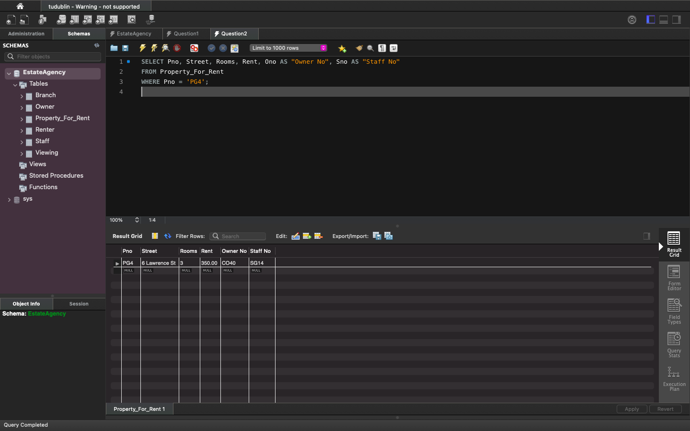 *Question 2 in Workbench: the property PG4.* |
| [`lab/solution/queries/Question3.sql`](lab/solution/queries/Question3.sql) | Question 3: the same columns for rent between 355 and 470. | 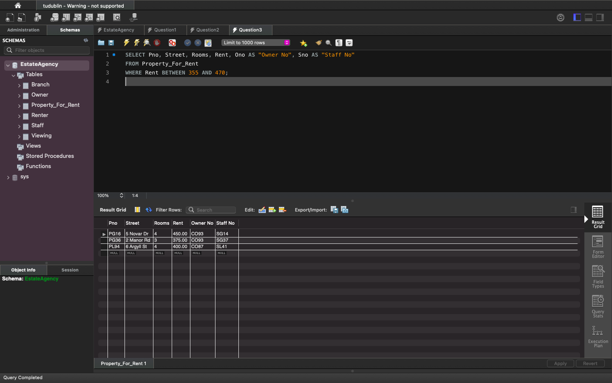 *Question 3 in Workbench: rent between 355 and 470.* |
| [`lab/solution/queries/Question4.sql`](lab/solution/queries/Question4.sql) | Question 4: the number of properties for rent. | 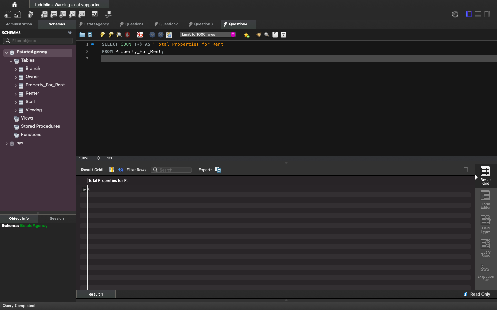 *Question 4 in Workbench: the number of properties for rent.* |
| [`lab/solution/queries/Question5.sql`](lab/solution/queries/Question5.sql) | Question 5: the property with the most rooms (ORDER BY with LIMIT 1). | 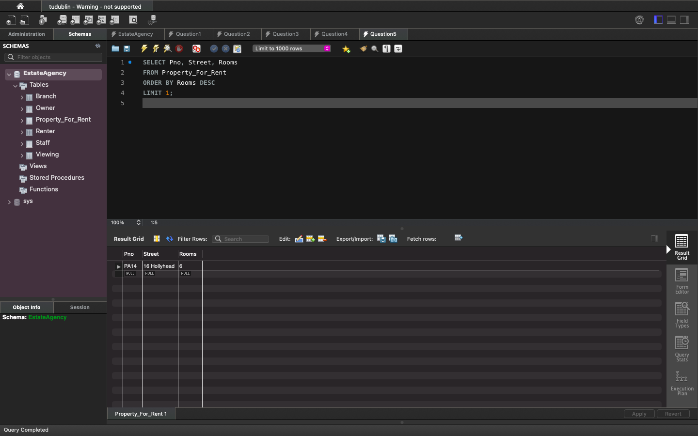 *Question 5 in Workbench: the property with the most rooms.* |
| [`lab/solution/queries/Question6.sql`](lab/solution/queries/Question6.sql) | Question 6: staff in branch B5. | 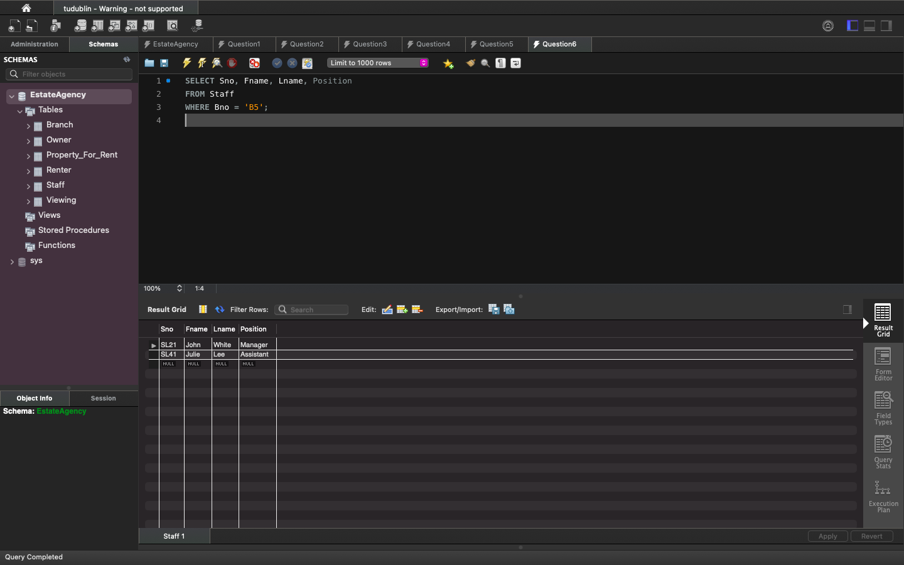 *Question 6 in Workbench: staff in branch B5.* |
| [`lab/solution/queries/Question7.sql`](lab/solution/queries/Question7.sql) | Question 7: the number of staff per branch. | 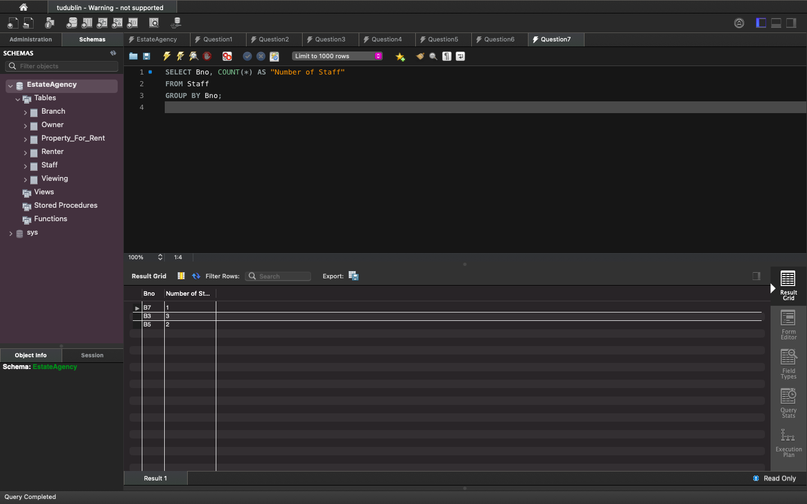 *Question 7 in Workbench: the number of staff per branch.* |
| [`lab/solution/queries/Question8.sql`](lab/solution/queries/Question8.sql) | Question 8: the number of viewings of property PA14. | 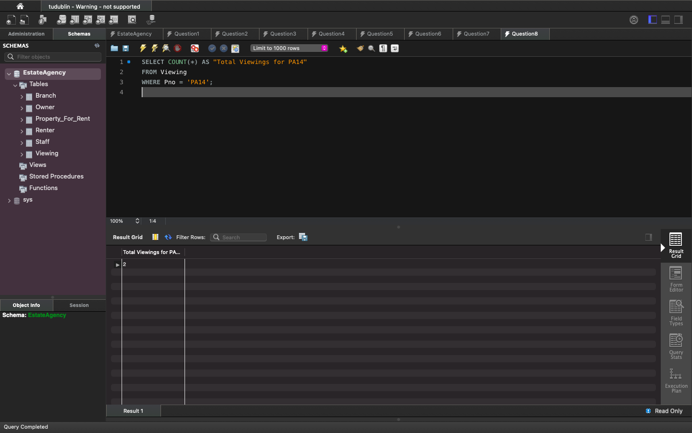 *Question 8 in Workbench: viewings of property PA14.* |
| [`lab/solution/queries/Question9.sql`](lab/solution/queries/Question9.sql) | Question 9: the total salary bill. | 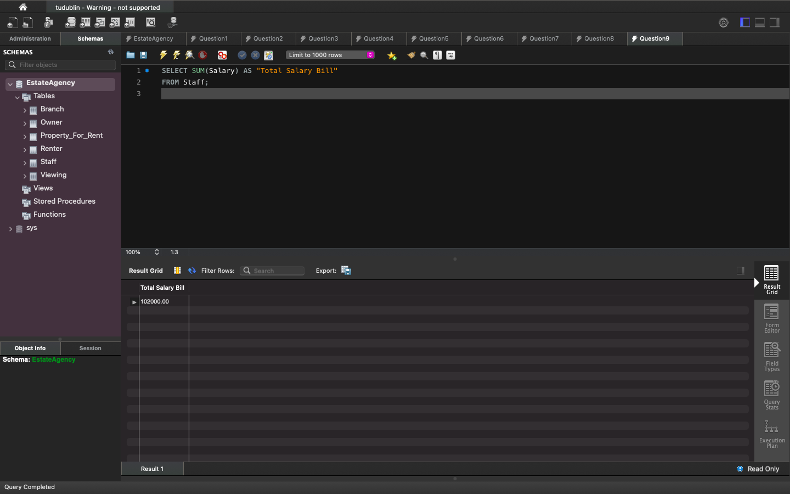 *Question 9 in Workbench: the total salary bill.* |
| [`lab/solution/queries/Question10.sql`](lab/solution/queries/Question10.sql) | Question 10: the highest paid staff member. | 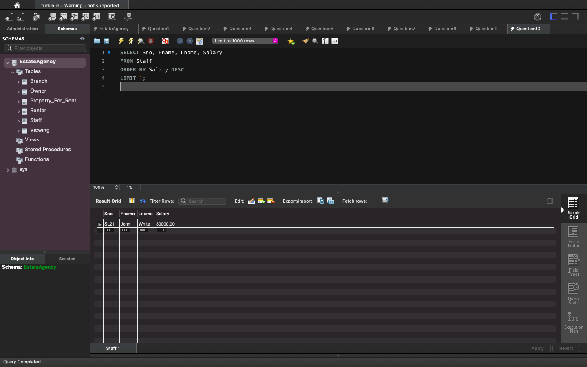 *Question 10 in Workbench: the highest paid staff member.* |
| [`lab/solution/queries/Question11.sql`](lab/solution/queries/Question11.sql) | Question 11: owners whose address does not contain Glasgow. | 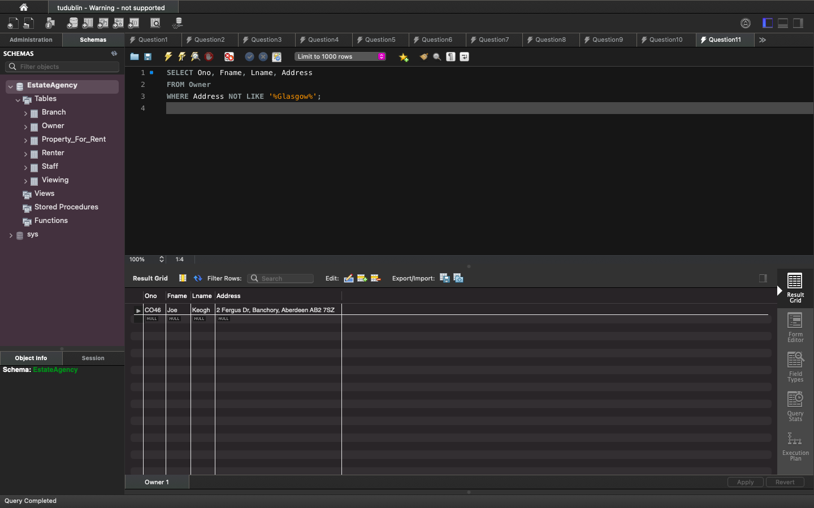 *Question 11 in Workbench: owners who do not live in Glasgow.* |
| [`lab/solution/queries/Question12.sql`](lab/solution/queries/Question12.sql) | Question 12: renter names with the property number and comment, by an inner join of renter and viewing. | 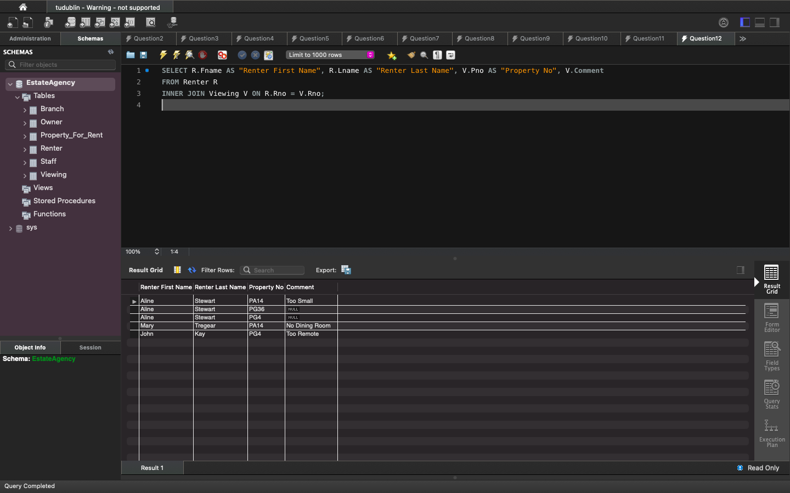 *Question 12 in Workbench: renters who viewed a property, with their comments.* |
| [`lab/teacher_solution/database_fundamentals_week10_lab_teacher_solution_1.pdf`](lab/teacher_solution/database_fundamentals_week10_lab_teacher_solution_1.pdf) | Lecturer's solution (2 pages): the Estate Agency tables and the SQL answers to the Lab Sheet 9 questions. | — |
| [`lab/teacher_solution/database_fundamentals_week10_lab_teacher_solution_2.pdf`](lab/teacher_solution/database_fundamentals_week10_lab_teacher_solution_2.pdf) | Lecturer's solution (4 pages, titled Lab 10 Solution): answers to 14 questions on the same tables, including three inner joins and a left join. | — |
| [`resources/exercises/exercise_3.pdf`](resources/exercises/exercise_3.pdf) | Exam exercise 3 (1 page): explain three anomalies of a table that is not in third normal form, and convert it to 1NF, 2NF and 3NF. | — |
| [`resources/exercises/exercise_3_solution.pdf`](resources/exercises/exercise_3_solution.pdf) | Solution to exam exercise 3 (4 pages): the anomalies and the three normal forms. | — |
