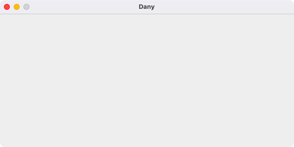
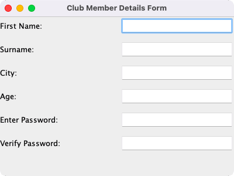
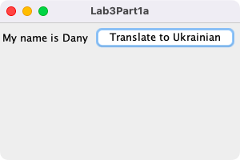
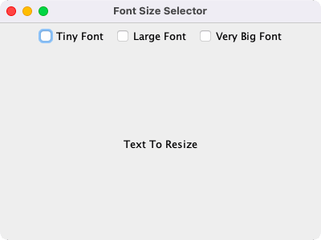
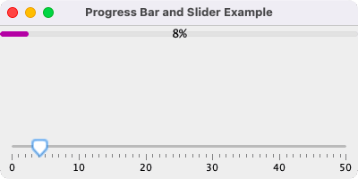
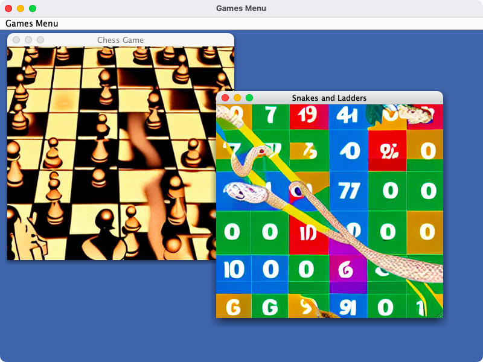

# GUI Programming

**Module:** GUI Programming (`COMP H2011`)  
**Semester:** 3 (Year 2), folder `sem03`  
**Lecturer:** Dr Luke Raeside  
**Date:** September - December 2024  
**Credits:** 5 ECTS  

## What this module is for

GUI Programming is a Java Swing module. The labs go from a JFrame with labels, buttons and text fields (lab 1) through layouts, lists, combo boxes and radio buttons (lab 2), listeners (lab 3), check boxes and menus (lab 4), a slider, a progress bar, CardLayout and BoxLayout (lab 5) to internal frames, mouse listeners, file and colour choosers, option dialogs and 2D graphics (lab 6). The week folders follow the ten lecture sessions, so the reading week (calendar week 7) is not counted; weeks 4, 8, 9 and 10 had a lecture but no lab sheet, and the folders of those weeks hold the lecture examples. The module is 100% continuous assessment: six lab sheets of 100 points each (10% of the grade each, self-assessed and then checked with the lecturer in the lab) and a one-day final assessment (40%) on 5 December 2024, a household cooker with sliders and a mouse events frame. The final assessment code is on the branch linked above. This folder has the lab sheets, the Java solutions with their images and screenshots, the lecturer's examples for each session, the assessment brief with its self-assessment sheet, and the individual lab assessment sheet.

## Grades Breakdown

| Assessment Type | Weighting |
|---|---|
| Labwork 1 to 6 (100 points each) | 10% each, 60% in total |
| Final Assessment (one day, 5 December 2024) | 40% |

### Verified self-assessment

The labs are self-assessed and then checked with the lab tutor. The steps of the weekly labwork assessment process:

1. Fill in the self-assessment when the work is complete (the claim section of the [individual lab assessment sheet](resources/gui_programming_individual_lab_assessment_sheet.pdf)).
2. Upload the work and the self-assessment sheet.
3. Meet the lab tutor and have the work assessed before the assessment deadline.

## Assessments

| File | What it contains |
|---|---|
| [`assessment/01/README.md`](assessment/01/README.md) | The README of Assessment 1: the final assessment (40%), its two questions, the Java project and the problem of the household cooker. |
| [`assessment/01/gui_programming_assessment.pdf`](assessment/01/gui_programming_assessment.pdf) | The final assessment brief (5 pages, 40%, upload by 23:59 on 5 December 2024): question 1, a household cooker in Swing with five cooking zones, a font size drop-down and a slider (0 to 10) per zone that makes the zone brighter red (30 marks); question 2, a label that shows an image and a border only while the mouse is inside it (10 marks). The instructions ask for two short videos (before coding and before submission) and give the late penalties. |
| [`assessment/01/submission/gui_programming_assessment_self_assessment.pdf`](assessment/01/submission/gui_programming_assessment_self_assessment.pdf) | The self-assessment sheet for the final assessment (1 page): the marks claimed for each marking point, with comments. |
| [`assessment/01/submission/src/`](assessment/01/submission/src/) | The Java project of the final assessment: [`HouseholdCooker.java`](assessment/01/submission/src/HouseholdCooker.java) (question 1), [`MouseEvents.java`](assessment/01/submission/src/MouseEvents.java) (question 2) and the image [`img/venus-de-milo.jpg`](assessment/01/submission/src/img/venus-de-milo.jpg). |
| [`assessment/01/submission/sketches/`](assessment/01/submission/sketches/) | The sketches of the two frames: [`household_cooker_sketch.png`](assessment/01/submission/sketches/household_cooker_sketch.png) and [`mouse_events_sketch.png`](assessment/01/submission/sketches/mouse_events_sketch.png). |

> [!WARNING]
> [`assessment/01/submission/gui_programming_assessment_self_assessment.pdf`](assessment/01/submission/gui_programming_assessment_self_assessment.pdf): The household cooker of question 1 has four cooking zones, where the brief asks for five. The comment on the sheet says that the code can be changed to five.

## All weeks

| Week | Title | Files | Screenshot |
|---|---|---|---|
| [Week 1](week01/) | Lab 1: JFrame, labels, buttons and text fields | [`lab/gui_programming_week01_lab.pdf`](week01/lab/gui_programming_week01_lab.pdf) [`lab/solution/Lab1Part1.java`](week01/lab/solution/Lab1Part1.java) [`lab/solution/Lab1Part2.java`](week01/lab/solution/Lab1Part2.java) [`lab/solution/Lab1Part3.java`](week01/lab/solution/Lab1Part3.java) [`lab/solution/Lab1Part4.java`](week01/lab/solution/Lab1Part4.java) [`lab/solution/img/`](week01/lab/solution/img/) [`resources/examples/`](week01/resources/examples/) |  |
| [Week 2](week02/) | Lab 2: fields, lists, combo boxes and layouts | [`lab/gui_programming_week02_lab.pdf`](week02/lab/gui_programming_week02_lab.pdf) [`lab/solution/Lab2Part1.java`](week02/lab/solution/Lab2Part1.java) [`lab/solution/Lab2Part2.java`](week02/lab/solution/Lab2Part2.java) [`lab/solution/Lab2Part3.java`](week02/lab/solution/Lab2Part3.java) [`lab/solution/Lab2Part4.java`](week02/lab/solution/Lab2Part4.java) [`resources/examples/`](week02/resources/examples/) |  |
| [Week 3](week03/) | Lab 3: events and listeners | [`lab/gui_programming_week03_lab.pdf`](week03/lab/gui_programming_week03_lab.pdf) [`lab/solution/Lab3Part1a.java`](week03/lab/solution/Lab3Part1a.java) [`lab/solution/Lab3Part1b.java`](week03/lab/solution/Lab3Part1b.java) [`lab/solution/Lab3Part2.java`](week03/lab/solution/Lab3Part2.java) [`lab/solution/Lab3Part3.java`](week03/lab/solution/Lab3Part3.java) [`lab/solution/Lab3Part4.java`](week03/lab/solution/Lab3Part4.java) [`lab/solution/img/`](week03/lab/solution/img/) [`resources/examples/`](week03/resources/examples/) |  |
| [Week 4](week04/) | Event handling (lecture only, no lab) | [`resources/examples/ComplexAction.java`](week04/resources/examples/ComplexAction.java) [`resources/examples/FirstAction.java`](week04/resources/examples/FirstAction.java) [`resources/examples/ItemAction.java`](week04/resources/examples/ItemAction.java) [`resources/examples/ListSelection.java`](week04/resources/examples/ListSelection.java) [`resources/examples/WindowEventDemo.java`](week04/resources/examples/WindowEventDemo.java) | — |
| [Week 5](week05/) | Lab 4: check boxes, menus and listeners | [`lab/gui_programming_week05_lab.pdf`](week05/lab/gui_programming_week05_lab.pdf) [`lab/solution/Lab4Part1.java`](week05/lab/solution/Lab4Part1.java) [`lab/solution/Lab4Part2.java`](week05/lab/solution/Lab4Part2.java) [`lab/solution/Lab4Part3.java`](week05/lab/solution/Lab4Part3.java) [`lab/solution/Lab4Part4.java`](week05/lab/solution/Lab4Part4.java) [`lab/solution/img/`](week05/lab/solution/img/) [`resources/examples/`](week05/resources/examples/) |  |
| [Week 6](week06/) | Lab 5: slider, progress bar, CardLayout and BoxLayout | [`lab/gui_programming_week06_lab.pdf`](week06/lab/gui_programming_week06_lab.pdf) [`lab/solution/Lab5Part1.java`](week06/lab/solution/Lab5Part1.java) [`lab/solution/Lab5Part2.java`](week06/lab/solution/Lab5Part2.java) [`lab/solution/Lab5Part3.java`](week06/lab/solution/Lab5Part3.java) [`lab/solution/Lab5Part4.java`](week06/lab/solution/Lab5Part4.java) [`lab/solution/img/`](week06/lab/solution/img/) [`resources/examples/`](week06/resources/examples/) |  |
| [Week 7](week07/) | Lab 6: internal frames, mouse, choosers, dialogs and 2D graphics | [`lab/gui_programming_week07_lab.pdf`](week07/lab/gui_programming_week07_lab.pdf) [`lab/solution/Lab6Part1.java`](week07/lab/solution/Lab6Part1.java) [`lab/solution/Lab6Part2.java`](week07/lab/solution/Lab6Part2.java) [`lab/solution/Lab6Part3.java`](week07/lab/solution/Lab6Part3.java) [`lab/solution/Lab6Part4.java`](week07/lab/solution/Lab6Part4.java) [`lab/solution/img/`](week07/lab/solution/img/) [`resources/examples/`](week07/resources/examples/) |  |
| [Week 8](week08/) | Choosers and mouse listeners (lecture only, no lab) | [`resources/examples/ColorAndFileChooserExample.java`](week08/resources/examples/ColorAndFileChooserExample.java) [`resources/examples/ColorChooserExample.java`](week08/resources/examples/ColorChooserExample.java) [`resources/examples/MouseListenExample.java`](week08/resources/examples/MouseListenExample.java) | — |
| [Week 9](week09/) | Dialogs (lecture only, no lab) | [`resources/examples/CustomDialog.java`](week09/resources/examples/CustomDialog.java) [`resources/examples/DialogDemo.java`](week09/resources/examples/DialogDemo.java) [`resources/examples/middle.gif`](week09/resources/examples/middle.gif) | — |
| [Week 10](week10/) | Graphics (lecture only, no lab) | [`resources/examples/ArcExample.java`](week10/resources/examples/ArcExample.java) [`resources/examples/BasicDrawer.java`](week10/resources/examples/BasicDrawer.java) [`resources/examples/DrawFrameOnly.java`](week10/resources/examples/DrawFrameOnly.java) [`resources/examples/DrawPolygons.java`](week10/resources/examples/DrawPolygons.java) [`resources/examples/LinesRectsOvals.java`](week10/resources/examples/LinesRectsOvals.java) [`resources/examples/ShowColors.java`](week10/resources/examples/ShowColors.java) [`resources/examples/ShowColors2.java`](week10/resources/examples/ShowColors2.java) | — |

## Resources

| File | What it contains |
|---|---|
| [`resources/gui_programming_individual_lab_assessment_sheet.pdf`](resources/gui_programming_individual_lab_assessment_sheet.pdf) | The individual lab assessment sheet filled in (1 page, PDF): for the four parts of each of labs 1 to 6 the marks available, the claim and the lecturer's final mark (600 of 600), which is 60% of the module with 40% remaining for the final assessment. |

### Schedule

The assessment breakdown and schedule of the module. The weeks are the calendar weeks of the semester, reading week included; the week folders of this module are numbered by lecture session, so the labs are linked by their number. The sheet prints 4 and 11 December as the dates of weeks 12 and 13; the table has the Mondays, 2 and 9 December.

| Week | Session | Week Date |
|---|---|---|
| Week 1 | Introduction (0%) | 16 September 2024 |
| Week 2 | Labwork 1 out (10%): [lab 1](week01/) | 23 September 2024 |
| Week 3 | Labwork 2 out (10%): [lab 2](week02/) | 30 September 2024 |
| Week 4 | Labwork 3 out (10%): [lab 3](week03/) | 7 October 2024 |
| Week 5 | Labwork 4 out (10%): [lab 4](week05/) Submission of labs 1 to 3, Sunday 20 October at 23:55 | 14 October 2024 |
| Week 6 | Labwork 5 out (10%): [lab 5](week06/) Assessment deadline for labs 1 to 3, by the end of the group lab in the week starting 21 October | 21 October 2024 |
| Week 7 | Reading week | 28 October 2024 |
| Week 8 | Labwork 6 out (10%): [lab 6](week07/) | 4 November 2024 |
| Week 9 | — | 11 November 2024 |
| Week 10 | Submission of labs 4 to 6, Sunday 24 November at 23:55 | 18 November 2024 |
| Week 11 | Assessment deadline 2 for labs 4 to 6, to be completed by the final lab session of the group | 25 November 2024 |
| Week 12 | Final assessment on Thursday 5 December: live on Brightspace at 09:00, submissions closed at 23:59 (40%): [the brief](assessment/01/gui_programming_assessment.pdf) | 2 December 2024 |
| Week 13 | — | 9 December 2024 |
