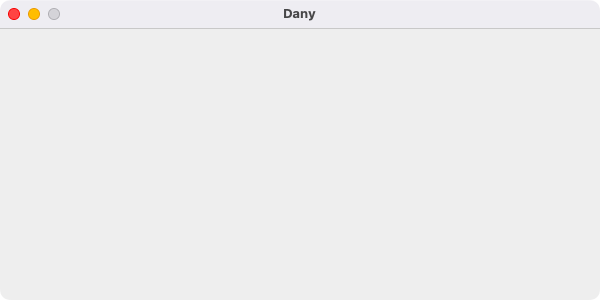
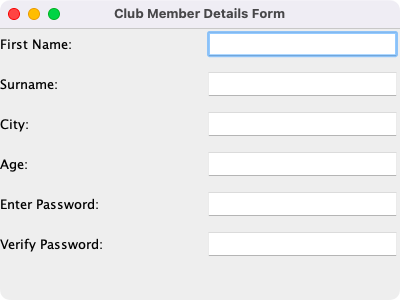
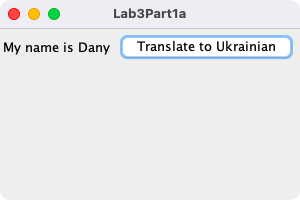
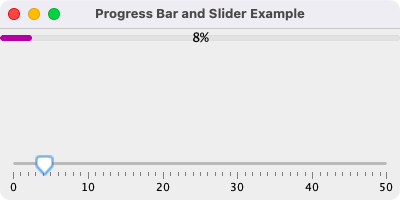
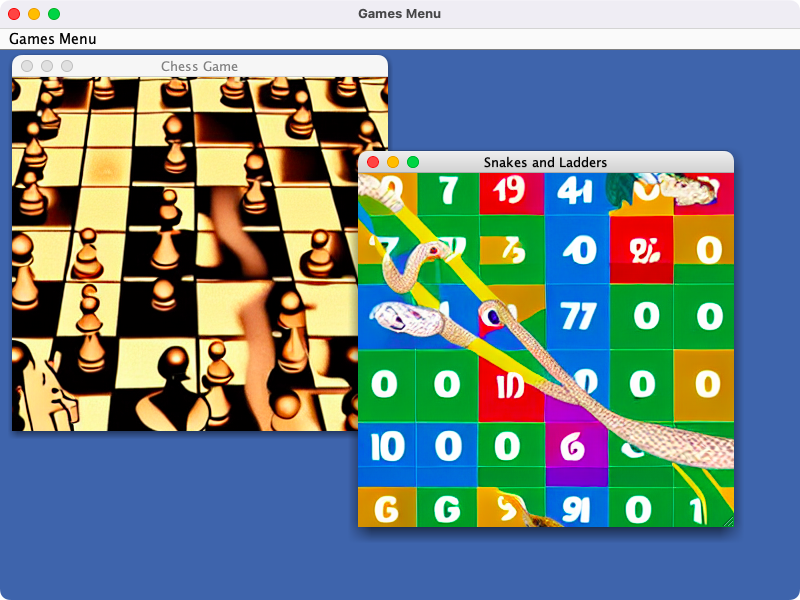
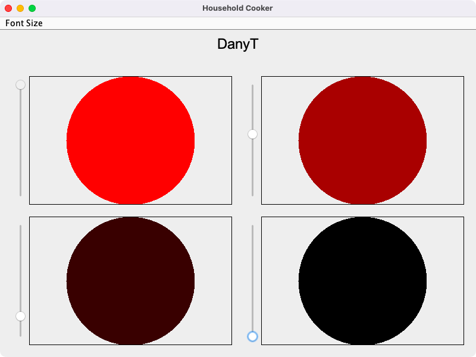
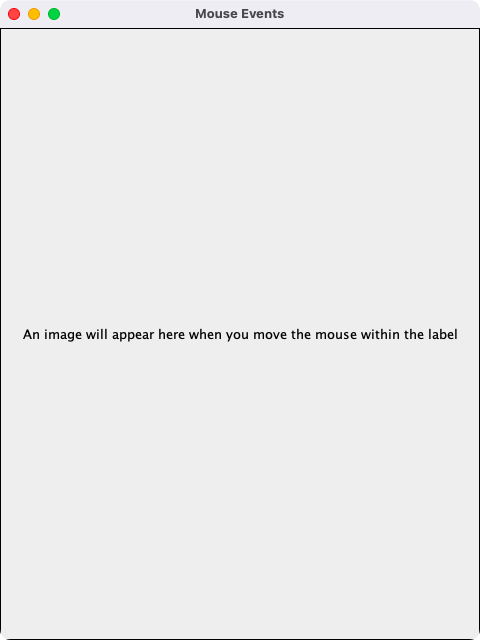
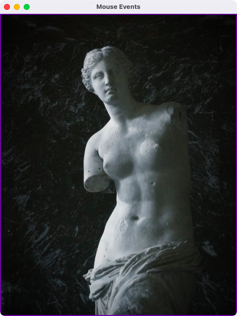

# GUI Programming

**Module:** GUI Programming (`COMP H2011`)  
**Semester:** 3 (Year 2), folder `sem03`  
**Lecturer:** Dr Luke Raeside  
**Date:** September - December 2024  
**Credits:** 5 ECTS  
**Matching project branch:** [`assessment/year02/module-gui_programming/household-cooker-and-mouse-events`](https://github.com/DanyilT/projects-in-university/tree/assessment/year02/module-gui_programming/household-cooker-and-mouse-events) (the final assessment: a household cooker and a mouse events frame)

## What this module is for

GUI Programming is a Java Swing module. The labs go from a JFrame with labels, buttons and text fields (lab 1) through layouts, lists, combo boxes and radio buttons (lab 2), listeners (lab 3), check boxes and menus (lab 4), a slider, a progress bar, CardLayout and BoxLayout (lab 5) to internal frames, mouse listeners, file and colour choosers, option dialogs and 2D graphics (lab 6). The week folders follow the ten lecture sessions, so the reading week (calendar week 7) is not counted; weeks 4, 8, 9 and 10 had a lecture but no lab sheet, and the folders of those weeks hold the lecture examples. The module is 100% continuous assessment: six lab sheets of 100 points each (10% of the grade each, self-assessed and then checked with the lecturer in the lab) and a one-day final assessment (40%) on 5 December 2024, a household cooker with sliders and a mouse events frame. The final assessment code is on the branch linked above. This folder has the lab sheets, the Java solutions with their images and screenshots, the lecturer's examples for each session, the assessment brief with its self-assessment sheet, and the assessment schedule.

## Grades Breakdown

| Assessment Type | Weighting |
|---|---|
| Labwork 1 to 6 (100 points each) | 10% each, 60% in total |
| Final Assessment (one day, 5 December 2024) | 40% |

## All weeks

| Week | Title | Files | Screenshot |
|---|---|---|---|
| [Week 1](week01/) | Lab 1: JFrame, labels, buttons and text fields | [`lab/gui_programming_week01_lab.pdf`](week01/lab/gui_programming_week01_lab.pdf) [`lab/solution/Lab1Part1.java`](week01/lab/solution/Lab1Part1.java) [`lab/solution/Lab1Part2.java`](week01/lab/solution/Lab1Part2.java) [`lab/solution/Lab1Part3.java`](week01/lab/solution/Lab1Part3.java) [`lab/solution/Lab1Part4.java`](week01/lab/solution/Lab1Part4.java) [`lab/solution/img/`](week01/lab/solution/img/) [`resources/examples/`](week01/resources/examples/) |  |
| [Week 2](week02/) | Lab 2: fields, lists, combo boxes and layouts | [`lab/gui_programming_week02_lab.pdf`](week02/lab/gui_programming_week02_lab.pdf) [`lab/solution/Lab2Part1.java`](week02/lab/solution/Lab2Part1.java) [`lab/solution/Lab2Part2.java`](week02/lab/solution/Lab2Part2.java) [`lab/solution/Lab2Part3.java`](week02/lab/solution/Lab2Part3.java) [`lab/solution/Lab2Part4.java`](week02/lab/solution/Lab2Part4.java) [`resources/examples/`](week02/resources/examples/) |  |
| [Week 3](week03/) | Lab 3: events and listeners | [`lab/gui_programming_week03_lab.pdf`](week03/lab/gui_programming_week03_lab.pdf) [`lab/solution/Lab3Part1a.java`](week03/lab/solution/Lab3Part1a.java) [`lab/solution/Lab3Part1b.java`](week03/lab/solution/Lab3Part1b.java) [`lab/solution/Lab3Part2.java`](week03/lab/solution/Lab3Part2.java) [`lab/solution/Lab3Part3.java`](week03/lab/solution/Lab3Part3.java) [`lab/solution/Lab3Part4.java`](week03/lab/solution/Lab3Part4.java) [`lab/solution/img/`](week03/lab/solution/img/) [`resources/examples/`](week03/resources/examples/) |  |
| [Week 4](week04/) | Event handling (lecture only, no lab) | [`resources/examples/ComplexAction.java`](week04/resources/examples/ComplexAction.java) [`resources/examples/FirstAction.java`](week04/resources/examples/FirstAction.java) [`resources/examples/ItemAction.java`](week04/resources/examples/ItemAction.java) [`resources/examples/ListSelection.java`](week04/resources/examples/ListSelection.java) [`resources/examples/WindowEventDemo.java`](week04/resources/examples/WindowEventDemo.java) | — |
| [Week 5](week05/) | Lab 4: check boxes, menus and listeners | [`lab/gui_programming_week05_lab.pdf`](week05/lab/gui_programming_week05_lab.pdf) [`lab/solution/Lab4Part1.java`](week05/lab/solution/Lab4Part1.java) [`lab/solution/Lab4Part2.java`](week05/lab/solution/Lab4Part2.java) [`lab/solution/Lab4Part3.java`](week05/lab/solution/Lab4Part3.java) [`lab/solution/Lab4Part4.java`](week05/lab/solution/Lab4Part4.java) [`lab/solution/img/`](week05/lab/solution/img/) [`resources/examples/`](week05/resources/examples/) |  |
| [Week 6](week06/) | Lab 5: slider, progress bar, CardLayout and BoxLayout | [`lab/gui_programming_week06_lab.pdf`](week06/lab/gui_programming_week06_lab.pdf) [`lab/solution/Lab5Part1.java`](week06/lab/solution/Lab5Part1.java) [`lab/solution/Lab5Part2.java`](week06/lab/solution/Lab5Part2.java) [`lab/solution/Lab5Part3.java`](week06/lab/solution/Lab5Part3.java) [`lab/solution/Lab5Part4.java`](week06/lab/solution/Lab5Part4.java) [`lab/solution/img/`](week06/lab/solution/img/) [`resources/examples/`](week06/resources/examples/) |  |
| [Week 7](week07/) | Lab 6: internal frames, mouse, choosers, dialogs and 2D graphics | [`lab/gui_programming_week07_lab.pdf`](week07/lab/gui_programming_week07_lab.pdf) [`lab/solution/Lab6Part1.java`](week07/lab/solution/Lab6Part1.java) [`lab/solution/Lab6Part2.java`](week07/lab/solution/Lab6Part2.java) [`lab/solution/Lab6Part3.java`](week07/lab/solution/Lab6Part3.java) [`lab/solution/Lab6Part4.java`](week07/lab/solution/Lab6Part4.java) [`lab/solution/img/`](week07/lab/solution/img/) [`resources/examples/`](week07/resources/examples/) |  |
| [Week 8](week08/) | Choosers and mouse listeners (lecture only, no lab) | [`resources/examples/ColorAndFileChooserExample.java`](week08/resources/examples/ColorAndFileChooserExample.java) [`resources/examples/ColorChooserExample.java`](week08/resources/examples/ColorChooserExample.java) [`resources/examples/MouseListenExample.java`](week08/resources/examples/MouseListenExample.java) | — |
| [Week 9](week09/) | Dialogs (lecture only, no lab) | [`resources/examples/CustomDialog.java`](week09/resources/examples/CustomDialog.java) [`resources/examples/DialogDemo.java`](week09/resources/examples/DialogDemo.java) [`resources/examples/middle.gif`](week09/resources/examples/middle.gif) | — |
| [Week 10](week10/) | Graphics (lecture only, no lab) | [`resources/examples/ArcExample.java`](week10/resources/examples/ArcExample.java) [`resources/examples/BasicDrawer.java`](week10/resources/examples/BasicDrawer.java) [`resources/examples/DrawFrameOnly.java`](week10/resources/examples/DrawFrameOnly.java) [`resources/examples/DrawPolygons.java`](week10/resources/examples/DrawPolygons.java) [`resources/examples/LinesRectsOvals.java`](week10/resources/examples/LinesRectsOvals.java) [`resources/examples/ShowColors.java`](week10/resources/examples/ShowColors.java) [`resources/examples/ShowColors2.java`](week10/resources/examples/ShowColors2.java) | — |

## Assessments and other files

| File | What it contains |
|---|---|
| [`assessment/01/gui_programming_assessment.pdf`](assessment/01/gui_programming_assessment.pdf) | The final assessment brief (5 pages, 40%, upload by 23:59 on 5 December 2024): question 1, a household cooker in Swing with five cooking zones, a font size drop-down and a slider (0 to 10) per zone that makes the zone brighter red (30 marks); question 2, a label that shows an image and a border only while the mouse is inside it (10 marks). The instructions ask for two short videos (before coding and before submission) and give the late penalties. |
| [`assessment/01/submission/gui_programming_assessment_self_assessment.pdf`](assessment/01/submission/gui_programming_assessment_self_assessment.pdf) | The self-assessment sheet for the final assessment (1 page): the marks claimed for each marking point, with comments. |
| [`assessment/01/submission/project_link.txt`](assessment/01/submission/project_link.txt) | Two lines: the GitHub link to the final assessment on its branch, and the branch name. The branch has HouseholdCooker.java, MouseEvents.java, the image and two sketches. |
| [`resources/gui_programming_assessment_schedule.pdf`](resources/gui_programming_assessment_schedule.pdf) | The assessment breakdown and schedule (1 page): labs 1 to 6 out in weeks 2 to 6 and 8 (10% each), the submission and assessment deadlines, and the final assessment on 5 December (40%). |
| [`resources/gui_programming_individual_lab_assessment_sheet.xlsx`](resources/gui_programming_individual_lab_assessment_sheet.xlsx) | The blank individual lab assessment sheet (Excel): for each lab part, the marks available and columns for the student claim, the lecturer mark and comments. |
| [`resources/gui_programming_individual_lab_assessment_sheet_filled.pdf`](resources/gui_programming_individual_lab_assessment_sheet_filled.pdf) | The lab assessment sheet filled in (1 page, PDF): the marks available and claimed for the parts of the labs. |
| [`resources/verified_self_assessment.png`](resources/verified_self_assessment.png) | A flowchart of the lab self-assessment steps: fill in the self-assessment, upload the work and the sheet, have it assessed by the lecturer before the deadline, and check the CA assessment status through a OneDrive link. |

> [!WARNING]
> [`assessment/01/submission/gui_programming_assessment_self_assessment.pdf`](assessment/01/submission/gui_programming_assessment_self_assessment.pdf): The household cooker of question 1 has four cooking zones, where the brief asks for five. The comment on the sheet says that the code can be changed to five.

### Screenshots

*Question 1: the household cooker with a Font Size menu and four zones, each with a slider.*

*Question 2: the mouse events frame with the original text.*

*Question 2: the image and the border shown while the mouse is inside the label.*
