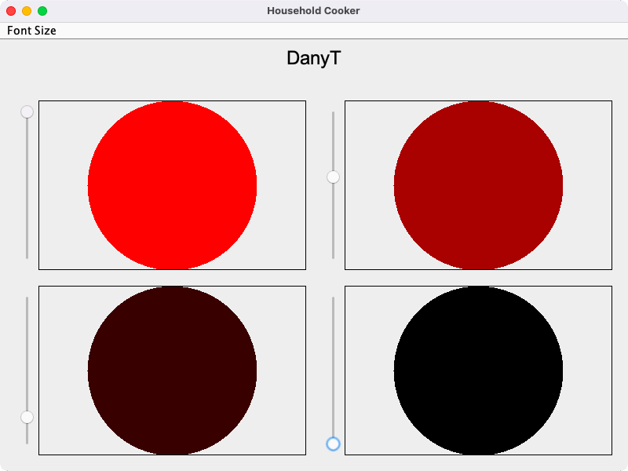
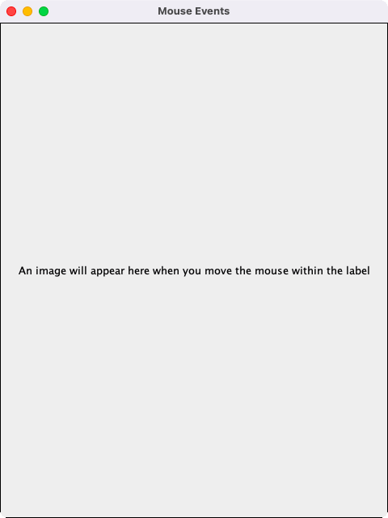
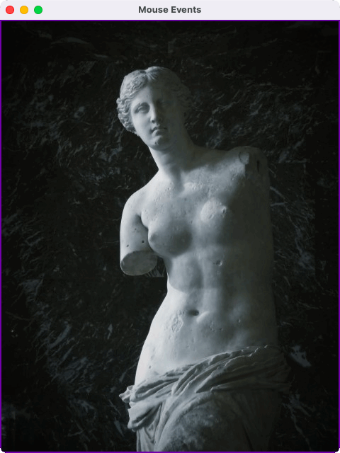

# Assessment 1: Household cooker and mouse events

**Module:** GUI Programming (`COMP H2011`)  
**Semester:** 3 (Year 2), folder `sem03`  
**Type:** assessment, individual  
**Weight:** 40%  
**Deadline:** 23:59 on 5 December 2024  
**Result:** —  
**On main:** [`sem03/gui_programming/assessment/01/`](https://github.com/DanyilT/projects-in-university/tree/main/sem03/gui_programming/assessment/01) (the brief, the self-assessment sheet, the Java project and this README)  
**Branch:** —  
**Repository:** —

[Module README](../../README.md)

## What this assessment is for

The brief (5 pages) has two questions. Question 1 (30 marks) is a household cooker in Swing: five cooking zones, a font size drop-down and a slider (0 to 10) per zone that makes the zone brighter red. Question 2 (10 marks) is a label that shows an image and a border only while the mouse is inside it. The instructions ask for two short videos (before coding and before submission) and give the late penalties.

The submission is the Java project: [`HouseholdCooker.java`](submission/src/HouseholdCooker.java) for question 1, [`MouseEvents.java`](submission/src/MouseEvents.java) for question 2 with the image [`venus-de-milo.jpg`](submission/src/img/venus-de-milo.jpg), two hand-drawn sketches of the frames, and the self-assessment sheet with the marks claimed for each marking point.

> [!WARNING]
> [`submission/src/HouseholdCooker.java`](submission/src/HouseholdCooker.java#L42): The household cooker of question 1 has four cooking zones, where the brief asks for five. The comments in the code and the comment on the self-assessment sheet say that it can be changed to five.

## Files

| File | What it contains | Screenshot |
|---|---|---|
| [`README.md`](README.md) | This README. | — |
| [`gui_programming_assessment.pdf`](gui_programming_assessment.pdf) | The final assessment brief (5 pages, 40%, upload by 23:59 on 5 December 2024): question 1, a household cooker in Swing with five cooking zones, a font size drop-down and a slider (0 to 10) per zone that makes the zone brighter red (30 marks); question 2, a label that shows an image and a border only while the mouse is inside it (10 marks). The instructions ask for two short videos (before coding and before submission) and give the late penalties. | — |
| [`submission/gui_programming_assessment_self_assessment.pdf`](submission/gui_programming_assessment_self_assessment.pdf) | The self-assessment sheet for the final assessment (1 page): the marks claimed for each marking point, with comments. | — |
| [`submission/src/HouseholdCooker.java`](submission/src/HouseholdCooker.java) | Question 1: a JFrame with a Font Size menu and the cooking zones, each with a slider that makes the zone brighter red. | <br>*Question 1: the household cooker with a Font Size menu and four zones, each with a slider.* |
| [`submission/src/MouseEvents.java`](submission/src/MouseEvents.java) | Question 2: a frame with a label that shows the image and a border while the mouse is inside it. | <br>*Question 2: the mouse events frame with the original text.*<br><br>*Question 2: the image and the border shown while the mouse is inside the label.* |
| [`submission/src/img/venus-de-milo.jpg`](submission/src/img/venus-de-milo.jpg) | The image of question 2, Venus de Milo (52 KB). | — |
| [`submission/sketches/household_cooker_sketch.png`](submission/sketches/household_cooker_sketch.png) | The sketch of the household cooker frame. | — |
| [`submission/sketches/mouse_events_sketch.png`](submission/sketches/mouse_events_sketch.png) | The sketch of the mouse events frame. | — |

## How to run

The project needs a JDK. MouseEvents reads the image through the relative path img/venus-de-milo.jpg, so both programs run from the folder src:

```sh
cd submission/src
javac HouseholdCooker.java MouseEvents.java
java HouseholdCooker
java MouseEvents
```
