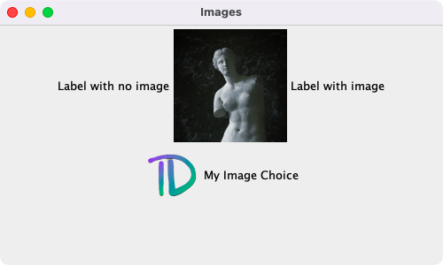
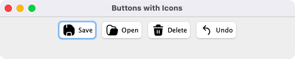
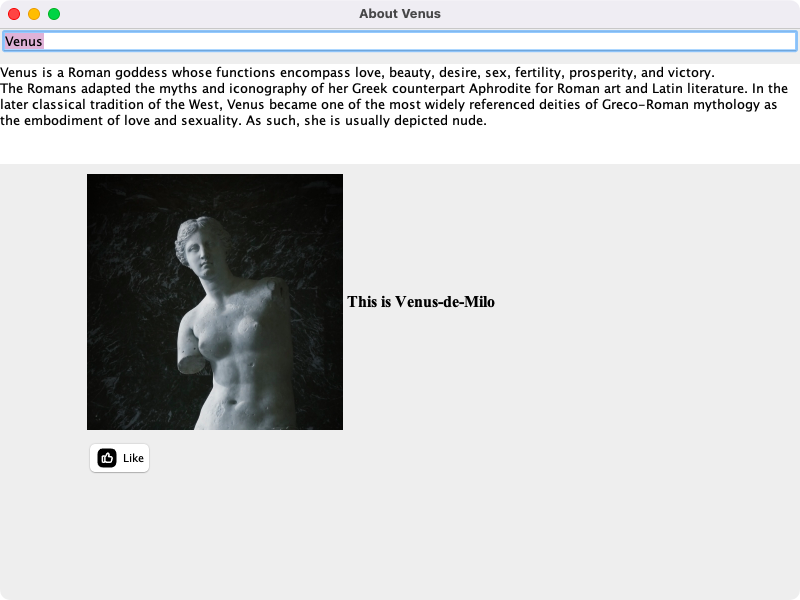

# Week 01 — Lab 1: JFrame, labels, buttons and text fields

**Module:** GUI Programming (`COMP H2011`)  
**Semester:** 3 (Year 2), folder `sem03`

[Module README](../README.md)

## What this week is for

Lab 1 (Frame, Button, Fields) creates the first Swing windows in four parts: a blank JFrame with set properties (size, location, title, not resizable), a panel with three labels (without an image, with an image and with a personal image), four buttons with newly drawn icons (Save, Open, Delete and Undo), and an About frame with a text field, a text area, a picture label and a Like button. The lecture was the introduction to GUI design and Swing. The resources are the small demos that the lab groups wrote in the lab.

## Files

| File | What it contains | Screenshot |
|---|---|---|
| [`README.md`](README.md) | This README. | — |
| [`lab/gui_programming_week01_lab.pdf`](lab/gui_programming_week01_lab.pdf) | The lab sheet (3 pages): Labwork 1, 100 points in four parts (20, 20, 30 and 30) with the marking guide of each part. | — |
| [`lab/solution/Lab1Part1.java`](lab/solution/Lab1Part1.java) | Part 1: a blank JFrame, 600 by 300 pixels, with a location, a title, not resizable and a contentPane variable. |  *Part 1: the blank frame, titled with a name.* |
| [`lab/solution/Lab1Part2.java`](lab/solution/Lab1Part2.java) | Part 2: a JPanel with three JLabels: text only, text with an image, and a personal image with its own text. |  *Part 2: three labels in a panel.* |
| [`lab/solution/Lab1Part3.java`](lab/solution/Lab1Part3.java) | Part 3: a panel with four JButtons (Save, Open, Delete and Undo), each with an icon. |  *Part 3: Save, Open, Delete and Undo buttons with icons.* |
| [`lab/solution/Lab1Part4.java`](lab/solution/Lab1Part4.java) | Part 4: an About Venus frame in a BoxLayout panel: a text field, a text area with a description, a picture label with the text This is Venus-de-Milo, and a Like button with a thumbs-up icon. |  *Part 4: the About Venus frame.* |
| [`lab/solution/img/Part2/img2.png`](lab/solution/img/Part2/img2.png) | Part 2: the personal image of the third label (a small logo). | — |
| [`lab/solution/img/Part2/venus-de-milo.jpg`](lab/solution/img/Part2/venus-de-milo.jpg) | Part 2: the picture of the second label. | — |
| [`lab/solution/img/Part3/Delete.png`](lab/solution/img/Part3/Delete.png) | Part 3: the Delete button icon. | — |
| [`lab/solution/img/Part3/Open.png`](lab/solution/img/Part3/Open.png) | Part 3: the Open button icon. | — |
| [`lab/solution/img/Part3/Save.png`](lab/solution/img/Part3/Save.png) | Part 3: the Save button icon. | — |
| [`lab/solution/img/Part3/Undo.png`](lab/solution/img/Part3/Undo.png) | Part 3: the Undo button icon. | — |
| [`lab/solution/img/Part4/ThumbUp.png`](lab/solution/img/Part4/ThumbUp.png) | Part 4: the Like button icon. | — |
| [`lab/solution/img/Part4/venus-de-milo.jpg`](lab/solution/img/Part4/venus-de-milo.jpg) | Part 4: the picture in the About Venus frame. | — |
| [`resources/examples/Group1Week1.java`](resources/examples/Group1Week1.java) | Lab group demo: a frame with a Hello Group 1 button in a panel at the top. | — |
| [`resources/examples/Group6Week1.java`](resources/examples/Group6Week1.java) | Lab group demo: a frame with a Push Me button in a panel. | — |
| [`resources/examples/Week1Frame.java`](resources/examples/Week1Frame.java) | Lab group demo: a frame with a Hello Group 7 button in a panel. | — |
| [`resources/examples/Week1Group3.java`](resources/examples/Week1Group3.java) | Lab group demo: a frame with a Click Here button and a label with a picture. | — |
