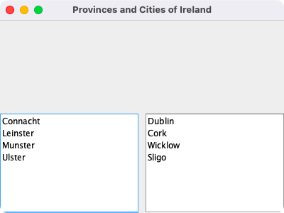
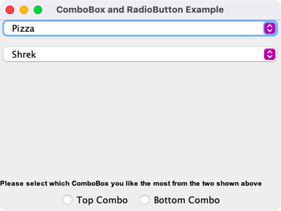
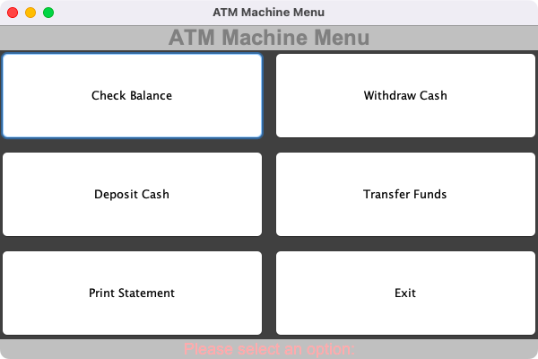

# Week 02 — Lab 2: fields, lists, combo boxes and layouts

**Module:** GUI Programming (`COMP H2011`)  
**Semester:** 3 (Year 2), folder `sem03`

[Module README](../README.md)

## What this week is for

Lab 2 (Fields, Combos, Lists, Layouts) has four parts: a club member form with labels, text fields and two password fields; two JLists side by side (the provinces of Ireland and four towns); two JComboBoxes with two JRadioButtons in a ButtonGroup and a bold label; and an ATM menu made of six buttons and labels with layout managers, colours and images. The lecture was basic GUI with Swing, with examples of frames, labels, buttons and text fields. The resources are those examples and the lab group demos.

## Files

| File | What it contains | Screenshot |
|---|---|---|
| [`README.md`](README.md) | This README. | — |
| [`lab/gui_programming_week02_lab.pdf`](lab/gui_programming_week02_lab.pdf) | The lab sheet (3 pages): Labwork 2, 100 points in four parts (20, 20, 30 and 30). | — |
| [`lab/solution/Lab2Part1.java`](lab/solution/Lab2Part1.java) | Part 1: a club member form in a GridLayout panel: labels with four text fields and the Enter Password and Verify Password fields (JPasswordField). |  *Part 1: the club member details form.* |
| [`lab/solution/Lab2Part2.java`](lab/solution/Lab2Part2.java) | Part 2: two JLists in scroll panes, side by side at the bottom of the frame: the four provinces and four towns. |  *Part 2: the provinces and cities lists side by side.* |
| [`lab/solution/Lab2Part3.java`](lab/solution/Lab2Part3.java) | Part 3: two JComboBoxes at the top (Pizza and Shrek among the choices), a bold label, and the Top Combo and Bottom Combo radio buttons in a ButtonGroup. |  *Part 3: two combo boxes and the Top Combo and Bottom Combo radio buttons.* |
| [`lab/solution/Lab2Part4.java`](lab/solution/Lab2Part4.java) | Part 4: an ATM Machine Menu: six buttons (Check Balance, Withdraw Cash, Deposit Cash, Transfer Funds, Print Statement, Exit) in a GridLayout, with title and message labels in a BorderLayout. |  *Part 4: the ATM machine menu with six buttons.* |
| [`resources/examples/ButtonFrame.java`](resources/examples/ButtonFrame.java) | Lecture example: a frame titled Button Sample with a button in a panel. | — |
| [`resources/examples/ButtonIcon.java`](resources/examples/ButtonIcon.java) | Lecture example: a frame titled Button with Icon with a button that has an icon. | — |
| [`resources/examples/FirstTestFrame.java`](resources/examples/FirstTestFrame.java) | Lecture example: the smallest frame (titled FirstFrame). | — |
| [`resources/examples/Kenno.jpg`](resources/examples/Kenno.jpg) | A photograph used by the examples as a label picture. | — |
| [`resources/examples/LabelFrame.java`](resources/examples/LabelFrame.java) | Lecture example: a frame titled My Label Frame with labels in a panel. | — |
| [`resources/examples/Lecture2Frame.java`](resources/examples/Lecture2Frame.java) | Lecture example: a frame titled Brian Frame with labels and text fields in panels. | — |
| [`resources/examples/TextDemo.java`](resources/examples/TextDemo.java) | Lecture example: a text field and a text area in a scroll pane (the title string is Button with Icon, copied from ButtonIcon). | — |
| [`resources/examples/bug1.GIF`](resources/examples/bug1.GIF) | A small GIF used as an icon by the examples. | — |
| [`resources/examples/Group1Week2.java`](resources/examples/Group1Week2.java) | Lab group demo: a Raeside Med Center form with name and age fields and a text area. | — |
| [`resources/examples/Group6Week2.java`](resources/examples/Group6Week2.java) | Lab group demo: a banner, name and age fields and a cover letter text area. | — |
| [`resources/examples/Group7Week2.java`](resources/examples/Group7Week2.java) | Lab group demo: a Premier League Live Match frame with a result and commentary. | — |
