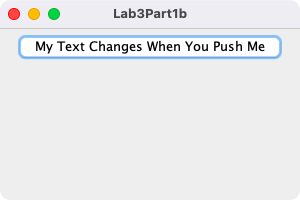
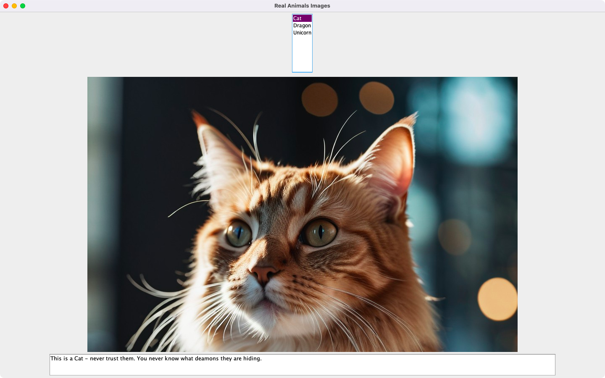
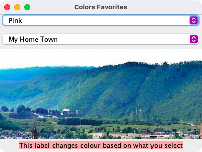
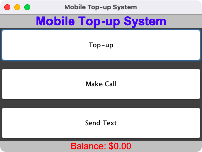

# Week 03 — Lab 3: events and listeners

**Module:** GUI Programming (`COMP H2011`)  
**Semester:** 3 (Year 2), folder `sem03`

[Module README](../README.md)

## What this week is for

Lab 3 (Events) adds listeners in four parts: a button that changes a label (part 1a, a translation to Ukrainian) and a button whose own text changes (part 1b); a JList with a listener that shows a picture and a description for each of three animals; two JComboBoxes that change a picture and the colour of a label; and a first full working GUI, a mobile top-up system with Top-up, Make Call and Send Text buttons and a balance label. The lecture was more Swing components (check boxes, radio buttons, lists, combo boxes) and layout managers. The resources are the lecture examples and the lab group demos.

## Files

| File | What it contains | Screenshot |
|---|---|---|
| [`README.md`](README.md) | This README. | — |
| [`lab/gui_programming_week03_lab.pdf`](lab/gui_programming_week03_lab.pdf) | The lab sheet (3 pages): Labwork 3, 100 points in four parts (20, 20, 30 and 30). The topic line is the one of lab 2; the parts are about listeners. | — |
| [`lab/solution/Lab3Part1a.java`](lab/solution/Lab3Part1a.java) | Part 1a: a frame with a label and a Translate to Ukrainian button that changes the label text. |  *Part 1a: the label and the Translate to Ukrainian button.* |
| [`lab/solution/Lab3Part1b.java`](lab/solution/Lab3Part1b.java) | Part 1b: a frame with one button whose text changes when it is pushed. |  *Part 1b: the button with changing text.* |
| [`lab/solution/Lab3Part2.java`](lab/solution/Lab3Part2.java) | Part 2: a JList of three animals with a mouse listener that shows a picture and a description of the chosen animal. |  *Part 2: the list of animals with a picture and a description.* |
| [`lab/solution/Lab3Part3.java`](lab/solution/Lab3Part3.java) | Part 3: two JComboBoxes (colours and places) with action listeners that change a picture and the colour of a label. |  *Part 3: two combo boxes with a picture and a label that changes colour.* |
| [`lab/solution/Lab3Part4.java`](lab/solution/Lab3Part4.java) | Part 4: the Mobile Top-up System: Top-up, Make Call and Send Text buttons with action listeners and a balance label. |  *Part 4: the Mobile Top-up System.* |
| [`lab/solution/img/Part2/Cat-stablediffusion.jpg`](lab/solution/img/Part2/Cat-stablediffusion.jpg) | Part 2: the picture of the cat. | — |
| [`lab/solution/img/Part2/Dragon-stablediffusion.jpg`](lab/solution/img/Part2/Dragon-stablediffusion.jpg) | Part 2: the picture of the dragon. | — |
| [`lab/solution/img/Part2/Unicorn-stablediffusion.jpg`](lab/solution/img/Part2/Unicorn-stablediffusion.jpg) | Part 2: the picture of the unicorn. | — |
| [`lab/solution/img/Part3/Dream Car-stablediffusion.png`](lab/solution/img/Part3/Dream%20Car-stablediffusion.png) | Part 3: the Dream Car picture. | — |
| [`lab/solution/img/Part3/Dream Home-stablediffusion.png`](lab/solution/img/Part3/Dream%20Home-stablediffusion.png) | Part 3: the Dream Home picture. | — |
| [`lab/solution/img/Part3/Dream Job-stablediffusion.png`](lab/solution/img/Part3/Dream%20Job-stablediffusion.png) | Part 3: the Dream Job picture. | — |
| [`lab/solution/img/Part3/Favourite Team-stablediffusion.png`](lab/solution/img/Part3/Favourite%20Team-stablediffusion.png) | Part 3: the Favourite Team picture. | — |
| [`lab/solution/img/Part3/My Home Town-stablediffusion.png`](lab/solution/img/Part3/My%20Home%20Town-stablediffusion.png) | Part 3: the My Home Town picture. | — |
| [`resources/examples/BorderWindow.java`](resources/examples/BorderWindow.java) | Lecture example: BorderLayout with a button in each of the five regions. | — |
| [`resources/examples/Check.java`](resources/examples/Check.java) | Lecture example: a check box in a panel. | — |
| [`resources/examples/CheckBoxTest.java`](resources/examples/CheckBoxTest.java) | Lecture example: check boxes with an item listener that changes the style of a text field. | — |
| [`resources/examples/Combo.java`](resources/examples/Combo.java) | Lecture example: a combo box filled in a loop. | — |
| [`resources/examples/Combo_Java_1_7.java`](resources/examples/Combo_Java_1_7.java) | The same example written for Java 1.7 (a typed combo box). | — |
| [`resources/examples/FlowWindow.java`](resources/examples/FlowWindow.java) | Lecture example: FlowLayout with five buttons. | — |
| [`resources/examples/GiantButtonNoLayout.java`](resources/examples/GiantButtonNoLayout.java) | Lecture example: a button with no layout manager. | — |
| [`resources/examples/GridWindow.java`](resources/examples/GridWindow.java) | Lecture example: GridLayout with five buttons. | — |
| [`resources/examples/Lecture3.java`](resources/examples/Lecture3.java) | Lecture example: check boxes, radio buttons, a combo box and a list in a FlowLayout and a GridLayout. | — |
| [`resources/examples/Password.java`](resources/examples/Password.java) | Lecture example: a password field. | — |
| [`resources/examples/Radio.java`](resources/examples/Radio.java) | Lecture example: radio buttons in a panel. | — |
| [`resources/examples/RadioButtonTest.java`](resources/examples/RadioButtonTest.java) | Lecture example: radio buttons with an item listener that changes the style of a text field. | — |
| [`resources/examples/RadioGroup.java`](resources/examples/RadioGroup.java) | Lecture example: radio buttons in a button group, so only one can be selected. | — |
| [`resources/examples/SimpleList.java`](resources/examples/SimpleList.java) | Lecture example: a list in a scroll pane. | — |
| [`resources/examples/SimpleList_Java_1_7.java`](resources/examples/SimpleList_Java_1_7.java) | The same example written for Java 1.7 (a typed list). | — |
| [`resources/examples/Week3Group1.java`](resources/examples/Week3Group1.java) | Lab group demo: a combo box of holidays and a list of activities in a FlowLayout and a GridLayout. | — |
| [`resources/examples/Week3Group6.java`](resources/examples/Week3Group6.java) | Lab group demo: a combo box of streets and a list of cities in a GridLayout. | — |
| [`resources/examples/Week3Group7.java`](resources/examples/Week3Group7.java) | Lab group demo: a combo box of labs and a list of groups in a FlowLayout. | — |
