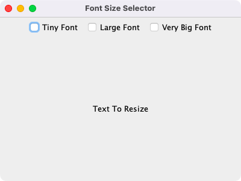
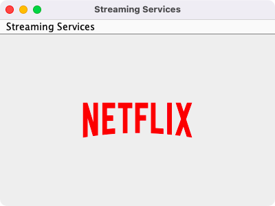
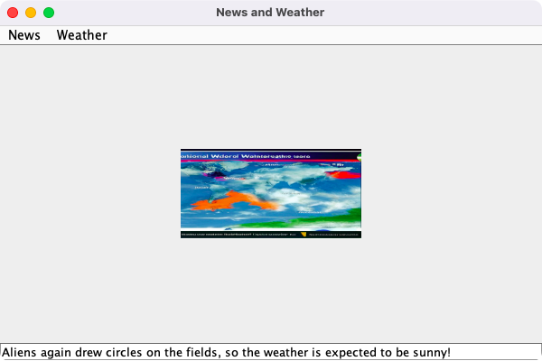
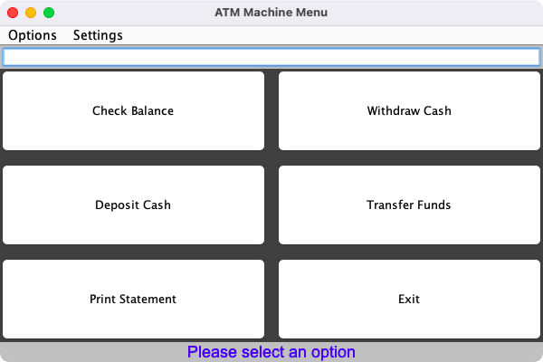

# Week 05 — Lab 4: check boxes, menus and listeners

**Module:** GUI Programming (`COMP H2011`)  
**Semester:** 3 (Year 2), folder `sem03`

[Module README](../README.md)

## What this week is for

Lab 4 (Listeners continued and Menus) has four parts: a font size selector with check boxes in a ButtonGroup; a Streaming Services menu with a logo for each of five services; a News and Weather menu with menu items, an image and a text area; and the ATM machine of lab 2 with menus and listeners added (Options and Settings menus, six buttons and a text field). The lecture was menus. The resources are the lecture examples MenuBar to MenuBar9, which build up a menu bar step by step.

## Files

| File | What it contains | Screenshot |
|---|---|---|
| [`README.md`](README.md) | This README. | — |
| [`lab/gui_programming_week05_lab.pdf`](lab/gui_programming_week05_lab.pdf) | The lab sheet (4 pages): Labwork 4, 100 points in four parts (20, 20, 30 and 30). | — |
| [`lab/solution/Lab4Part1.java`](lab/solution/Lab4Part1.java) | Part 1: four check boxes (Tiny, Large, Very Big and Huge Font) in a ButtonGroup that change the size of a text label. |  *Part 1: the font size selector.* |
| [`lab/solution/Lab4Part2.java`](lab/solution/Lab4Part2.java) | Part 2: a Streaming Services menu with five items (Netflix, Hulu, Disney+, Amazon Prime and YouTube) that show the logo of each service. |  *Part 2: the Streaming Services menu with the Netflix logo.* |
| [`lab/solution/Lab4Part3.java`](lab/solution/Lab4Part3.java) | Part 3: News and Weather menus with local and international items that show a picture and a text in a text area. |  *Part 3: the News and Weather menu with a weather picture.* |
| [`lab/solution/Lab4Part4.java`](lab/solution/Lab4Part4.java) | Part 4: the ATM machine with Options and Settings menus, six buttons, a text field and action listeners. |  *Part 4: the ATM Machine Menu with Options and Settings menus.* |
| [`lab/solution/img/Part2/Netflix_Logo_RGB.png`](lab/solution/img/Part2/Netflix_Logo_RGB.png) | Part 2: the Netflix logo. | — |
| [`lab/solution/img/Part2/disney_logo_march_2024_050fef2e.png`](lab/solution/img/Part2/disney_logo_march_2024_050fef2e.png) | Part 2: the Disney+ logo. | — |
| [`lab/solution/img/Part2/hulu-Black-digital.png`](lab/solution/img/Part2/hulu-Black-digital.png) | Part 2: the Hulu logo. | — |
| [`lab/solution/img/Part2/prime-logo-rgb-prime-blue-master.png`](lab/solution/img/Part2/prime-logo-rgb-prime-blue-master.png) | Part 2: the Amazon Prime logo. | — |
| [`lab/solution/img/Part2/yt_logo_rgb_light.png`](lab/solution/img/Part2/yt_logo_rgb_light.png) | Part 2: the YouTube logo. | — |
| [`lab/solution/img/Part3/international_news.png`](lab/solution/img/Part3/international_news.png) | Part 3: the picture for international news. | — |
| [`lab/solution/img/Part3/international_weather.png`](lab/solution/img/Part3/international_weather.png) | Part 3: the picture for international weather. | — |
| [`lab/solution/img/Part3/local_news.png`](lab/solution/img/Part3/local_news.png) | Part 3: the picture for local news. | — |
| [`lab/solution/img/Part3/local_weather.png`](lab/solution/img/Part3/local_weather.png) | Part 3: the picture for local weather. | — |
| [`resources/examples/MenuBar.java`](resources/examples/MenuBar.java) | Lecture example: an empty menu bar. | — |
| [`resources/examples/MenuBar2.java`](resources/examples/MenuBar2.java) | Lecture example: a menu bar with a menu. | — |
| [`resources/examples/MenuBar3.java`](resources/examples/MenuBar3.java) | Lecture example: a menu with items. | — |
| [`resources/examples/MenuBar3Methods.java`](resources/examples/MenuBar3Methods.java) | Lecture example: the same menu built in separate methods. | — |
| [`resources/examples/MenuBar4.java`](resources/examples/MenuBar4.java) | Lecture example: a menu with submenus. | — |
| [`resources/examples/MenuBar5.java`](resources/examples/MenuBar5.java) | Lecture example: submenus with a check box menu item. | — |
| [`resources/examples/MenuBar6.java`](resources/examples/MenuBar6.java) | Lecture example: menu items with icons. | — |
| [`resources/examples/MenuBar7.java`](resources/examples/MenuBar7.java) | Lecture example: menu items with icons, continued. | — |
| [`resources/examples/MenuBar8.java`](resources/examples/MenuBar8.java) | Lecture example: key accelerators on menu items. | — |
| [`resources/examples/MenuBar9.java`](resources/examples/MenuBar9.java) | Lecture example: event handling for the menu items. | — |
| [`resources/examples/MnemonicSample.java`](resources/examples/MnemonicSample.java) | Lab demo: a menu and a menu item with a mnemonic and an Alt accelerator. | — |
| [`resources/examples/new.gif`](resources/examples/new.gif) | The New icon used by the menu examples. | — |
| [`resources/examples/open.gif`](resources/examples/open.gif) | The Open icon used by the menu examples. | — |
