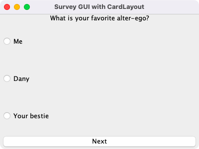
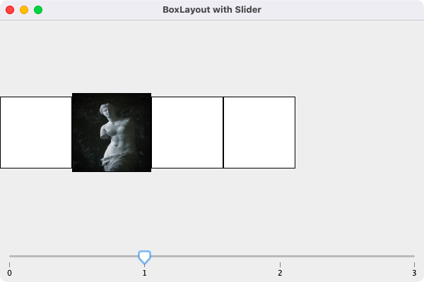
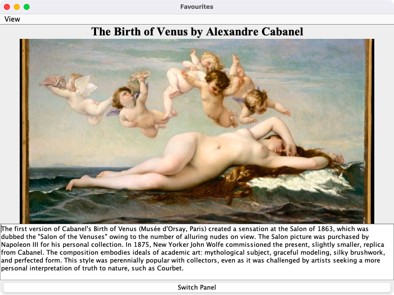

# Week 06 — Lab 5: slider, progress bar, CardLayout and BoxLayout

**Module:** GUI Programming (`COMP H2011`)  
**Semester:** 3 (Year 2), folder `sem03`

[Module README](../README.md)

## What this week is for

Lab 5 has four parts: a progress bar that follows a slider (0 to 50); a survey with a CardLayout (radio buttons and a Next button); a BoxLayout row of boxes where a slider moves an image from one box to the next; and a Favourites window with a CardLayout of separate panel classes (two pictures of The Birth of Venus with a text, a View menu and a Switch Panel button). The lecture was box layout, MVC components and the slider, progress bar and card layout. The resources are the lecture examples for these components.

## Files

| File | What it contains | Screenshot |
|---|---|---|
| [`README.md`](README.md) | This README. | — |
| [`lab/gui_programming_week06_lab.pdf`](lab/gui_programming_week06_lab.pdf) | The lab sheet (4 pages): Labwork 5, 100 points in four parts (20, 20, 30 and 30). | — |
| [`lab/solution/Lab5Part1.java`](lab/solution/Lab5Part1.java) | Part 1: a JProgressBar and a JSlider (0 to 50) with a change listener, so the bar follows the slider. |  *Part 1: the progress bar and the slider.* |
| [`lab/solution/Lab5Part2.java`](lab/solution/Lab5Part2.java) | Part 2: a survey in a CardLayout: a question with radio buttons in a ButtonGroup and a Next button that shows the next card. |  *Part 2: the survey with a CardLayout.* |
| [`lab/solution/Lab5Part3.java`](lab/solution/Lab5Part3.java) | Part 3: a BoxLayout row of four labels and a JSlider (0 to 3) with a change listener that shows the image in the label chosen by the slider. |  *Part 3: the BoxLayout row with a slider.* |
| [`lab/solution/Lab5Part4.java`](lab/solution/Lab5Part4.java) | Part 4: a Favourites window: a CardLayout of two panels with a picture and a text area each, a View menu and a Switch Panel button. |  *Part 4: the Favourites window with a View menu.* |
| [`lab/solution/img/Part3/venus-de-milo.jpg`](lab/solution/img/Part3/venus-de-milo.jpg) | Part 3: the picture that moves between the boxes. | — |
| [`lab/solution/img/Part4/The Birth of Venus - The Metropolitan Museum of Art.jpg`](lab/solution/img/Part4/The%20Birth%20of%20Venus%20-%20The%20Metropolitan%20Museum%20of%20Art.jpg) | Part 4: the picture of the first panel. | — |
| [`lab/solution/img/Part4/The Birth of Venus by Sandro Botticelli.png`](lab/solution/img/Part4/The%20Birth%20of%20Venus%20by%20Sandro%20Botticelli.png) | Part 4: the picture of the second panel. | — |
| [`resources/examples/BoxLayoutExample.java`](resources/examples/BoxLayoutExample.java) | Lecture example: a BoxLayout of labels. | — |
| [`resources/examples/CardLayoutExample.java`](resources/examples/CardLayoutExample.java) | Lecture example: a CardLayout of cards chosen with a combo box. | — |
| [`resources/examples/JSliderExample.java`](resources/examples/JSliderExample.java) | Lecture example: a slider with a change listener. | — |
| [`resources/examples/ProgBarExample.java`](resources/examples/ProgBarExample.java) | Lecture example: a progress bar. | — |
