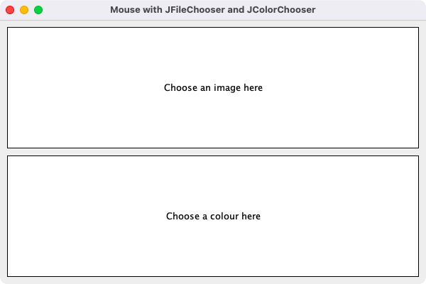
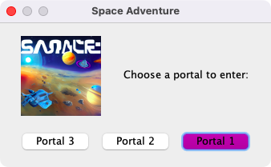
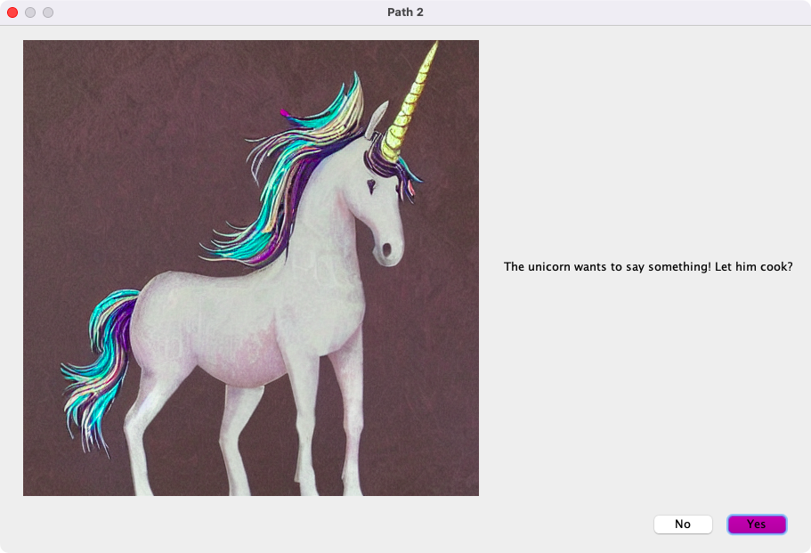
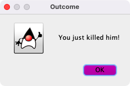
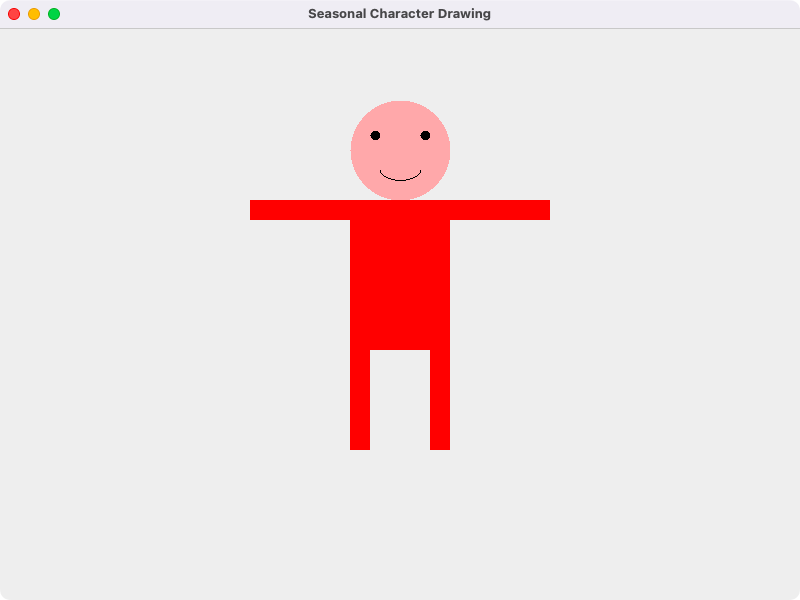

# Week 07 — Lab 6: internal frames, mouse, choosers, dialogs and 2D graphics

**Module:** GUI Programming (`COMP H2011`)  
**Semester:** 3 (Year 2), folder `sem03`

[Module README](../README.md)

## What this week is for

Lab 6 has four parts: a Games Menu that opens a chess board and a Snakes and Ladders board in internal frames; two labels that open a JFileChooser and a JColorChooser when the mouse enters them; a small space adventure game made only of option dialogs; and a character drawn with 2D graphics on a JFrame. The lecture was frames and internal frames. The resources are the internal frame lecture examples. Part 4 asks for a seasonal character (the grading line of the sheet in this folder mentions a snowman); the solution draws a figure with a pink head and a red body.

## Files

| File | What it contains | Screenshot |
|---|---|---|
| [`README.md`](README.md) | This README. | — |
| [`lab/gui_programming_week07_lab.pdf`](lab/gui_programming_week07_lab.pdf) | The lab sheet (3 pages): Labwork 6, 100 points in four parts (20, 20, 30 and 30). | — |
| [`lab/solution/Lab6Part1.java`](lab/solution/Lab6Part1.java) | Part 1: a Games Menu with Launch Chess Game and Launch Snakes and Ladders items that open a JInternalFrame with a board picture in a JDesktopPane. |  *Part 1: the Games Menu with the chess and Snakes and Ladders internal frames.* |
| [`lab/solution/Lab6Part2.java`](lab/solution/Lab6Part2.java) | Part 2: two labels with mouse listeners: entering the first opens a JFileChooser and shows the chosen image, entering the second opens a JColorChooser and sets the colour. |  *Part 2: the two labels for the image chooser and the colour chooser.* |
| [`lab/solution/Lab6Part3.java`](lab/solution/Lab6Part3.java) | Part 3: a space adventure game with option dialogs only: choose a portal, answer yes or no questions, and win or lose by a random outcome. |  *Part 3: the Space Adventure game, choosing a portal.*  *Part 3: Path 2, a question about the unicorn.*  *Part 3: an outcome dialog.* |
| [`lab/solution/Lab6Part4.java`](lab/solution/Lab6Part4.java) | Part 4: a character drawn in paint() with ovals, rectangles and an arc. |  *Part 4: the character drawn with 2D graphics.* |
| [`lab/solution/img/Part1/Chess Game.png`](lab/solution/img/Part1/Chess%20Game.png) | Part 1: the chess board picture. | — |
| [`lab/solution/img/Part1/Snakes and Ladders.png`](lab/solution/img/Part1/Snakes%20and%20Ladders.png) | Part 1: the Snakes and Ladders board picture. | — |
| [`lab/solution/img/Part3/Alien.png`](lab/solution/img/Part3/Alien.png) | Part 3: the alien picture. | — |
| [`lab/solution/img/Part3/Artifact.png`](lab/solution/img/Part3/Artifact.png) | Part 3: the artifact picture. | — |
| [`lab/solution/img/Part3/Space Adventure Game.png`](lab/solution/img/Part3/Space%20Adventure%20Game.png) | Part 3: the picture of the game window. | — |
| [`lab/solution/img/Part3/Unicorn.png`](lab/solution/img/Part3/Unicorn.png) | Part 3: the unicorn picture. | — |
| [`resources/examples/InternalFrameDemo.java`](resources/examples/InternalFrameDemo.java) | Lecture example (the Java tutorial demo): a desktop pane with a menu that creates internal frames. | — |
| [`resources/examples/InternalFrameDemo1.java`](resources/examples/InternalFrameDemo1.java) | Lecture example: a desktop pane with one internal frame. | — |
| [`resources/examples/InternalFrameDemo2.java`](resources/examples/InternalFrameDemo2.java) | Lecture example: internal frames created from a menu. | — |
| [`resources/examples/InternalFrameEventDemo.java`](resources/examples/InternalFrameEventDemo.java) | Lecture example: internal frame events listed in a text area. | — |
| [`resources/examples/MyInternalFrame.java`](resources/examples/MyInternalFrame.java) | Lecture example: the internal frame class used by InternalFrameDemo.java. | — |
| [`resources/examples/SimpleInternalFrameExample.java`](resources/examples/SimpleInternalFrameExample.java) | Lecture example: a simple internal frame. | — |
