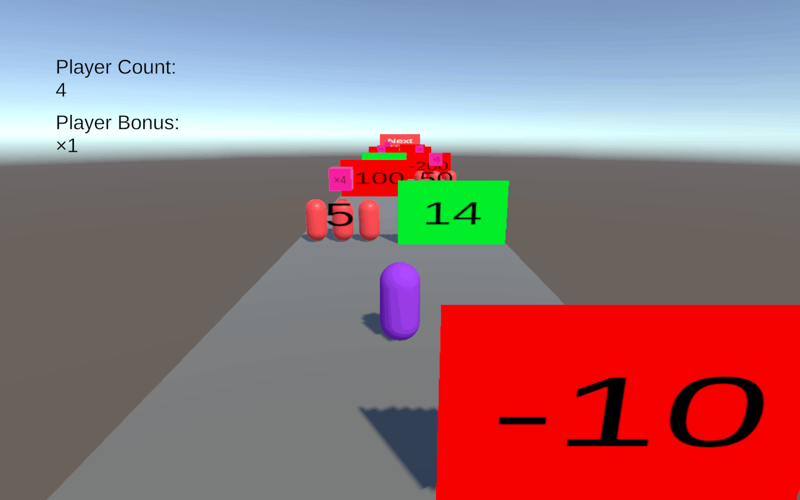
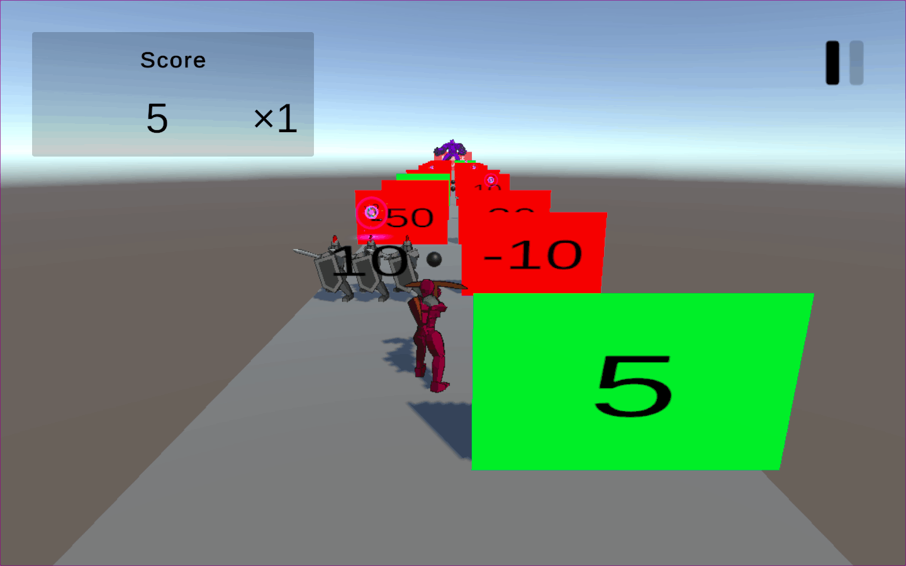

# Assessment 1: Group game project in Unity

**Module:** Interactive Multimedia (`COMP H2033`)  
**Semester:** 3 (Year 2), folder `sem03`  
**Type:** project, group of 2 to 3  
**Weight:** 60% (Alpha 20%, final version 40%)  
**Deadline:** the Alpha on 15 November 2024 at 10pm (week 9), the final version on 9 December 2024 at 9am (week 13)  
**Result:** —  
**On main:** [`sem03/interactive_multimedia/assessment/01/`](https://github.com/DanyilT/projects-in-university/tree/main/sem03/interactive_multimedia/assessment/01) (the brief, the link file and this README)  
**Branch:** —  
**Repository:** [tu863-imm-webgl-game](https://github.com/DanyilT/tu863-imm-webgl-game) (the Unity project, with the branches alpha and beta)

[Module README](../../README.md)

## What this assessment is for

The brief (11 pages) asks groups of 2 to 3 to design and build an original interactive 3D game in Unity, using the Create with Code tutorials as a foundation. The game has multiple scenes and menus, collisions, animation, a particle system and sound, and most marks go to a unique implementation. The first deliverable is the Alpha version, a rough version with the working functionality (what Lab 4 produces); the second is the final game, which is marked for the work done since the Alpha. Both are submitted as a link to a public GitHub repository and a link to a playable WebGL build.

The submission is the repository tu863-imm-webgl-game: its branch `alpha` is the Alpha version and its branch `beta` is the later version, both with a WebGL build. The links are in the link file. The screenshots below show the Alpha and the Beta running.

<table>
  <tr valign="top">
    <td width="50%"> <i>The Alpha of the group project: a runner with Player Count and Player Bonus on screen and number gates.</i></td>
    <td width="50%"> <i>The Beta of the group project: a score panel and a pause button, with a character and number gates.</i></td>
  </tr>
</table>

## Files

| File | What it contains |
|---|---|
| [`README.md`](README.md) | This README. |
| [`interactive_multimedia_assessment.pdf`](interactive_multimedia_assessment.pdf) | The group project brief (11 pages): groups of 2 to 3 build an original interactive 3D game in Unity on the mechanics of the Create with Code units, with multiple scenes and menus, collisions, animation, a particle system, prefabs, Instantiate, Destroy and SetActive, arrays and lists, audio (background, effects and event sounds), a score and heads-up display, a consistent theme and a unique selling point. Deliverables: the Alpha, then the final game, both on GitHub with a WebGL build on Unity Play, a sources file for third-party assets, and a recorded demo video (15 minutes at most). Submission dates: week 6 (25 October 2024), week 9 (15 November 2024) and week 13 (9 December 2024). |
| [`submission/project_link.txt`](submission/project_link.txt) | The GitHub link to the tu863-imm-webgl-game repository and the links to its alpha and beta branches. |
