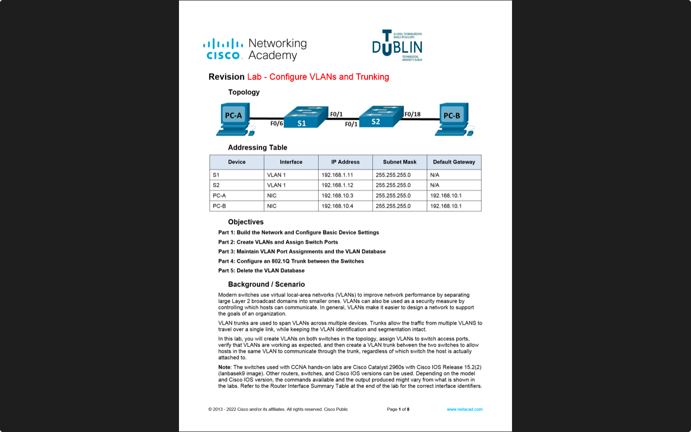
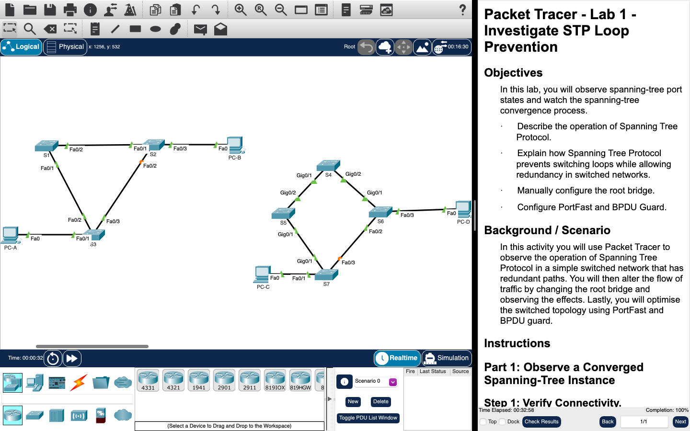
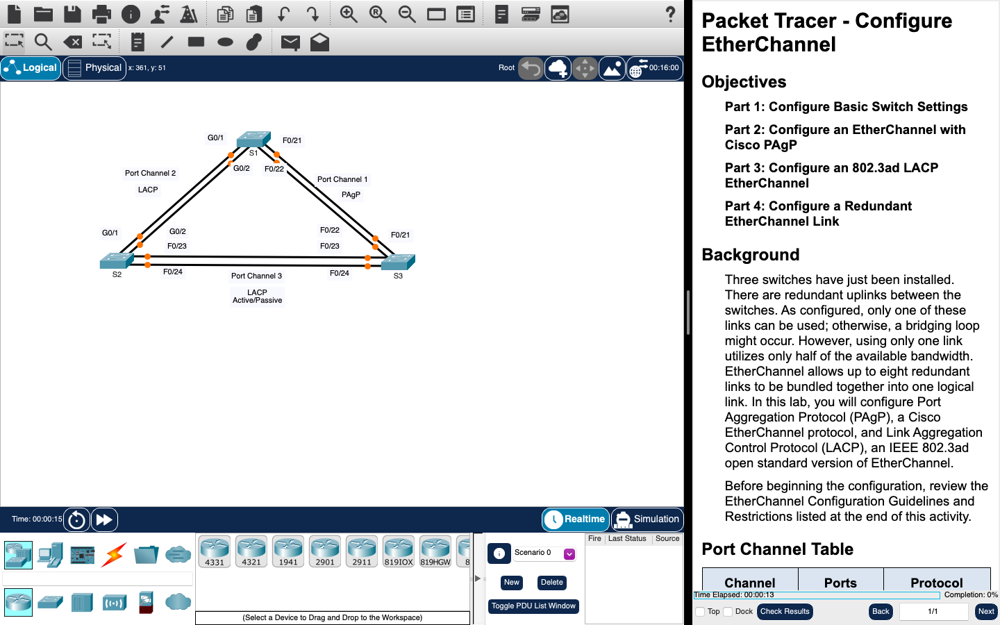
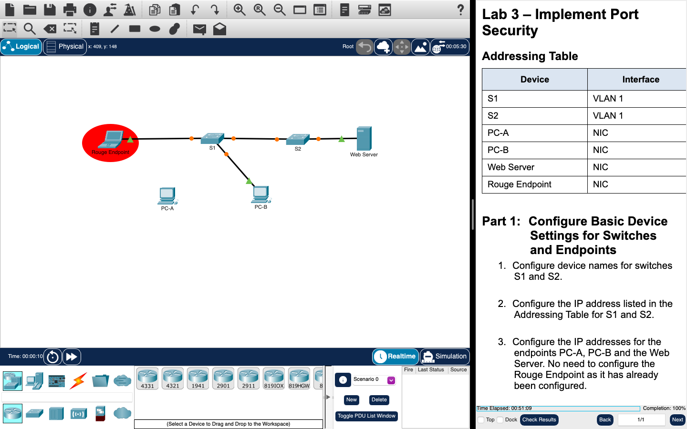
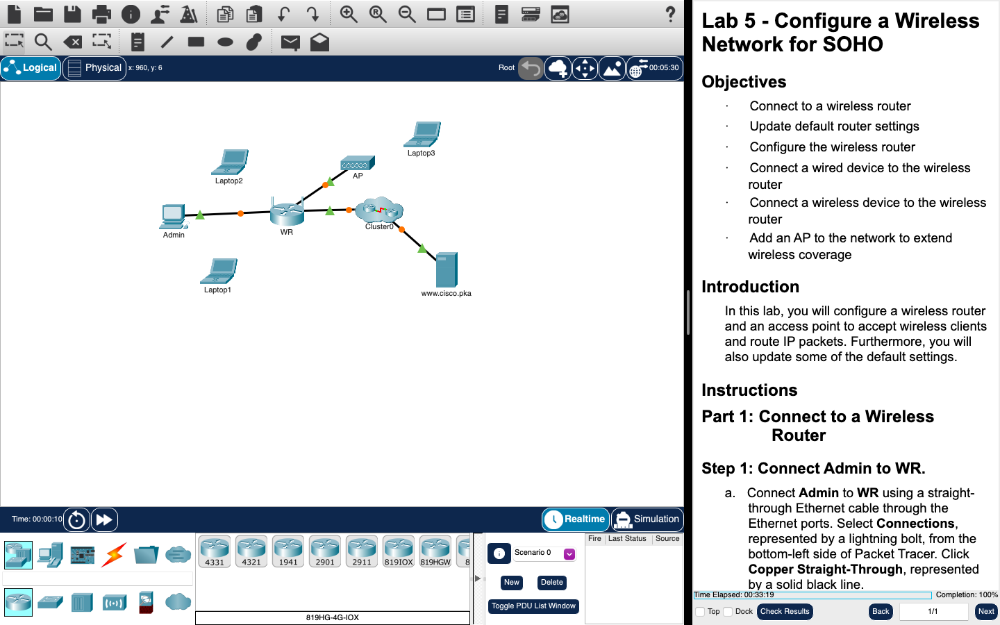
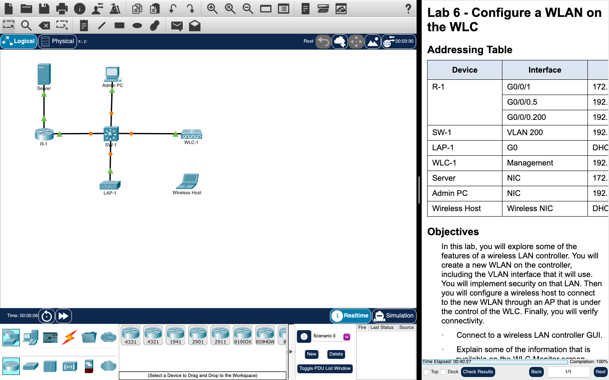
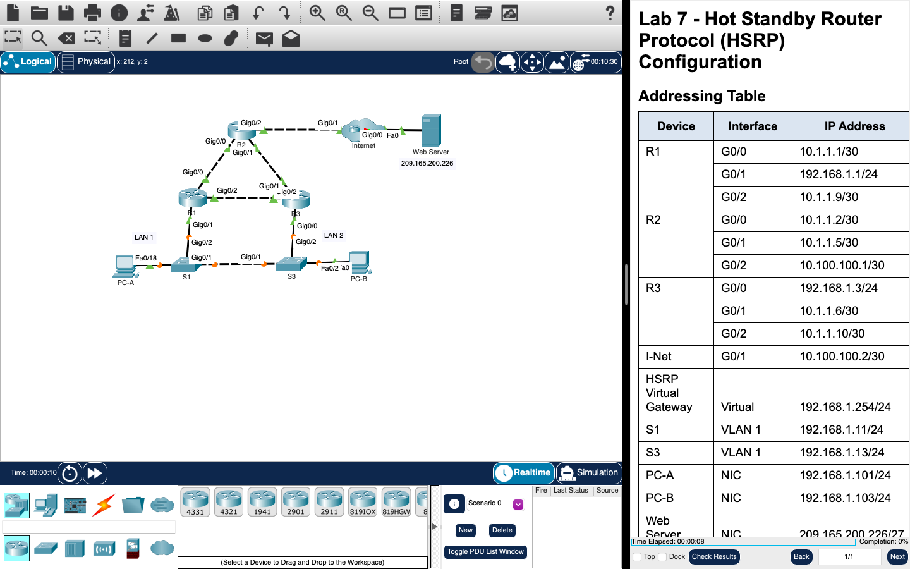
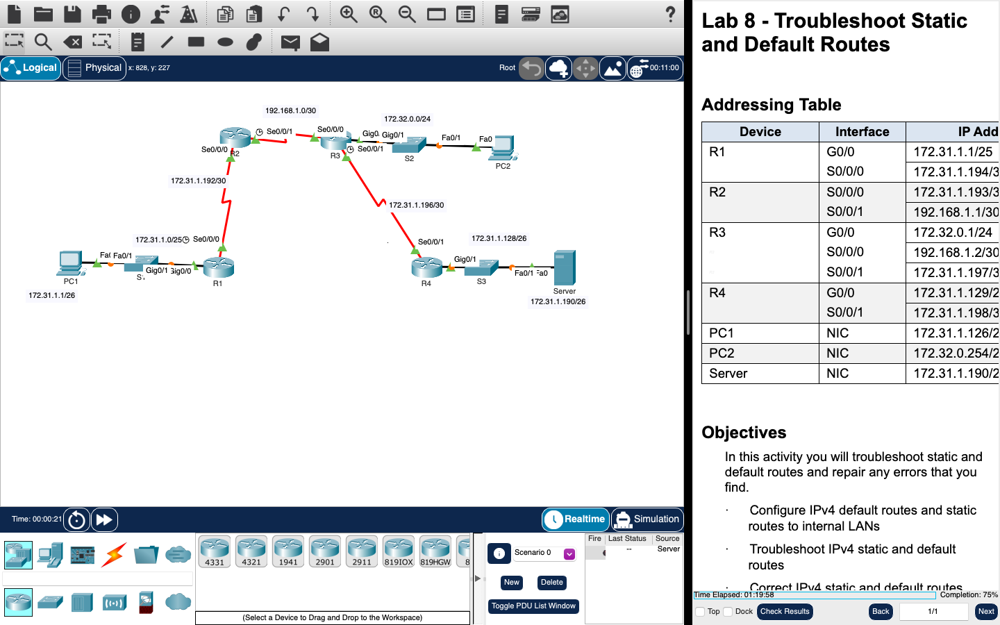
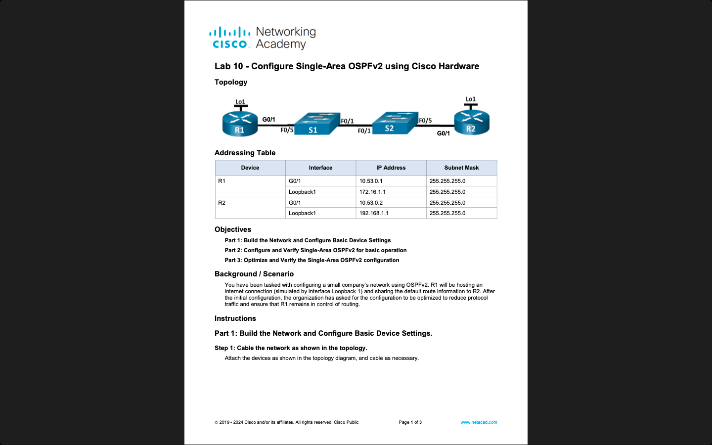

# LAN Switching and Wireless

**Module:** LAN Switching and Wireless (`COMP H2015`)  
**Semester:** 3 (Year 2), folder `sem03`  
**Lecturer:** Aoife Fox  
**Date:** September - December 2024  
**Credits:** 5 ECTS  
**Matching project branch:** none

## What this module is for

LAN Switching and Wireless is the second-year Cisco networking module (Cisco NetAcad, Switching, Routing and Wireless Essentials). It covers switching technologies and router operations for small and medium business networks: VLANs and trunking, Spanning Tree Protocol, EtherChannel, LAN security threats and switch security (port security, DHCP snooping), wireless LANs with a wireless router and a wireless LAN controller, first-hop redundancy with HSRP, static and default routes (IPv4 and IPv6), troubleshooting routes, and single-area and advanced OSPFv2. Each week has a lecture and a lab, and each lab is either a Cisco Packet Tracer activity or a hands-on lab on real switches and routers (labs 0, 2, 4, 7 and 10). This folder has the lab sheets as PDFs, the Packet Tracer files (the starting activity and, for labs 1, 3, 5, 6, 8 and 9, the file after the lab), a Cisco command help sheet, the course outline and screenshots. Packet Tracer saves files in an encrypted format, so the .pka files open only in Packet Tracer. The grade is labs (30%), four grouped NetAcad exams (10%), CA 1, a theory test in week 12 (30%), and CA 2, a skills exam in January (30%); the tests and exams are not in the repository.

## Grades Breakdown

| Assessment Type | Weighting |
|---|---|
| Labs | 30% |
| Grouped NetAcad exams (4) | 10% |
| CA 1: theory test during the lecture (week 12) | 30% |
| CA 2: skills exam (January) | 30% |

## All weeks

| Week | Title | Files | Screenshot |
|---|---|---|---|
| [Week 1](week01/) | Lab 0: revision, configure VLANs and trunking (hardware) | [`lab/lan_switching_and_wireless_week01_lab_revision_configure_vlans_and_trunking.pdf`](week01/lab/lan_switching_and_wireless_week01_lab_revision_configure_vlans_and_trunking.pdf) [`resources/cisco_basic_commands_help_sheet.pdf`](week01/resources/cisco_basic_commands_help_sheet.pdf) |  |
| [Week 2](week02/) | Lab 1: investigate STP loop prevention (Packet Tracer) | [`lab/lan_switching_and_wireless_week02_lab_investigate_stp_loop_prevention.pdf`](week02/lab/lan_switching_and_wireless_week02_lab_investigate_stp_loop_prevention.pdf) [`lab/lan_switching_and_wireless_week02_lab_investigate_stp_loop_prevention.pka`](week02/lab/lan_switching_and_wireless_week02_lab_investigate_stp_loop_prevention.pka) [`lab/solution/lan_switching_and_wireless_week02_lab_investigate_stp_loop_prevention_solution.pka`](week02/lab/solution/lan_switching_and_wireless_week02_lab_investigate_stp_loop_prevention_solution.pka) |  |
| [Week 3](week03/) | Lab 2: implement EtherChannel (hardware, with a Packet Tracer activity) | [`lab/lan_switching_and_wireless_week03_lab_implementing_etherchannel.pdf`](week03/lab/lan_switching_and_wireless_week03_lab_implementing_etherchannel.pdf) [`lab/lan_switching_and_wireless_week03_lab_configure_etherchannel.pka`](week03/lab/lan_switching_and_wireless_week03_lab_configure_etherchannel.pka) |  |
| [Week 4](week04/) | Lab 3: implement port security (Packet Tracer) | [`lab/lan_switching_and_wireless_week04_lab_implement_port_security.pdf`](week04/lab/lan_switching_and_wireless_week04_lab_implement_port_security.pdf) [`lab/lan_switching_and_wireless_week04_lab_implement_port_security.pka`](week04/lab/lan_switching_and_wireless_week04_lab_implement_port_security.pka) [`lab/solution/lan_switching_and_wireless_week04_lab_implement_port_security_solution.pka`](week04/lab/solution/lan_switching_and_wireless_week04_lab_implement_port_security_solution.pka) |  |
| [Week 5](week05/) | Lab 4: switch security configuration (hardware, with a Packet Tracer file) | [`lab/lan_switching_and_wireless_week05_lab_switch_security_configuration.pdf`](week05/lab/lan_switching_and_wireless_week05_lab_switch_security_configuration.pdf) [`lab/lan_switching_and_wireless_week05_lab_switch_security_configuration.pka`](week05/lab/lan_switching_and_wireless_week05_lab_switch_security_configuration.pka) |  |
| [Week 6](week06/) | Lab 5: configure a wireless network for SOHO (Packet Tracer) | [`lab/lan_switching_and_wireless_week06_lab_configure_a_wireless_network_for_soho.pdf`](week06/lab/lan_switching_and_wireless_week06_lab_configure_a_wireless_network_for_soho.pdf) [`lab/lan_switching_and_wireless_week06_lab_configure_a_wireless_network_for_soho.pka`](week06/lab/lan_switching_and_wireless_week06_lab_configure_a_wireless_network_for_soho.pka) [`lab/solution/lan_switching_and_wireless_week06_lab_configure_a_wireless_network_for_soho_solution.pka`](week06/lab/solution/lan_switching_and_wireless_week06_lab_configure_a_wireless_network_for_soho_solution.pka) |  |
| [Week 7](week07/) | Lab 6: configure a WLAN on the WLC (Packet Tracer) | [`lab/lan_switching_and_wireless_week07_lab_configure_a_wlan_on_the_wlc.pdf`](week07/lab/lan_switching_and_wireless_week07_lab_configure_a_wlan_on_the_wlc.pdf) [`lab/lan_switching_and_wireless_week07_lab_configure_a_wlan_on_the_wlc.pka`](week07/lab/lan_switching_and_wireless_week07_lab_configure_a_wlan_on_the_wlc.pka) [`lab/solution/lan_switching_and_wireless_week07_lab_configure_a_wlan_on_the_wlc_solution.pka`](week07/lab/solution/lan_switching_and_wireless_week07_lab_configure_a_wlan_on_the_wlc_solution.pka) |  |
| [Week 8](week08/) | Lab 7: HSRP and static routes (hardware, with Packet Tracer files) | [`lab/lan_switching_and_wireless_week08_lab_configuring_hsrp_and_static_routing.pdf`](week08/lab/lan_switching_and_wireless_week08_lab_configuring_hsrp_and_static_routing.pdf) [`lab/lan_switching_and_wireless_week08_lab_hot_standby_router_protocol_(hsrp)_configuration.pka`](week08/lab/lan_switching_and_wireless_week08_lab_hot_standby_router_protocol_%28hsrp%29_configuration.pka) [`lab/lan_switching_and_wireless_week08_lab_configure_ipv4_and_ipv6_static_and_default_routes.pka`](week08/lab/lan_switching_and_wireless_week08_lab_configure_ipv4_and_ipv6_static_and_default_routes.pka) |  |
| [Week 9](week09/) | Lab 8: troubleshoot static and default routes (Packet Tracer) | [`lab/lan_switching_and_wireless_week09_lab_troubleshoot_static_and_default_routes.pdf`](week09/lab/lan_switching_and_wireless_week09_lab_troubleshoot_static_and_default_routes.pdf) [`lab/lan_switching_and_wireless_week09_lab_troubleshoot_static_and_default_routes.pka`](week09/lab/lan_switching_and_wireless_week09_lab_troubleshoot_static_and_default_routes.pka) [`lab/solution/lan_switching_and_wireless_week09_lab_troubleshoot_static_and_default_routes_solution.pka`](week09/lab/solution/lan_switching_and_wireless_week09_lab_troubleshoot_static_and_default_routes_solution.pka) |  |
| [Week 10](week10/) | Lab 9: single-area OSPFv2 (Packet Tracer) | [`lab/lan_switching_and_wireless_week10_lab_single_area_ospfv2.pdf`](week10/lab/lan_switching_and_wireless_week10_lab_single_area_ospfv2.pdf) [`lab/lan_switching_and_wireless_week10_lab_single_area_ospfv2.pka`](week10/lab/lan_switching_and_wireless_week10_lab_single_area_ospfv2.pka) [`lab/solution/lan_switching_and_wireless_week10_lab_single_area_ospfv2_solution.pka`](week10/lab/solution/lan_switching_and_wireless_week10_lab_single_area_ospfv2_solution.pka) |  |
| [Week 11](week11/) | Lab 10: advanced OSPFv2 (hardware, with a Packet Tracer activity) | [`lab/lan_switching_and_wireless_week11_lab_configure_single_area_ospfv2_using_cisco_hardware.pdf`](week11/lab/lan_switching_and_wireless_week11_lab_configure_single_area_ospfv2_using_cisco_hardware.pdf) [`lab/lan_switching_and_wireless_week11_lab_advanced_ospfv2.pka`](week11/lab/lan_switching_and_wireless_week11_lab_advanced_ospfv2.pka) |  |
| Week 12 | CA 1: theory test | None. CA 1 was a quiz in the lecture on Tuesday 10 December 2024 (30%); see the assessments below. | — |

## Assessments and other files

There are no assessment files: the NetAcad exams, CA 1 and CA 2 are not in the repository. CA 1 was a theory test in the lecture of week 12, Tuesday 10 December 2024 (30%), taken as a quiz in Brightspace with the LockDown Browser. It was a closed-book test with no access to online resources and no Brightspace or Internet materials, and Brightspace logs were checked. Mobile phones had to be locked away in bags. The test lasted one hour: 5 minutes to log in and 55 minutes to complete the exam, and there was only one opportunity to take it. CA 2 was a skills exam in January 2025 (30%, details given closer to the time).

| File | What it contains |
|---|---|
| [`resources/lan_switching_and_wireless_course_outline.pdf`](resources/lan_switching_and_wireless_course_outline.pdf) | The course outline for Autumn 2024 (1 page): for each week the lecture and the lab (Packet Tracer or hardware), the CA breakdown (labs 30%, four grouped NetAcad exams 10%, CA 1 30%, CA 2 30%) and the NetAcad topics of the four exams. |
