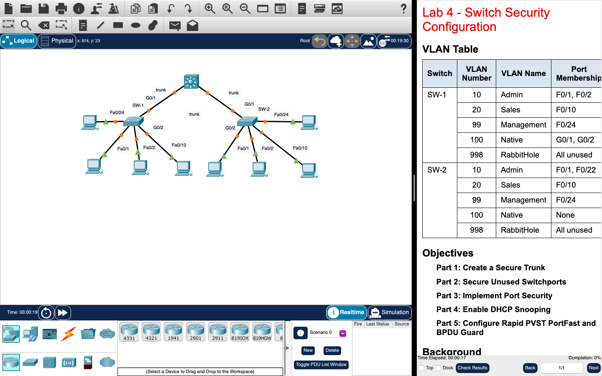

# Week 05 — Lab 4: switch security configuration (hardware, with a Packet Tracer file)

**Module:** LAN Switching and Wireless (`COMP H2015`)  
**Semester:** 3 (Year 2), folder `sem03`

[Module README](../README.md)

## What this week is for

Lecture 5 was switch security configuration. Lab 4 is a hardware lab: configure the network devices (cable the network, configure R1 and the basic switch settings), configure VLANs on the switches (VLAN 10 with its SVI, VLAN 333 named Native and VLAN 999 named ParkingLot), and configure switch security (802.1Q trunking, access ports, securing and disabling unused ports). The Packet Tracer file is a version of the lab with two switches (SW-1 and SW-2) and a VLAN table.

## Screenshots

*Packet Tracer with the Lab 4 network and its VLAN table.*

## Files

| File | What it contains |
|---|---|
| [`README.md`](README.md) | This README. |
| [`lab/lan_switching_and_wireless_week05_lab_switch_security_configuration.pdf`](lab/lan_switching_and_wireless_week05_lab_switch_security_configuration.pdf) | The lab sheet (8 pages): Hardware Lab 4 - Switch Security Configuration, three parts. |
| [`lab/lan_switching_and_wireless_week05_lab_switch_security_configuration.pka`](lab/lan_switching_and_wireless_week05_lab_switch_security_configuration.pka) | The Packet Tracer activity Lab 4 - Switch Security Configuration. Packet Tracer saves files in an encrypted format, so this file opens only in Cisco Packet Tracer and its contents are not shown in the repository. |
