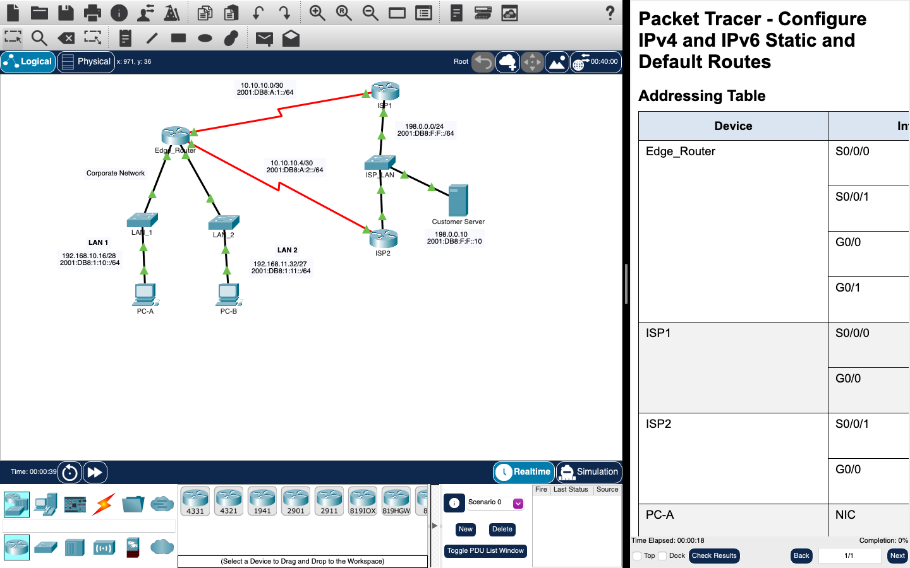

# Week 08 — Lab 7: HSRP and static routes (hardware, with Packet Tracer files)

**Module:** LAN Switching and Wireless (`COMP H2015`)  
**Semester:** 3 (Year 2), folder `sem03`

[Module README](../README.md)

## What this week is for

Lecture 8 was HSRP and a recap of static routes for IPv4 and IPv6. Lab 7 is a hardware lab on first-hop redundancy: build the network and verify connectivity (cable the network, configure the PCs and the basic router settings), then configure first-hop redundancy with HSRP. There are two Packet Tracer files: the HSRP configuration lab with three routers, two switches and two PCs, and the Cisco activity Configure IPv4 and IPv6 Static and Default Routes.

## Screenshots

*Packet Tracer with the HSRP configuration network: three routers, switches, two PCs and an internet server.*

*Packet Tracer with the Configure IPv4 and IPv6 Static and Default Routes network: the edge router, two ISP routers and the corporate network.*

## Files

| File | What it contains |
|---|---|
| [`README.md`](README.md) | This README. |
| [`lab/lan_switching_and_wireless_week08_lab_configuring_hsrp_and_static_routing.pdf`](lab/lan_switching_and_wireless_week08_lab_configuring_hsrp_and_static_routing.pdf) | The lab sheet (5 pages): Lab - Configuring HSRP, two parts. |
| [`lab/lan_switching_and_wireless_week08_lab_hot_standby_router_protocol_(hsrp)_configuration.pka`](lab/lan_switching_and_wireless_week08_lab_hot_standby_router_protocol_%28hsrp%29_configuration.pka) | The Packet Tracer file for Lab 7, Hot Standby Router Protocol (HSRP) Configuration. Packet Tracer saves files in an encrypted format, so this file opens only in Cisco Packet Tracer and its contents are not shown in the repository. |
| [`lab/lan_switching_and_wireless_week08_lab_configure_ipv4_and_ipv6_static_and_default_routes.pka`](lab/lan_switching_and_wireless_week08_lab_configure_ipv4_and_ipv6_static_and_default_routes.pka) | The Packet Tracer activity Configure IPv4 and IPv6 Static and Default Routes (the Cisco course activity 15.6.1). Packet Tracer saves files in an encrypted format, so this file opens only in Cisco Packet Tracer and its contents are not shown in the repository. |
