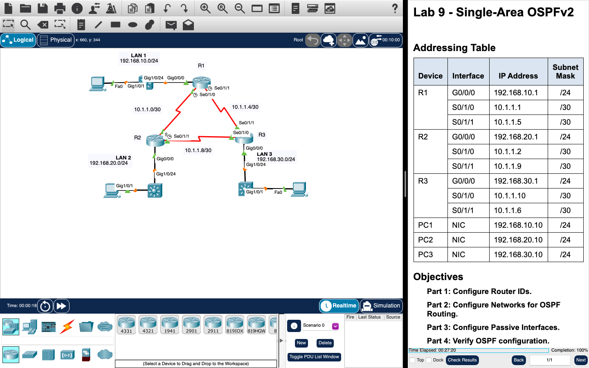

# Week 10 — Lab 9: single-area OSPFv2 (Packet Tracer)

**Module:** LAN Switching and Wireless (`COMP H2015`)  
**Semester:** 3 (Year 2), folder `sem03`

[Module README](../README.md)

## What this week is for

Lecture 10 was single-area OSPFv2 concepts. Lab 9 is a Packet Tracer activity with three routers: configure router IDs, configure networks for OSPF routing, configure passive interfaces, and verify the OSPF configuration.

## Screenshots

*Packet Tracer with the Lab 9 network: three routers and three LANs.*

## Files

| File | What it contains |
|---|---|
| [`README.md`](README.md) | This README. |
| [`lab/lan_switching_and_wireless_week10_lab_single_area_ospfv2.pdf`](lab/lan_switching_and_wireless_week10_lab_single_area_ospfv2.pdf) | The lab sheet (3 pages): Lab 9 - Single-Area OSPFv2, four parts. |
| [`lab/lan_switching_and_wireless_week10_lab_single_area_ospfv2.pka`](lab/lan_switching_and_wireless_week10_lab_single_area_ospfv2.pka) | The Packet Tracer activity for this lab: the starting network. Packet Tracer saves files in an encrypted format, so this file opens only in Cisco Packet Tracer and its contents are not shown in the repository. |
| [`lab/solution/lan_switching_and_wireless_week10_lab_single_area_ospfv2_solution.pka`](lab/solution/lan_switching_and_wireless_week10_lab_single_area_ospfv2_solution.pka) | The Packet Tracer file after the lab: the same network with OSPF configured. Packet Tracer saves files in an encrypted format, so this file opens only in Cisco Packet Tracer and its contents are not shown in the repository. |
