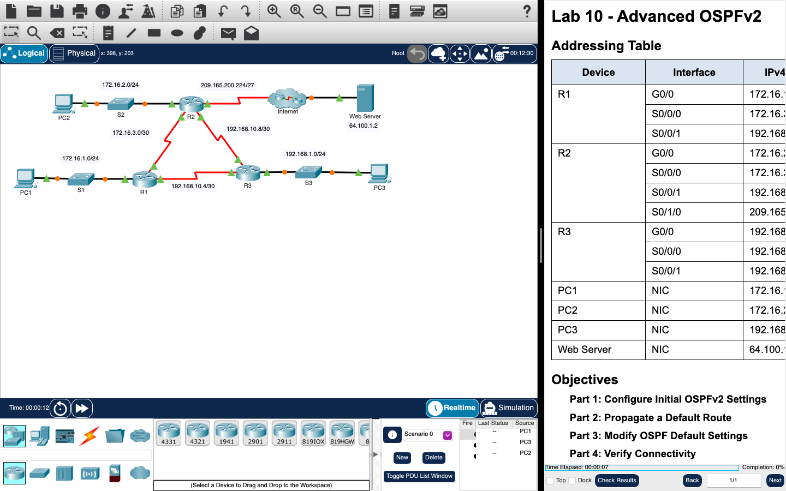

# Week 11 — Lab 10: advanced OSPFv2 (hardware, with a Packet Tracer activity)

**Module:** LAN Switching and Wireless (`COMP H2015`)  
**Semester:** 3 (Year 2), folder `sem03`

[Module README](../README.md)

## What this week is for

Lecture 11 was advanced OSPF. Lab 10 is a hardware lab: build the network and configure the basic device settings, configure and verify single-area OSPFv2 for basic operation, and optimise and verify the configuration. The Packet Tracer file is the activity Advanced OSPFv2: configure the initial OSPFv2 settings, propagate a default route, modify the OSPF default settings and verify connectivity. The file names in this folder say week10 and refer to lab 10.

## Screenshots

*The first page of the hardware lab sheet: two routers and two switches.*

*Packet Tracer with the Lab 10 Advanced OSPFv2 network.*

## Files

| File | What it contains |
|---|---|
| [`README.md`](README.md) | This README. |
| [`lab/lan_switching_and_wireless_week11_lab_configure_single_area_ospfv2_using_cisco_hardware.pdf`](lab/lan_switching_and_wireless_week11_lab_configure_single_area_ospfv2_using_cisco_hardware.pdf) | The lab sheet (3 pages): Lab 10 - Configure Single-Area OSPFv2 using Cisco Hardware, three parts. |
| [`lab/lan_switching_and_wireless_week11_lab_advanced_ospfv2.pka`](lab/lan_switching_and_wireless_week11_lab_advanced_ospfv2.pka) | The Packet Tracer activity Lab 10 - Advanced OSPFv2. Packet Tracer saves files in an encrypted format, so this file opens only in Cisco Packet Tracer and its contents are not shown in the repository. |
