# Object Oriented Analysis and Design

**Module:** Object Oriented Analysis and Design (`COMP H2031`)  
**Semester:** 3 (Year 2), folder `sem03`  
**Lecturer:** Orla McMahon  
**Date:** September - December 2024  
**Credits:** 5 ECTS  
**Matching project branch:** [`project/year02/module-object_oriented_analysis_and_design/blackjack`](https://github.com/DanyilT/projects-in-university/tree/project/year02/module-object_oriented_analysis_and_design/blackjack) (the Blackjack mini-project); [`test/year02/module-object_oriented_analysis_and_design/in-lab-practical-test`](https://github.com/DanyilT/projects-in-university/tree/test/year02/module-object_oriented_analysis_and_design/in-lab-practical-test) (the solutions of lab tests 1 and 2)

## What this module is for

Object Oriented Analysis and Design builds on the first-year Java modules and teaches object-oriented programming in Java and how to design it with UML class, object and package diagrams. The labs cover constructors, getters and setters and toString() (week 2), constants, booleans, command line arguments and static members (week 3), inheritance and composition (week 4), enumerations, protected visibility and abstract and final classes and methods (week 5) and packages (week 6). The lectures go on to UML class-object diagrams (week 8), interfaces (week 9), exceptions (week 10) and databases (week 11). The module is 100% continuous assessment: labs 1 to 5 (10% in total; lab 1 is not graded), lecture attendance and participation (10%), two in-lab coding tests (15% in week 8 and 25% in week 11) and a mini-project (40%, submitted on 6 December 2024). The lab sheets refer to two course books (book 1, a year 1 Java recap, and book 2, OO Java), which are not in the repository. The solutions of the lab tests and the Blackjack mini-project are on the branches linked above. This folder has the lab sheets and Java solutions for weeks 1 to 6, the lab test papers with their sample papers and solution links, the mini-project brief, the semester plan and screenshots.

## Grades Breakdown

| Assessment Type | Weighting |
|---|---|
| Labs 1 to 5 | 10% |
| Lecture attendance and participation | 10% |
| Lab test 1 (week 8) | 15% |
| Lab test 2 (week 11) | 25% |
| Mini-project (submitted 6 December 2024) | 40% |

## All weeks

| Week | Title | Files | Screenshot |
|---|---|---|---|
| [Week 1](week01/) | Lab 1: setting up Java, Hello and a Car class | [`lab/object_oriented_analysis_and_design_week01_lab.pdf`](week01/lab/object_oriented_analysis_and_design_week01_lab.pdf) [`lab/solution/exercise1/Main.java`](week01/lab/solution/exercise1/Main.java) [`lab/solution/exercise2/Car.java`](week01/lab/solution/exercise2/Car.java) [`lab/solution/exercise2/Main.java`](week01/lab/solution/exercise2/Main.java) | 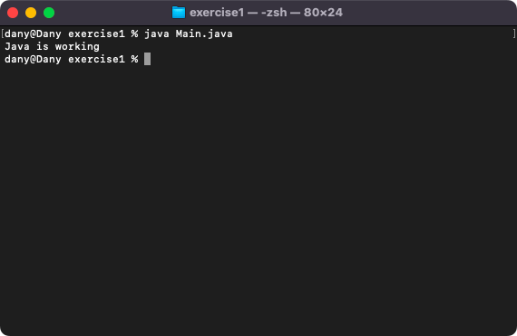 |
| [Week 2](week02/) | Lab 2: constructors, getters and setters, toString and validation | [`lab/object_oriented_analysis_and_design_week02_lab.pdf`](week02/lab/object_oriented_analysis_and_design_week02_lab.pdf) [`lab/solution/exercise1/Pet.java`](week02/lab/solution/exercise1/Pet.java) [`lab/solution/exercise1/Main.java`](week02/lab/solution/exercise1/Main.java) [`lab/solution/exercise2/Book.java`](week02/lab/solution/exercise2/Book.java) [`lab/solution/exercise2/Main.java`](week02/lab/solution/exercise2/Main.java) [`lab/solution/exercise3/Diagram.txt`](week02/lab/solution/exercise3/Diagram.txt) | 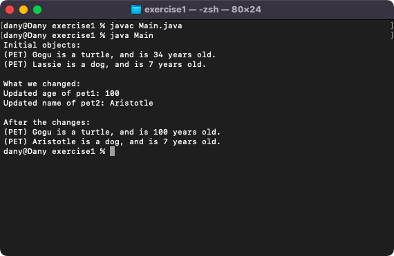 |
| [Week 3](week03/) | Lab 3: constants, booleans, command line arguments and static | [`lab/object_oriented_analysis_and_design_week03_lab.pdf`](week03/lab/object_oriented_analysis_and_design_week03_lab.pdf) [`lab/solution/exercise1/FamilyTicket.java`](week03/lab/solution/exercise1/FamilyTicket.java) [`lab/solution/exercise1/Main.java`](week03/lab/solution/exercise1/Main.java) [`lab/solution/exercise2/Dessert.java`](week03/lab/solution/exercise2/Dessert.java) [`lab/solution/exercise2/Main.java`](week03/lab/solution/exercise2/Main.java) [`lab/solution/exercise3/Main.java`](week03/lab/solution/exercise3/Main.java) [`lab/solution/exercise4/Main.java`](week03/lab/solution/exercise4/Main.java) [`lab/solution/exercise4/Student.java`](week03/lab/solution/exercise4/Student.java) | 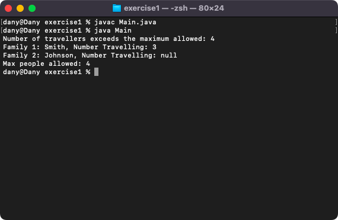 |
| [Week 4](week04/) | Lab 4: inheritance, composition and super | [`lab/object_oriented_analysis_and_design_week04_lab.pdf`](week04/lab/object_oriented_analysis_and_design_week04_lab.pdf) [`lab/solution/exercise1/Phone.java`](week04/lab/solution/exercise1/Phone.java) [`lab/solution/exercise1/Galaxy.java`](week04/lab/solution/exercise1/Galaxy.java) [`lab/solution/exercise1/Iphone.java`](week04/lab/solution/exercise1/Iphone.java) [`lab/solution/exercise1/Main.java`](week04/lab/solution/exercise1/Main.java) [`lab/solution/exercise2/Person.java`](week04/lab/solution/exercise2/Person.java) [`lab/solution/exercise2/Phone.java`](week04/lab/solution/exercise2/Phone.java) [`lab/solution/exercise2/Main.java`](week04/lab/solution/exercise2/Main.java) [`lab/solution/exercise3/ProgramsLibrary.java`](week04/lab/solution/exercise3/ProgramsLibrary.java) [`lab/solution/exercise3/VeryImportantProgram.java`](week04/lab/solution/exercise3/VeryImportantProgram.java) [`lab/solution/exercise3/Main.java`](week04/lab/solution/exercise3/Main.java) | 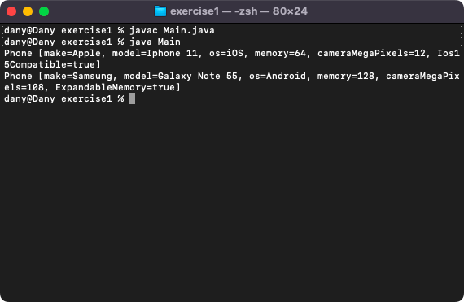 |
| [Week 5](week05/) | Lab 5: enumerations, protected, abstract and final | [`lab/object_oriented_analysis_and_design_week05_lab.pdf`](week05/lab/object_oriented_analysis_and_design_week05_lab.pdf) [`lab/solution/exercise1/FreshType.java`](week05/lab/solution/exercise1/FreshType.java) [`lab/solution/exercise1/Food.java`](week05/lab/solution/exercise1/Food.java) [`lab/solution/exercise1/Main.java`](week05/lab/solution/exercise1/Main.java) [`lab/solution/exercise2/Building.java`](week05/lab/solution/exercise2/Building.java) [`lab/solution/exercise2/House.java`](week05/lab/solution/exercise2/House.java) [`lab/solution/exercise2/Main.java`](week05/lab/solution/exercise2/Main.java) [`lab/solution/exercise3/Building.java`](week05/lab/solution/exercise3/Building.java) [`lab/solution/exercise3/House.java`](week05/lab/solution/exercise3/House.java) [`lab/solution/exercise3/Main.java`](week05/lab/solution/exercise3/Main.java) [`lab/solution/exercise4/Building.java`](week05/lab/solution/exercise4/Building.java) [`lab/solution/exercise4/House.java`](week05/lab/solution/exercise4/House.java) [`lab/solution/exercise4/Warehouse.java`](week05/lab/solution/exercise4/Warehouse.java) [`lab/solution/exercise4/Main.java`](week05/lab/solution/exercise4/Main.java) [`lab/solution/exercise5/Person.java`](week05/lab/solution/exercise5/Person.java) [`lab/solution/exercise5/Student.java`](week05/lab/solution/exercise5/Student.java) [`lab/solution/exercise6/Employee.java`](week05/lab/solution/exercise6/Employee.java) [`lab/solution/exercise6/Caretaker.java`](week05/lab/solution/exercise6/Caretaker.java) [`lab/solution/exercise7/Vehicle.java`](week05/lab/solution/exercise7/Vehicle.java) [`lab/solution/exercise7/Boat.java`](week05/lab/solution/exercise7/Boat.java) | 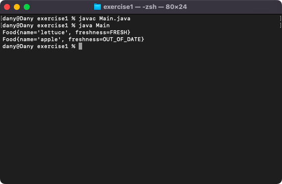 |
| [Week 6](week06/) | Lab 6: packages | [`lab/object_oriented_analysis_and_design_week06_lab.pdf`](week06/lab/object_oriented_analysis_and_design_week06_lab.pdf) [`lab/solution/exercise1/Main.java`](week06/lab/solution/exercise1/Main.java) [`lab/solution/exercise1/tudublin/Programme.java`](week06/lab/solution/exercise1/tudublin/Programme.java) [`lab/solution/exercise1/tudublin/Student.java`](week06/lab/solution/exercise1/tudublin/Student.java) [`lab/solution/exercise2/Main.java`](week06/lab/solution/exercise2/Main.java) [`lab/solution/exercise2/netflix/Video.java`](week06/lab/solution/exercise2/netflix/Video.java) [`lab/solution/exercise2/dubdevs/Video.java`](week06/lab/solution/exercise2/dubdevs/Video.java) [`lab/solution/exercise3/Main.java`](week06/lab/solution/exercise3/Main.java) [`lab/solution/exercise3/netflix/Video.java`](week06/lab/solution/exercise3/netflix/Video.java) [`lab/solution/exercise3/dubdevs/Video.java`](week06/lab/solution/exercise3/dubdevs/Video.java) | 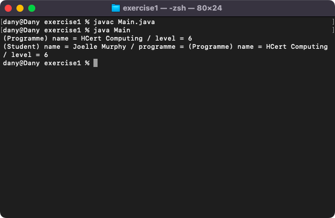 |
| Week 7 | Review week | None. Study week; no lecture and no lab. | — |
| Week 8 | UML class-object diagrams; lab test 1 (15%) | None. Lab test 1 is in [`assessment/01/`](assessment/01/). | — |
| Week 9 | Interfaces; project work | None. A lecture on interfaces and project work. | — |
| Week 10 | Exceptions; project work | None. A lecture on exceptions and project work. | — |
| Week 11 | Databases; lab test 2 (25%) | None. Lab test 2 is in [`assessment/02/`](assessment/02/). | — |
| Week 12 | Project work and submission (40%) | None. The mini-project is in [`assessment/03/`](assessment/03/). | — |
| Week 13 | Team project grading sessions | None. The projects were demonstrated in the lab session of the week beginning 9 December 2024. | — |

## Assessments and other files

| File | What it contains |
|---|---|
| [`assessment/01/object_oriented_analysis_and_design_assessment.pdf`](assessment/01/object_oriented_analysis_and_design_assessment.pdf) | Lab test 1 (15%): photographs of pages 2 and 3 of the paper (2 pages). Question 1 (30 marks): a Painting class and an enumeration ValueType (CHEAP, EXPENSIVE, PRICELESS) with a toString() and a Main. Question 2 (70 marks): inheritance, protected and static: an abstract Exhibit, a Painting and a final Sculpture with a static tax rate and a taxRateMessage() method. |
| [`assessment/01/resources/object_oriented_analysis_and_design_assessment_sample.pdf`](assessment/01/resources/object_oriented_analysis_and_design_assessment_sample.pdf) | The sample paper for lab test 1 that was given to the students in October 2024 (3 pages, 95 minutes plus 5 to upload): question 1, a Dessert and an enumeration (40 marks), and question 2, inheritance, protected and static with a MainDish class (60 marks), with the expected output. |
| [`assessment/01/solution_link.txt`](assessment/01/solution_link.txt) | Two lines: the GitHub link to the solution of lab test 1 and the branch name. The solution has the folders question1 and question2. |
| [`assessment/02/object_oriented_analysis_and_design_assessment.pdf`](assessment/02/object_oriented_analysis_and_design_assessment.pdf) | Lab test 2 (25%): a photograph of the paper (1 page): a class diagram of a vaccination system with the packages surgery (Pet, Vaccination and the enumeration InjectionType) and people (an abstract Person, Owner and EmptyAddressException), with a static count of needles, a RuntimeException for a quantity below 1 and an EmptyAddressException for an empty address. |
| [`assessment/02/resources/object_oriented_analysis_and_design_assessment_sample.zip`](assessment/02/resources/object_oriented_analysis_and_design_assessment_sample.zip) | The sample paper for lab test 2 (a zip of 4 files): the instructions (a Word file, 100 minutes), a class-package diagram of a dog hotel as an image, a Main.java and the expected output. |
| [`assessment/02/solution_link.txt`](assessment/02/solution_link.txt) | Two lines: the GitHub link to the solution of lab test 2 and the branch name. |
| [`assessment/03/object_oriented_analysis_and_design_assessment.pdf`](assessment/03/object_oriented_analysis_and_design_assessment.pdf) | The mini-project brief (6 pages, 40%): individual or a team of 2, to be uploaded on Friday 6 December 2024 and demonstrated in the lab session of the week beginning 9 December. The deliverables are a class-package diagram (PDF), the Java code (ZIP) and a project summary (PDF), and a team meetings and contributions PDF for teams. The project has to show classes, inheritance and associations, constructors and chaining, visibility and accessors, packages, enumerations, static and instance members, abstract and final classes and methods, interfaces and exceptions. A late penalty of 20% per day applies for up to 3 days. |
| [`assessment/03/submission/project_link.txt`](assessment/03/submission/project_link.txt) | Two lines: the GitHub link to the Blackjack mini-project on its branch and the branch name. The project is a console Blackjack game in Java with players and a dealer, card shuffling and drawing, and data stored in YAML files (SnakeYAML), with UML diagrams. |
| [`resources/object_oriented_analysis_and_design_plan.pdf`](resources/object_oriented_analysis_and_design_plan.pdf) | The provisional 12-week semester plan (1 page): the topic and the assessment of each week. |

The lab 1 sheet points to GitHub Education (https://github.com/education/students), which gives students a GitHub account pack and a free JetBrains IntelliJ IDEA licence, and to the JetBrains Education licences (https://www.jetbrains.com/community/education/#students).

The BlackJack mini-project is also in the Java repository: https://github.com/DanyilT/Java/tree/main/BlackJack.

The module page lists these tools and learning resources:
- Tools: Java JDK 21 (https://jdk.java.net/21/), IntelliJ IDEA Community Edition 2023.1.2 (https://www.jetbrains.com/idea/download/other.html), MySQL Community Server (https://dev.mysql.com/downloads/mysql/) and Maven (https://maven.apache.org/download.cgi, installation: https://maven.apache.org/install.html).
- Useful links for object-oriented Java programming: an introduction to object-oriented programming (http://ee402.eeng.dcu.ie/introduction/chapter-1---introduction-to-object-oriented-programming), Java naming conventions (https://howtodoinjava.com/java/basics/java-naming-conventions/), when to use this in a class (https://stackoverflow.com/questions/2411270/when-should-i-use-this-in-a-class) and Java packages (https://www.tutorialspoint.com/java/java_packages.htm).
- LinkedIn Learning courses, which are free after activating the account through the university (https://www.linkedin.com/learning/activate): Java Essential Training: Objects and APIs (https://www.linkedin.com/learning/java-essential-training-objects-and-apis-16021820), Java: Object-Oriented Programming (https://www.linkedin.com/learning/java-object-oriented-programming-2), Learning Java 11 (https://www.linkedin.com/learning/learning-java-11), Learning Java 17 (https://www.linkedin.com/learning/learning-java-17), Practice It! Java (https://www.linkedin.com/learning/practice-it-java), Programming Foundations: Object-Oriented Design (https://www.linkedin.com/learning/programming-foundations-object-oriented-design-3), Software Design: Modeling with UML (https://www.linkedin.com/learning/software-design-modeling-with-uml), Object-Oriented Programming with Java (https://www.linkedin.com/learning/object-oriented-programming-with-java), and PHP: Object-Oriented Programming (https://www.linkedin.com/learning/php-object-oriented-programming-2017).

### Screenshots

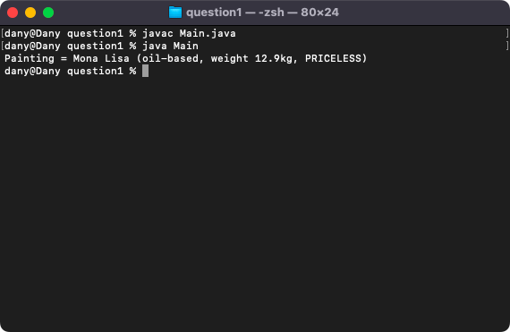

*Lab test 1, question 1: the output.*

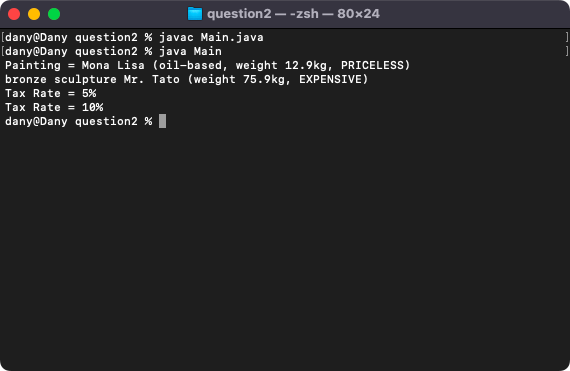

*Lab test 1, question 2: the output.*

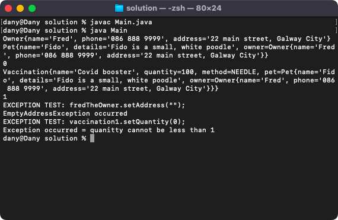

*Lab test 2: the output, with an Owner, a Pet, a Vaccination and the two exceptions.*

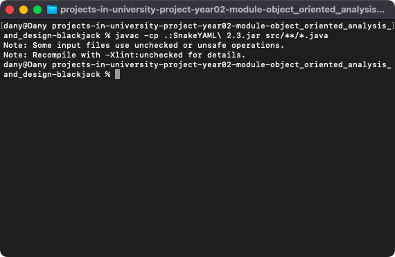

*The Blackjack project: compiling with the SnakeYAML jar.*

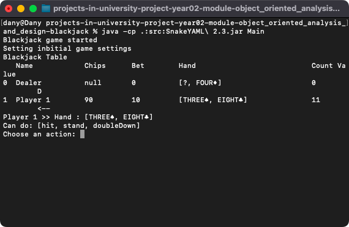

*The Blackjack project: the game table with the dealer and a player, and the choice of an action.*

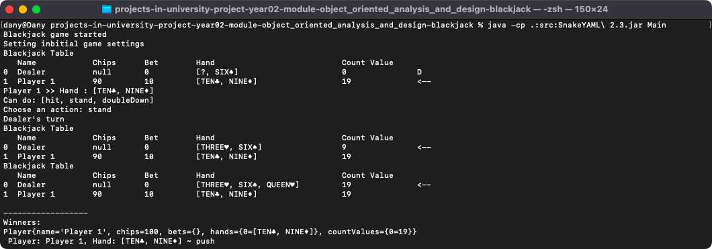

*The Blackjack project: a finished round with the winners.*
