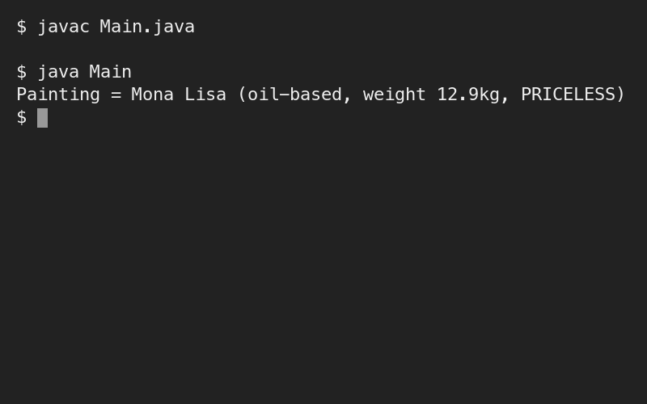
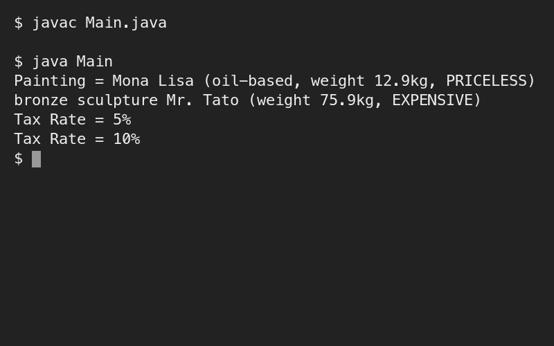

# Assessment 1: Lab test 1: Painting and Sculpture classes

**Module:** Object Oriented Analysis and Design (`COMP H2031`)  
**Semester:** 3 (Year 2), folder `sem03`  
**Type:** test, individual  
**Weight:** 15%  
**Deadline:** the lab session of week 8 (the week of 4 November 2024)  
**Result:** —  
**On main:** [`sem03/object_oriented_analysis_and_design/assessment/01/`](https://github.com/DanyilT/projects-in-university/tree/main/sem03/object_oriented_analysis_and_design/assessment/01) (the paper, its photographs, the sample paper, the Java solution and this README)  
**Branch:** —  
**Repository:** —

[Module README](../../README.md)

## What this assessment is for

The paper has three pages: the title page (an individual open-book test for paper-based materials, 95 minutes plus 5 minutes to upload, marked out of 100), question 1 and question 2. Question 1 (30 marks) is a `Painting` class and an enumeration `ValueType` (CHEAP, EXPENSIVE, PRICELESS) with a `toString()` and a `Main` that creates and prints the painting `mona`. Question 2 (70 marks) is inheritance, protected and static: an abstract `Exhibit`, a `Painting` and a final `Sculpture` with a static tax rate and a `taxRateMessage()` method, and a `Main` that prints the painting, the sculpture and the tax rate message before and after the rate is changed to 0.1. Each question has the expected output of the program.

The paper was photographed (pages 2 and 3). [`object_oriented_analysis_and_design_assessment.pdf`](object_oriented_analysis_and_design_assessment.pdf) is a recreation of it: the title page is recreated from the title page of the sample paper (the date and the time are as on the sample), and the texts and diagrams of the two questions are redrawn from the photographs, which are in [`resources/`](resources/). The submission is the folder [`question1/`](submission/question1/) (Painting, ValueType and Main) and the folder [`question2/`](submission/question2/) (Exhibit, Painting, Sculpture, ValueType and Main).

> [!WARNING]
> [`submission/question2/Sculpture.java`](submission/question2/Sculpture.java#L12): `taxRateMessage()` cuts the percentage to a whole number with `(int)`, so the program prints "Tax Rate = 5%" where the paper's expected output is "Tax Rate = 5.5%". The second line, "Tax Rate = 10%", is right.

<table>
  <tr valign="top">
    <td width="50%"><br><i>Lab test 1, question 1: the output.</i></td>
    <td width="50%"><br><i>Lab test 1, question 2: the output.</i></td>
  </tr>
</table>

## Files

| File | What it contains |
|---|---|
| [`README.md`](README.md) | This README. |
| [`object_oriented_analysis_and_design_assessment.pdf`](object_oriented_analysis_and_design_assessment.pdf) | Lab test 1 (15%), recreated (3 pages): the title page with the instructions to candidates, question 1 (objects, enumeration and objects, 30 marks) and question 2 (inheritance, protected and static, 70 marks), each with the class and object diagram and the expected output. |
| [`resources/object_oriented_analysis_and_design_assessment_photographs.pdf`](resources/object_oriented_analysis_and_design_assessment_photographs.pdf) | The photographs of pages 2 and 3 of the paper (2 pages), from which the paper was recreated. |
| [`resources/object_oriented_analysis_and_design_assessment_sample.pdf`](resources/object_oriented_analysis_and_design_assessment_sample.pdf) | The sample paper for lab test 1 that was given to the students in October 2024 (3 pages, 95 minutes plus 5 to upload): question 1, a Dessert and an enumeration (40 marks), and question 2, inheritance, protected and static with a MainDish class (60 marks), with the expected output. |
| [`submission/question1/Main.java`](submission/question1/Main.java) | Creates the painting `mona` (Mona Lisa, PRICELESS, 12.9 kg, oil-based) and prints it. |
| [`submission/question1/Painting.java`](submission/question1/Painting.java) | The `Painting` class: a title and a value with getters and setters, the weight and the oil-based flag, and `toString()`. |
| [`submission/question1/ValueType.java`](submission/question1/ValueType.java) | The enumeration `ValueType`: CHEAP, EXPENSIVE and PRICELESS. |
| [`submission/question2/Main.java`](submission/question2/Main.java) | Creates the painting `mona` and the sculpture `bust` (Mr. Tato, bronze, EXPENSIVE, 75.9 kg), prints them and the tax rate message, changes the tax rate to 0.1 and prints the message again. |
| [`submission/question2/Exhibit.java`](submission/question2/Exhibit.java) | The abstract class `Exhibit`: the protected title and value, the weight, and getters and setters. |
| [`submission/question2/Painting.java`](submission/question2/Painting.java) | `Painting extends Exhibit`: the oil-based flag, the constructor with a title and a value, and `toString()`. |
| [`submission/question2/Sculpture.java`](submission/question2/Sculpture.java) | The final class `Sculpture extends Exhibit`: the material, the static tax rate (0.055), `toString()` and the static `taxRateMessage()`. |
| [`submission/question2/ValueType.java`](submission/question2/ValueType.java) | The enumeration `ValueType`, as in question 1. |

## How to run

Each question is a folder with a `Main` class; the compiled classes stay out of the repository:

```sh
cd submission/question2
javac *.java
java Main
```
