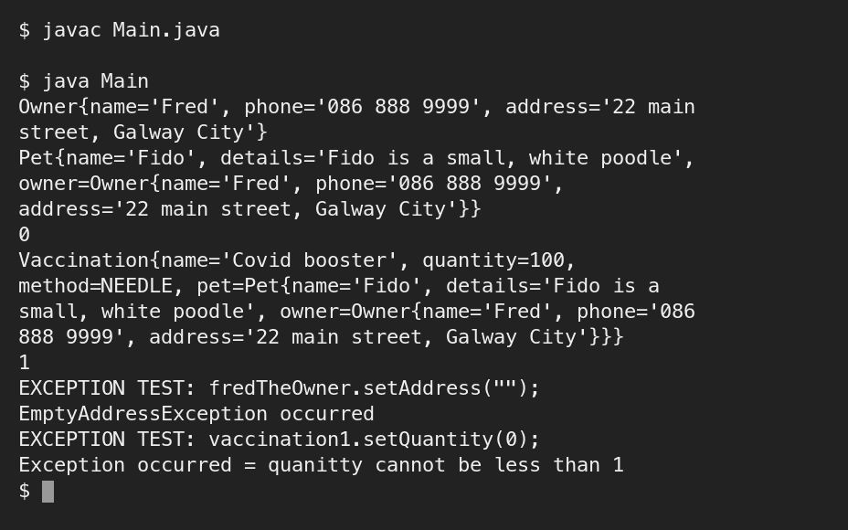

# Assessment 2: Lab test 2: a vaccination system

**Module:** Object Oriented Analysis and Design (`COMP H2031`)  
**Semester:** 3 (Year 2), folder `sem03`  
**Type:** test, individual  
**Weight:** 25%  
**Deadline:** the lab session of week 11 (the week of 25 November 2024)  
**Result:** —  
**On main:** [`sem03/object_oriented_analysis_and_design/assessment/02/`](https://github.com/DanyilT/projects-in-university/tree/main/sem03/object_oriented_analysis_and_design/assessment/02) (the task page, its photograph, the sample paper, the Java solution and this README)  
**Branch:** —  
**Repository:** —

[Module README](../../README.md)

## What this assessment is for

The paper has two pages: the title page with the instructions to candidates (an individual open-book test for paper-based materials on a university PC, 100 minutes with 95 for working and 5 for uploading) and a class-package diagram of a vaccination system. The packages are [`surgery`](submission/surgery/) (`Pet`, the final `Vaccination` with a static count of needles and the enumeration `InjectionType`) and [`people`](submission/people/) (an abstract `Person`, `Owner` and `EmptyAddressException`), with `RuntimeException` from `java.lang`: `setQuantity(int)` throws a `RuntimeException` for a quantity below 1, `setAddress(String)` throws an `EmptyAddressException` for an empty string, and every `toString()` summarises all properties, including the inherited ones and the composition. A Main.java and the sample output were handed out with the paper.

The paper was photographed (the diagram page). [`object_oriented_analysis_and_design_assessment.pdf`](object_oriented_analysis_and_design_assessment.pdf) is a recreation of the task page: the diagram is redrawn from the photograph, which is in [`resources/`](resources/); the title page with the instructions to candidates is not recreated. The submission is the code of the two packages and the `Main` class.



*Lab test 2: the output, with an Owner, a Pet, a Vaccination and the two exceptions.*

## Files

| File | What it contains |
|---|---|
| [`README.md`](README.md) | This README. |
| [`object_oriented_analysis_and_design_assessment.pdf`](object_oriented_analysis_and_design_assessment.pdf) | Lab test 2 (25%), the task page recreated (1 page): the class-package diagram of the vaccination system. |
| [`resources/object_oriented_analysis_and_design_assessment_photograph.pdf`](resources/object_oriented_analysis_and_design_assessment_photograph.pdf) | The photograph of the diagram page (1 page), from which the paper was recreated. |
| [`resources/object_oriented_analysis_and_design_assessment_sample.zip`](resources/object_oriented_analysis_and_design_assessment_sample.zip) | The sample paper for lab test 2 (a zip of 4 files): the instructions (a Word file, 100 minutes), a class-package diagram of a dog hotel as an image, a Main.java and the expected output. |
| [`submission/Main.java`](submission/Main.java) | The `Main` class: creates an owner, a pet and a vaccination, prints the number of needles before and after, and tests the two exceptions. |
| [`submission/people/Person.java`](submission/people/Person.java) | The abstract class `Person`: name, phone and address, with `setAddress` throwing `EmptyAddressException` for an empty string, and `toString()`. |
| [`submission/people/Owner.java`](submission/people/Owner.java) | `Owner extends Person`. |
| [`submission/people/EmptyAddressException.java`](submission/people/EmptyAddressException.java) | `EmptyAddressException extends RuntimeException`. |
| [`submission/surgery/Pet.java`](submission/surgery/Pet.java) | The class `Pet`: name, details and owner, with `toString()`. |
| [`submission/surgery/Vaccination.java`](submission/surgery/Vaccination.java) | The final class `Vaccination`: name, quantity (a quantity below 1 throws a `RuntimeException`), the injection type, the pet and the static count of needles. |
| [`submission/surgery/InjectionType.java`](submission/surgery/InjectionType.java) | The enumeration `InjectionType`: NEEDLE and EPIPEN. |

## How to run

The Main class is in the folder submission, with the packages people and surgery:

```sh
cd submission
javac Main.java
java Main
```
