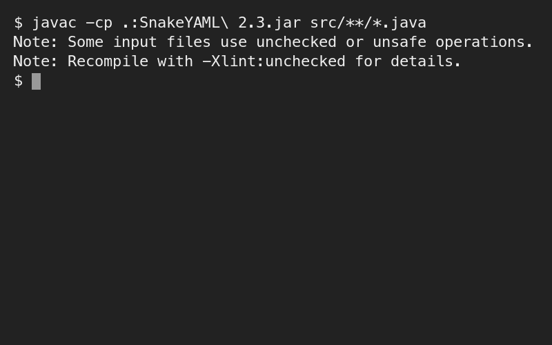
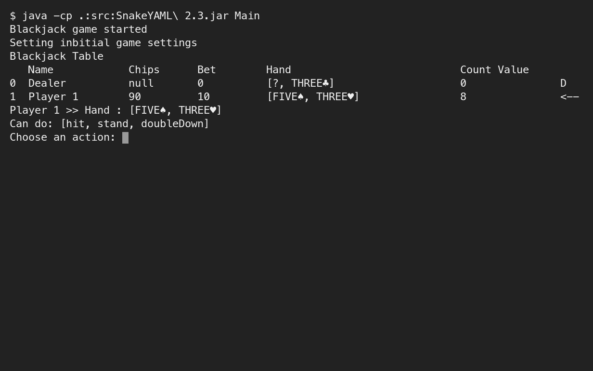
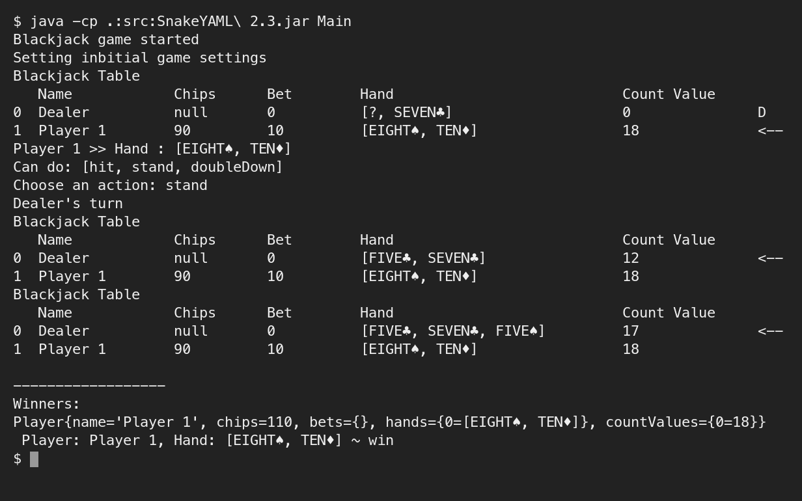

# Assessment 3: Mini-project: Blackjack

**Module:** Object Oriented Analysis and Design (`COMP H2031`)  
**Semester:** 3 (Year 2), folder `sem03`  
**Type:** project, individual or team of 2  
**Weight:** 40%  
**Deadline:** Friday 6 December 2024 (uploaded), demonstrated in the lab session of the week beginning 9 December 2024  
**Result:** —  
**On main:** [`sem03/object_oriented_analysis_and_design/assessment/03/`](https://github.com/DanyilT/projects-in-university/tree/main/sem03/object_oriented_analysis_and_design/assessment/03) (the brief, the link file and this README)  
**Branch:** [`project/year02/module-object_oriented_analysis_and_design/blackjack`](https://github.com/DanyilT/projects-in-university/tree/project/year02/module-object_oriented_analysis_and_design/blackjack) (the Blackjack project)  
**Repository:** [Java](https://github.com/DanyilT/Java) (the folder BlackJack has only a README that points to the branch; the code is in its history)

[Module README](../../README.md)

## What this assessment is for

The brief (6 pages) asks for an individual or a team project (2 members) with a class-package diagram (PDF), the Java code (ZIP) and a project summary (PDF), and for teams a PDF of the team meetings and contributions. The project has to show classes, inheritance and associations, constructors and chaining, visibility and accessors, packages, enumerations, static and instance members, abstract and final classes and methods, interfaces and exceptions. A late penalty of 20% per day applies for up to 3 days.

The submission is a console Blackjack game in Java with players and a dealer, card shuffling and drawing, and data stored in YAML files (SnakeYAML), with UML diagrams. The project is on the branch linked above; the screenshots below show it compiling with the SnakeYAML jar, the game table with the dealer and a player, and a finished round.

<table>
  <tr valign="top">
    <td width="33%"> <i>The Blackjack project: compiling with the SnakeYAML jar.</i></td>
    <td width="33%"> <i>The Blackjack project: the game table with the dealer and a player, and the choice of an action.</i></td>
    <td width="33%"> <i>The Blackjack project: a finished round with the winners.</i></td>
  </tr>
</table>

## Files

| File | What it contains |
|---|---|
| [`README.md`](README.md) | This README. |
| [`object_oriented_analysis_and_design_assessment.pdf`](object_oriented_analysis_and_design_assessment.pdf) | The mini-project brief (6 pages, 40%): individual or a team of 2, to be uploaded on Friday 6 December 2024 and demonstrated in the lab session of the week beginning 9 December. The deliverables are a class-package diagram (PDF), the Java code (ZIP) and a project summary (PDF), and a team meetings and contributions PDF for teams. The project has to show classes, inheritance and associations, constructors and chaining, visibility and accessors, packages, enumerations, static and instance members, abstract and final classes and methods, interfaces and exceptions. A late penalty of 20% per day applies for up to 3 days. |
| [`submission/project_link.txt`](submission/project_link.txt) | Two lines: the GitHub link to the Blackjack mini-project on its branch and the branch name. The project is a console Blackjack game in Java with players and a dealer, card shuffling and drawing, and data stored in YAML files (SnakeYAML), with UML diagrams. |
