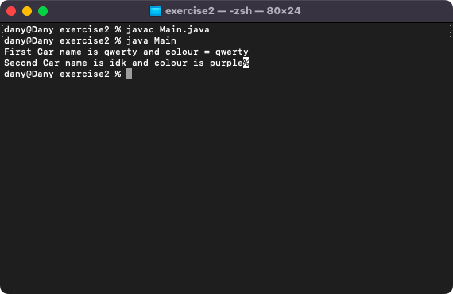

# Week 01 — Lab 1: setting up Java, Hello and a Car class

**Module:** Object Oriented Analysis and Design (`COMP H2031`)  
**Semester:** 3 (Year 2), folder `sem03`

[Module README](../README.md)

## What this week is for

Lecture 1 was the module overview and a recap of Java classes and objects. Lab 1 (not graded) prepares for the module: password recovery, the free student GitHub and JetBrains accounts, checking that Java works with a Main class (exercise 1), a Car class with a Main that creates two cars and prints them (exercise 2), and the exercises at the end of chapter 3 in book 1.

> [!WARNING]
> - [`lab/solution/exercise2/Car.java`](lab/solution/exercise2/Car.java): The car has a name and a colour, where the sheet says make and colour.
> - [`lab/solution/exercise1/Main.java`](lab/solution/exercise1/Main.java): It prints Java is working without the exclamation mark of the sheet.

## Files

| File | What it contains | Screenshot |
|---|---|---|
| [`README.md`](README.md) | This README. | — |
| [`lab/object_oriented_analysis_and_design_week01_lab.pdf`](lab/object_oriented_analysis_and_design_week01_lab.pdf) | The lab sheet (3 pages): the preparation steps, exercise 1 (Hello), exercise 2 (the Car class) and the chapter 3 exercises of book 1. | — |
| [`lab/solution/exercise1/Main.java`](lab/solution/exercise1/Main.java) | Exercise 1: a Main class that prints Java is working. |  *Exercise 1: compiling and running Main, which prints Java is working.* |
| [`lab/solution/exercise2/Car.java`](lab/solution/exercise2/Car.java) | Exercise 2: class Car with a name and a colour and a constructor. | — |
| [`lab/solution/exercise2/Main.java`](lab/solution/exercise2/Main.java) | Exercise 2: creates two cars and prints their details. |  *Exercise 2: the output for the two cars.* |
