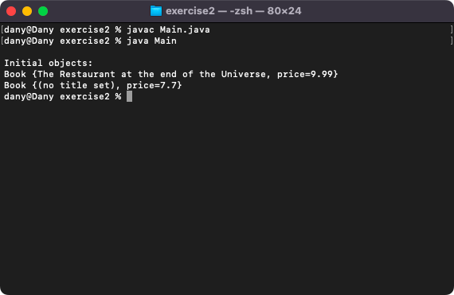
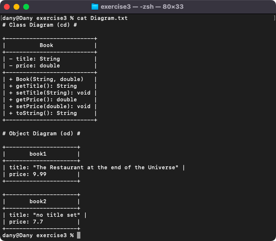

# Week 02 — Lab 2: constructors, getters and setters, toString and validation

**Module:** Object Oriented Analysis and Design (`COMP H2031`)  
**Semester:** 3 (Year 2), folder `sem03`

[Module README](../README.md)

## What this week is for

Lecture 2 was constructors, toString() and visibility with accessor methods. Lab 2 has three exercises. Exercise 1 is a Pet class (name, type and age, with a default age of 5, a constructor, getters and setters, and a toString() in the form (PET) name is a type, and is age years old), with a Main that creates two pets, changes them and prints them. Exercise 2 is a Book class whose constructor and setters replace an empty title by a default title and a negative price by 7.7. Exercise 3 asks for a class-object diagram for Book, which the solution gives as text.

## Files

| File | What it contains | Screenshot |
|---|---|---|
| [`README.md`](README.md) | This README. | — |
| [`lab/object_oriented_analysis_and_design_week02_lab.pdf`](lab/object_oriented_analysis_and_design_week02_lab.pdf) | The lab sheet (6 pages): exercise 1 (Pet), exercise 2 (Book with validation) and exercise 3 (a class-object diagram for Book). | — |
| [`lab/solution/exercise1/Pet.java`](lab/solution/exercise1/Pet.java) | Exercise 1: class Pet with private name, type and age (default 5), a constructor, getters and setters and toString(). | — |
| [`lab/solution/exercise1/Main.java`](lab/solution/exercise1/Main.java) | Exercise 1: creates the pets Gogu and Lassie, changes the age and the name, and prints them with toString() and with the getters. |  *Exercise 1: the two pets before and after the changes.* |
| [`lab/solution/exercise2/Book.java`](lab/solution/exercise2/Book.java) | Exercise 2: class Book with a title and a price; an empty title becomes no title set and a negative price becomes 7.7, in the constructor and in the setters. | — |
| [`lab/solution/exercise2/Main.java`](lab/solution/exercise2/Main.java) | Exercise 2: creates one book with valid values and one with invalid values and prints both. |  *Exercise 2: a book with valid values and a book with the default values.* |
| [`lab/solution/exercise3/Diagram.txt`](lab/solution/exercise3/Diagram.txt) | Exercise 3: the class diagram of Book and the object diagrams of two books, drawn as text. |  *Exercise 3: the class and object diagrams of Book in Diagram.txt.* |
